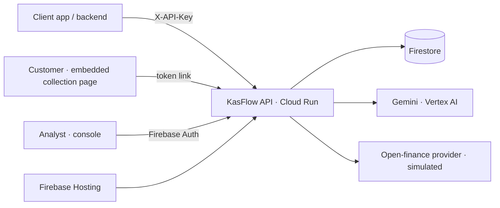

# KasFlow — credit signals from any data

KasFlow is credit-scoring infrastructure for Southeast Asia. Any company (lending, BNPL, rental, insurance) creates an
assessment through the API. KasFlow pulls **open-finance data first**. Only if that data isn't enough, it gives the
client an **embeddable collection page** where the customer adds bank statements, e-wallet screenshots, CSV exports, or
**camera photos of paper records**. Gemini reads every format. A deterministic engine scores cash flow, merges sources,
removes duplicates and internal transfers, and catches edited statements. Analysts review results in a Google sign-in console.



## Evaluate it
- **Client flow:** `https://<project>.web.app/demo/client`. Pick "Bu Sari", click **Connect your accounts**, then **Allow**,
  then upload files or **Take photo** in the embedded page. To try the camera on a phone, open the console's QR code
  for an assessment that needs more data.
- **Console:** `https://<project>.web.app/`. Sign in with any Google account (demo mode).
- **API docs:** `https://<project>.web.app/docs`

## Run locally (no Google Cloud needed)
```bash
uv venv --python 3.12 .venv && uv pip install --python .venv/bin/python -r requirements.txt
.venv/bin/python scripts/generate_personas.py      # data + assets (already committed)
SEED_ON_START=true .venv/bin/uvicorn app.main:app --port 8080
# open http://localhost:8080/demo/client and http://localhost:8080/ (dev stub sign-in)
.venv/bin/pytest
```
Backends are selected with `REPO_BACKEND` (memory|firestore), `GEMINI_BACKEND` (stub|vertex) and `AUTH_BACKEND` (stub|firebase).

## Deployment
KasFlow runs on Google Cloud:
- **Cloud Run:** one container built from the `Dockerfile` (API, pipeline and web UI). It scales to zero when idle.
- **Firebase Hosting:** the public front door. `firebase.json` rewrites every path to the Cloud Run service.
- **Firestore (Native mode):** clients, assessments, transactions and the audit trail. `firestore.rules` denies all direct client access; only the backend reads and writes.
- **Vertex AI Gemini:** document extraction, CSV/JSON mapping and explanations.
- **Firebase Authentication:** Google sign-in for analysts.

Cost guardrails: at most one Cloud Run instance, at most 5 Gemini calls per minute (`GEMINI_RPM`) and 50 per day (`GEMINI_DAILY_CAP`, counted in Firestore). A $10 monthly spend cap and budget alerts are set in Cloud Billing.

Production settings: `REPO_BACKEND=firestore`, `GEMINI_BACKEND=vertex`, `AUTH_BACKEND=firebase`, plus the `GOOGLE_CLOUD_*`, `FIREBASE_WEB_*` and demo-key variables listed in `.env.example`.

## Cost per assessment
Measured live on Gemini 2.5 Flash (Vertex AI) in October 2026, running each demo persona through the real pipeline:

| Scenario | Gemini calls | Tokens in / out | Gemini | Cloud Run + Firestore | Total per customer |
|---|---|---|---|---|---|
| Open-finance data is enough (Paolo) | 1: summary | 1.2k / 0.6k | $0.0020 | ~$0.0002 | **~$0.002** |
| Thin file, then e-wallet screenshot, QRIS CSV and camera photo (Sari) | 4: two image reads, CSV mapping, summary | 6.6k / 2.8k | $0.0091 | ~$0.0007 | **~$0.010** |
| 62-row bank statement PDF (Linh) | 2: PDF read, summary | 2.4k / 6.7k | $0.0174 | ~$0.0008 | **~$0.018** |

**Where the cost comes from**
- **Gemini:** $0.30 per 1M input tokens and $2.50 per 1M output tokens. Output dominates, so long statements cost the most; a 62-row PDF writes about 6k tokens.
- **No AI in the scoring:** merging, de-duplication, the tamper check and the score are plain Python.
- **Cloud Run** (request-based billing, 1 vCPU / 1 GiB): billed only while a request runs, about 8–30 s per assessment at roughly $0.000027 per second, and $0 when idle.
- **Firestore:** about 20 reads and writes per assessment, roughly $0.00005.
- **Free tiers:** at demo scale, the Cloud Run and Firestore free tiers absorb all infrastructure cost.
- **Per customer:** about 1–2 US cents, roughly Rp 30–300 at ~Rp 16,500 per US$. 10,000 mixed assessments a month comes to about US$100.

**Demo guardrails**
- one Cloud Run instance at most
- 5 Gemini calls per minute and 50 per day
- a $10 monthly spend cap with budget alerts, set in Cloud Billing

## How scoring works
Python computes every number: months covered, average inflow/outflow/net, income volatility, net margin, 3-month trend,
returned payments, debt burden, verified-data share, top-payer concentration, tamper flags, and affordability at 18% APR
with 1.5× coverage. The result is a 0–100 score, grade A–D and favorable/review/unfavorable. Gemini never changes them.
Gemini only extracts transactions and writes the explanation, and each point it makes cites a metric.

## Production roadmap
- Real rails (Indonesia's BI SNAP open API, Philippines Open Finance PH, and others)
- Webhooks
- Per-client tenancy and analyst invites
- Secret Manager
- Rate limiting
- Fairness monitoring
