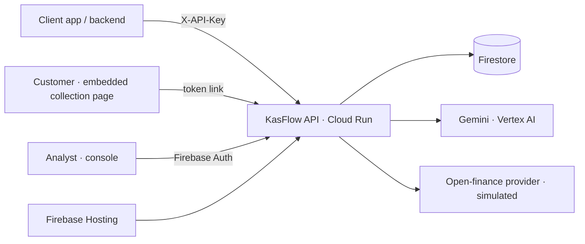

# KasFlow — credit signals from any data

KasFlow is credit-scoring infrastructure for Southeast Asia. Any company (lending, BNPL, rental, insurance) creates an
assessment through the API. KasFlow pulls **open-finance data first**. Only if that data isn't enough, it gives the
client an **embeddable collection page** where the customer adds bank statements, e-wallet screenshots, CSV exports, or
**camera photos of paper records**. Gemini reads every format. A deterministic engine scores cash flow, merges sources,
removes duplicates and internal transfers, and catches edited statements. Analysts review results in a Google sign-in console.



## Evaluate it
- **Client flow:** `https://<project>.web.app/demo/client`. Pick "Bu Sari", click **Connect your accounts**, then **Allow**,
  then upload files or **Take photo** in the embedded page. To try the camera on a phone, open the console's QR code
  for an assessment that needs more data.
- **Console:** `https://<project>.web.app/`. Sign in with any Google account (demo mode).
- **API docs:** `https://<project>.web.app/docs`

## Run locally (no Google Cloud needed)
```bash
uv venv --python 3.12 .venv && uv pip install --python .venv/bin/python -r requirements.txt
.venv/bin/python scripts/generate_personas.py      # data + assets (already committed)
SEED_ON_START=true .venv/bin/uvicorn app.main:app --port 8080
# open http://localhost:8080/demo/client and http://localhost:8080/ (dev stub sign-in)
.venv/bin/pytest
```
Backends are selected with `REPO_BACKEND` (memory|firestore), `GEMINI_BACKEND` (stub|vertex) and `AUTH_BACKEND` (stub|firebase).

## Deploy
See [ACCESS.md](ACCESS.md), then run `./deploy.sh <project> asia-southeast1`.

## How scoring works
Python computes every number: months covered, average inflow/outflow/net, income volatility, net margin, 3-month trend,
returned payments, debt burden, verified-data share, top-payer concentration, tamper flags, and affordability at 18% APR
with 1.5× coverage. The result is a 0–100 score, grade A–D and favorable/review/unfavorable. Gemini never changes them.
Gemini only extracts transactions and writes the explanation, and each point it makes cites a metric.

## Production roadmap
- Real rails (Indonesia's BI SNAP open API, Philippines Open Finance PH, and others)
- Webhooks
- Per-client tenancy and analyst invites
- Secret Manager
- Rate limiting
- Fairness monitoring
