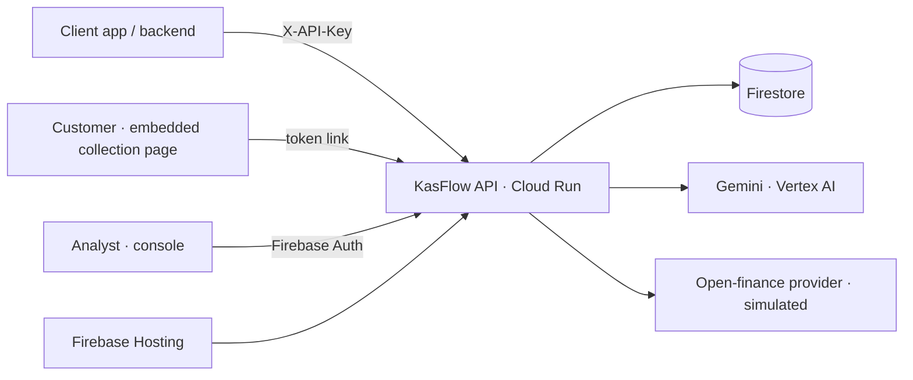

# KasFlow Implementation Plan

> **For agentic workers:** REQUIRED SUB-SKILL: Use superpowers:subagent-driven-development (recommended) or superpowers:executing-plans to implement this plan task-by-task. Steps use checkbox (`- [ ]`) syntax for tracking.

**Goal:** Build KasFlow, a B2B credit-scoring service for Southeast Asia. Clients create assessments through an API. Open-finance data is fetched first. If that data is insufficient, an embeddable collection page lets the customer upload files or take camera photos. Python code computes a deterministic score. Gemini reads documents and writes explanations. Analysts review results in a console behind Google sign-in.

**Architecture:** One FastAPI container serves the REST API and static Alpine.js pages. Storage, Gemini and auth each sit behind a small interface with two implementations, picked by environment variables:
- **Storage:** Firestore or in-memory
- **Gemini:** Vertex or stub
- **Auth:** Firebase or stub

The defaults are memory, stub and stub, so **Tasks 1–16 need no Google Cloud access at all**. Real Google services are only switched on through environment variables in Phase B, which the human runs after granting access (see `ACCESS.md`, produced in Task 17).

**Tech Stack:**
- **Backend:** Python 3.12 (venv via `uv`), FastAPI, Pydantic v2, google-genai, firebase-admin, google-cloud-firestore, segno, Pillow, reportlab, pytest
- **Frontend:** Alpine.js 3.14.1 (ESM), Tailwind Play CDN, Chart.js 4.4.1, Firebase JS SDK 10.12.2
- **Video:** Node 20+, Playwright 1.48.2, tsx

**Spec:** `docs/superpowers/specs/2026-10-18-kasflow-design.md`. Read it alongside this plan. Section numbers like "§7" refer to the spec.

**Deviations from the spec (intentional, all needed to keep the work unblocked):**
1. **Added `AUTH_BACKEND=stub|firebase`.** In stub mode, the browser sends `Bearer stub:<email>` and the console runs locally with no Firebase project.
2. **Added `SEED_ON_START=true`.** Seeds the in-memory store on startup, so the local demo works end to end.
3. **The fake-webcam `.y4m` file is generated in pure Python, not with ffmpeg.** ffmpeg isn't installed locally; `video/stitch.sh` still needs it, and it's listed in ACCESS.md.
4. **Dropped `pypdf`.** It isn't needed.
5. **Gemini calls retry once on any exception,** not only on 429/5xx.
6. **Extracted currency is accepted only if it's IDR, PHP or VND;** otherwise the assessment currency is used.
7. **Persona labels say "Ride-hailing driver"** rather than naming a real brand.
8. **The intro slide says "Lending, BNPL, rental & insurance"** rather than "Lenders, …", to follow the terminology rule.

---

## Global Constraints

- Python **3.12**. Create the virtual environment with `uv venv --python 3.12 .venv` and install with `uv pip install --python .venv/bin/python -r requirements.txt`. Run tests with `.venv/bin/pytest`.
- **No task may need GCP, Firebase or Vertex credentials, or network calls to Google APIs.** Defaults: `REPO_BACKEND=memory`, `GEMINI_BACKEND=stub`, `AUTH_BACKEND=stub`. Tests never touch real Google services.
- Terminology in code and UI: **client, customer, assessment, purpose, analyst**. Never use "borrower" or "lender".
- All institution and e-wallet names in assets and UI are fictional. Use these:

  | Kind | Names |
  |---|---|
  | Banks | Bank Merapi, Bank Luzon, Ngân hàng Sông Hồng |
  | E-wallets | DompetKu, PeraPay, ViMo |
  | Demo client | PinjamCepat |

- **Money:** always `Decimal` in Python. Ratios are `float`.
- **Time:** datetimes are timezone-aware UTC (`app.models.utcnow()`).
- **Error body:** always `{"error": {"code": str, "message": str}}`, raised as `app.errors.AppError(status, code, message)`.
- **Constants** (in `app/config.py`):

  | Constant | Value |
  |---|---|
  | `MIN_MONTHS` | `6` |
  | `MIN_INFLOW_TXNS` | `20` |
  | `COLLECTION_TTL_HOURS` | `72` |
  | `CONSENT_TTL_DAYS` | `30` |
  | `MAX_ITEMS` | `8` |
  | `MAX_FILE_BYTES` | `5*1024*1024` |
  | `MAX_TXNS` | `2000` |
  | `GEMINI_TIMEOUT_S` | `45` |
  | `ANNUAL_RATE` | `Decimal("0.18")` |
  | `COVERAGE_TARGET` | `Decimal("1.5")` |

- **Allowed upload MIME types:** `application/pdf`, `image/png`, `image/jpeg`, `text/csv` (`.csv` is accepted by extension).
- **Gemini never computes numbers, scores or recommendations.** It only extracts, maps and explains.
- **Frontend library URLs (exact):**
  - `https://cdn.tailwindcss.com`
  - `https://cdn.jsdelivr.net/npm/alpinejs@3.14.1/dist/module.esm.js`
  - `https://cdn.jsdelivr.net/npm/chart.js@4.4.1/dist/chart.umd.min.js`
  - `https://www.gstatic.com/firebasejs/10.12.2/firebase-app.js`
  - `https://www.gstatic.com/firebasejs/10.12.2/firebase-auth.js`
- **Every commit message ends with:**
  ```
  Co-Authored-By: Claude Opus 5.5 (1M context) <noreply@anthropic.com>
  ```
- **Working directory:** run all commands from the repo root `/Users/ichone/Documents/projects/hackathon/kasflow` unless a step says otherwise.

## Review Focus

These are the inputs most likely to bite a real user. Each line below has a test pinned in the task that owns the code.

1. **No usable data at all.** Example: an unknown consent ref, then "Score now". Expected: the assessment is scored D/unfavorable with `limited_data`, and nothing crashes or divides by zero. Tests are in Task 5 (`test_empty_transactions_score_cleanly`) and Task 8 (`test_unknown_ref_then_score_now_handles_no_data`).
2. **The same rows arrive twice.** Example: the customer uploads the same file twice. Expected: the rows are counted once. Test in Task 8 (`test_same_file_twice_counts_once`).
3. **A file with no transactions.** Examples: a selfie, a blank page, a photo of a cat. Expected: that one item is marked failed with a retry message, the API returns HTTP 200, and the assessment is otherwise unaffected. Tests in Task 8 (`test_unreadable_photo_marks_item_failed`) and Task 11 (`test_collect_unreadable_file_returns_failed_200`).
4. **A bank statement listed newest-first.** Expected: no false tamper flags. Test in Task 3 (`test_newest_first_statement_has_no_false_flags`).
5. **A messy CSV.** Examples: UTF-8 BOM, cp1252 bytes, `;` delimiters, `Rp` prefixes, `1.250.000` thousands separators. Expected: it parses correctly. Test in Task 6 (`test_parse_csv_handles_bom_cp1252_and_symbols`).

---

## File map

| File | Responsibility |
|---|---|
| `requirements.txt`, `pyproject.toml` | Dependencies; pytest config (`pythonpath=["."]`) |
| `app/config.py` | Constants, paths, `Settings` and `load_settings()` |
| `app/i18n.py` | Country → currency, language and locale |
| `app/models.py` | All Pydantic models, `new_id()`, `utcnow()` |
| `app/errors.py` | `AppError` |
| `app/repo.py` | `Repo` protocol, `InMemoryRepo`, `FirestoreRepo` |
| `app/services/tokens.py` | Collection tokens, secret hashing, collection URL |
| `app/services/tamper.py` | Running-balance reconciliation |
| `app/services/sourcing.py` | `months_covered`, `build_source` |
| `app/services/merge.py` | Dedupe, internal transfers, `effective()` |
| `app/services/sufficiency.py` | Data sufficiency |
| `app/services/scoring.py` | Metrics, points, grade, recommendation, affordability |
| `app/services/mock_provider.py` | Simulated open-finance aggregator |
| `app/services/adapters/open_finance.py`, `standard.py`, `csv_mapper.py` | Conversion into the standard transaction format |
| `app/services/prompts.py` | Gemini prompt templates |
| `app/services/gemini.py` | `GeminiService` protocol, `StubGemini`, `VertexGemini`, post-processing |
| `app/services/pipeline.py` | `AssessmentService` (all use cases) |
| `app/seeding.py` | Persona profiles, persona flows, demo client, seed |
| `app/auth.py` | `StubVerifier`, `FirebaseVerifier` |
| `app/deps.py` | `Services` container; `get_services`, `require_analyst`, `require_client` |
| `app/views.py` | Public and console views of an assessment |
| `app/main.py` | `build_services`, `create_app`, `app` |
| `app/routers/*.py` | client_api, console_api, collect_api, demo, pages |
| `app/static/**` | HTML, JS and CSS |
| `scripts/generate_personas.py` | Deterministic data, assets, fixtures and target verification |
| `scripts/seed.py`, `smoke.py`, `check_gemini.py` | Phase B tooling |
| `video/*` | Playwright recording and stitching |
| `Dockerfile`, `.dockerignore`, `.gcloudignore`, `firebase.json`, `.firebaserc`, `firestore.rules`, `deploy.sh`, `.env.example` | Deployment |
| `README.md`, `SUBMISSION.md`, `docs/pitch-outline.md`, `ACCESS.md` | Docs and the access checklist |

---

### Task 1: Scaffold, config, models, minimal app

**Files:**
- Create: `requirements.txt`, `pyproject.toml`, `.gitignore`, `.env.example`, `app/__init__.py`, `app/services/__init__.py`, `app/services/adapters/__init__.py`, `app/routers/__init__.py`, `app/config.py`, `app/i18n.py`, `app/errors.py`, `app/models.py`, `app/main.py`, `tests/__init__.py`, `tests/conftest.py`, `tests/test_models.py`

**Interfaces:**
- Produces:
  - `app.config`: `Settings`, `load_settings()`, the constants above, `ROOT`, `DATA_DIR`, `ASSETS_DIR`, `STATIC_DIR`, `DEMO_CLIENT_ID`, `DEMO_ANALYST_EMAIL`
  - `app.models`: every model in §4.1 plus `MonthlyRow`, `Point`, `ExtractedRow`, `Extraction`, `CsvMapping`, `StandardTxnIn`, `ConsentIn`, `CreateAssessmentRequest`, `PushSourceRequest`, `ReviewRequest`, `Analyst`, `METRIC_KEYS`, `new_id()`, `utcnow()`
  - `app.errors.AppError(status:int, code:str, message:str="")`
  - `app.i18n`: `COUNTRY`, `LANGUAGE_NAME`, `currency_for(c)`, `language_for(c)`

- [ ] **Step 1: Create the project files and virtual environment**

`requirements.txt`:
```
fastapi>=0.115
uvicorn[standard]>=0.32
pydantic>=2.9
python-multipart>=0.0.18
httpx>=0.28
firebase-admin>=6.5
google-cloud-firestore>=2.19
google-genai>=1.0
segno>=1.6
reportlab>=4.2
pillow>=10.4
pytest>=8.3
```

`pyproject.toml`:
```toml
[project]
name = "kasflow"
version = "1.0.0"
requires-python = ">=3.12"

[tool.pytest.ini_options]
pythonpath = ["."]
testpaths = ["tests"]
addopts = "-q"
```

`.gitignore`:
```
.venv/
__pycache__/
*.pyc
.pytest_cache/
.env
.env.deploy
video/node_modules/
video/out/
video/*.mp4
demo_assets/*.y4m
scripts/fonts/
hosting_public/*
!hosting_public/.gitkeep
```

`.env.example`:
```
GOOGLE_CLOUD_PROJECT=
GOOGLE_CLOUD_LOCATION=us-central1
GEMINI_MODEL=gemini-2.5-flash
DEMO_CLIENT_API_KEY=dev-client-key
DEMO_LOGIN_KEY=dev-login-key
PUBLIC_BASE_URL=http://localhost:8080
FIREBASE_WEB_API_KEY=
FIREBASE_WEB_AUTH_DOMAIN=
FIREBASE_WEB_PROJECT_ID=
FIREBASE_WEB_APP_ID=
REPO_BACKEND=memory
GEMINI_BACKEND=stub
AUTH_BACKEND=stub
SEED_ON_START=true
```

Run:
```bash
mkdir -p app/services/adapters app/routers app/static tests
touch app/__init__.py app/services/__init__.py app/services/adapters/__init__.py app/routers/__init__.py tests/__init__.py
uv venv --python 3.12 .venv && uv pip install --python .venv/bin/python -r requirements.txt
```
Expected: the install finishes with no errors.

- [ ] **Step 2: Write `app/config.py`, `app/i18n.py` and `app/errors.py`**

`app/config.py`:
```python
from __future__ import annotations

import os
from dataclasses import dataclass, field
from decimal import Decimal
from pathlib import Path

ROOT = Path(__file__).resolve().parent.parent
DATA_DIR = ROOT / "data" / "personas"
ASSETS_DIR = ROOT / "demo_assets"
STATIC_DIR = ROOT / "app" / "static"

ANNUAL_RATE = Decimal("0.18")
COVERAGE_TARGET = Decimal("1.5")
MIN_MONTHS = 6
MIN_INFLOW_TXNS = 20
COLLECTION_TTL_HOURS = 72
CONSENT_TTL_DAYS = 30
MAX_ITEMS = 8
MAX_FILE_BYTES = 5 * 1024 * 1024
MAX_TXNS = 2000
GEMINI_TIMEOUT_S = 45
JSON_PAYLOAD_MAX_BYTES = 200_000
DEMO_CLIENT_ID = "pinjamcepat"
DEMO_ANALYST_EMAIL = "demo-analyst@kasflow.demo"


@dataclass(frozen=True)
class Settings:
    project: str = ""
    location: str = "us-central1"
    gemini_model: str = "gemini-2.5-flash"
    demo_client_api_key: str = "dev-client-key"
    demo_login_key: str = "dev-login-key"
    public_base_url: str = "http://localhost:8080"
    firebase_web: dict = field(default_factory=dict)
    repo_backend: str = "memory"
    gemini_backend: str = "stub"
    auth_backend: str = "stub"
    seed_on_start: bool = False


def load_settings() -> Settings:
    e = os.environ.get
    return Settings(
        project=e("GOOGLE_CLOUD_PROJECT", ""),
        location=e("GOOGLE_CLOUD_LOCATION", "us-central1"),
        gemini_model=e("GEMINI_MODEL", "gemini-2.5-flash"),
        demo_client_api_key=e("DEMO_CLIENT_API_KEY", "dev-client-key"),
        demo_login_key=e("DEMO_LOGIN_KEY", "dev-login-key"),
        public_base_url=e("PUBLIC_BASE_URL", "http://localhost:8080"),
        firebase_web={
            "apiKey": e("FIREBASE_WEB_API_KEY", ""),
            "authDomain": e("FIREBASE_WEB_AUTH_DOMAIN", ""),
            "projectId": e("FIREBASE_WEB_PROJECT_ID", ""),
            "appId": e("FIREBASE_WEB_APP_ID", ""),
        },
        repo_backend=e("REPO_BACKEND", "memory"),
        gemini_backend=e("GEMINI_BACKEND", "stub"),
        auth_backend=e("AUTH_BACKEND", "stub"),
        seed_on_start=e("SEED_ON_START", "false").lower() == "true",
    )
```

`app/i18n.py`:
```python
COUNTRY = {
    "ID": {"currency": "IDR", "language": "id", "name": "Indonesia", "locale": "id-ID"},
    "PH": {"currency": "PHP", "language": "fil", "name": "the Philippines", "locale": "en-PH"},
    "VN": {"currency": "VND", "language": "vi", "name": "Vietnam", "locale": "vi-VN"},
}
LANGUAGE_NAME = {"id": "Bahasa Indonesia", "fil": "Filipino", "vi": "Vietnamese", "en": "English"}
CURRENCIES = {c["currency"] for c in COUNTRY.values()}


def currency_for(country: str) -> str:
    return COUNTRY[country]["currency"]


def language_for(country: str) -> str:
    return COUNTRY[country]["language"]


def country_name(country: str) -> str:
    return COUNTRY[country]["name"]
```

`app/errors.py`:
```python
class AppError(Exception):
    def __init__(self, status: int, code: str, message: str = ""):
        super().__init__(message or code)
        self.status = status
        self.code = code
        self.message = message or code
```

- [ ] **Step 3: Write the failing model tests**

`tests/test_models.py`:
```python
import pytest
from pydantic import ValidationError

from app.models import (
    CreateAssessmentRequest, Customer, PushSourceRequest, ReviewRequest, Transaction, new_id,
)


def test_transaction_amount_must_be_positive():
    with pytest.raises(ValidationError):
        Transaction(id=new_id(), date="2026-09-01", amount="0", direction="in", currency="IDR",
                    source_id="s", row_index=0)


def test_customer_country_is_restricted():
    with pytest.raises(ValidationError):
        Customer(name="A", type="business", occupation_or_business_type="Shop", country="SG", years_active=1)


def test_push_source_requires_matching_body():
    with pytest.raises(ValidationError):
        PushSourceRequest(label="x", format="standard", transactions=[])
    with pytest.raises(ValidationError):
        PushSourceRequest(label="x", format="auto")
    assert PushSourceRequest(label="x", format="auto", payload={"a": 1}).payload == {"a": 1}


def test_review_override_requires_final_recommendation():
    with pytest.raises(ValidationError):
        ReviewRequest(action="override")
    assert ReviewRequest(action="accept").final_recommendation is None


def test_create_request_parses_nested():
    r = CreateAssessmentRequest(
        customer={"name": "Sari", "type": "business", "occupation_or_business_type": "Warung",
                  "country": "ID", "years_active": 6},
        purpose="loan", requested_amount=50000000, tenor_months=12, consent={"ref": "of-sari-001"})
    assert r.consent.provider == "openfinance-sea-sim"
```

- [ ] **Step 4: Run the tests to verify they fail**

Run: `.venv/bin/pytest tests/test_models.py`
Expected: FAIL with `ModuleNotFoundError: No module named 'app.models'`.

- [ ] **Step 5: Write `app/models.py`**

```python
from __future__ import annotations

import datetime as dt
import uuid
from decimal import Decimal
from typing import Any, Literal

from pydantic import BaseModel, Field, model_validator

Direction = Literal["in", "out"]
Channel = Literal["bank", "ewallet", "qris", "card", "cash", "other"]
TxnKind = Literal["normal", "returned", "loan_repayment", "internal_transfer"]
Trust = Literal["verified", "extracted"]
SourceKind = Literal["open_finance", "api_push", "upload", "camera"]
Status = Literal["created", "needs_more_data", "scored", "reviewed", "error"]
Recommendation = Literal["favorable", "review", "unfavorable"]
Country = Literal["ID", "PH", "VN"]

METRIC_KEYS = (
    "months_covered", "avg_monthly_inflow", "avg_monthly_outflow", "avg_monthly_net", "income_cv",
    "net_margin", "trend_pct", "returned_count", "debt_burden", "verified_share", "top_payer_share",
    "tamper_flag_count", "coverage_ratio",
)


def new_id() -> str:
    return uuid.uuid4().hex


def utcnow() -> dt.datetime:
    return dt.datetime.now(dt.timezone.utc)


class Transaction(BaseModel):
    id: str
    date: dt.date
    amount: Decimal = Field(gt=0)
    direction: Direction
    description: str = ""
    channel: Channel = "other"
    counterparty: str | None = None
    balance: Decimal | None = None
    currency: str
    kind: TxnKind = "normal"
    source_id: str
    row_index: int
    duplicate_of: str | None = None


class Customer(BaseModel):
    name: str = Field(min_length=1, max_length=120)
    type: Literal["individual", "business"]
    occupation_or_business_type: str = Field(min_length=1, max_length=120)
    country: Country
    years_active: float = Field(ge=0)


class Consent(BaseModel):
    ref: str
    provider: str = "openfinance-sea-sim"
    granted_at: dt.datetime
    expires_at: dt.datetime


class TamperFlag(BaseModel):
    row_index: int
    expected_balance: Decimal
    actual_balance: Decimal


class Source(BaseModel):
    id: str
    kind: SourceKind
    label: str
    trust: Trust
    txn_count: int
    months_covered: int
    tamper_flags: list[TamperFlag] = Field(default_factory=list)
    added_at: dt.datetime


class Sufficiency(BaseModel):
    months_covered: int
    inflow_txn_count: int
    sufficient: bool
    reasons: list[str] = Field(default_factory=list)


class CollectionItem(BaseModel):
    id: str
    kind: Literal["upload", "camera"]
    filename: str
    mime_type: str
    status: Literal["done", "failed"]
    txn_count: int = 0
    source_id: str | None = None
    error: str | None = None
    added_at: dt.datetime


class Collection(BaseModel):
    token_hash: str
    created_at: dt.datetime
    expires_at: dt.datetime
    completed_at: dt.datetime | None = None
    items: list[CollectionItem] = Field(default_factory=list)


class MonthlyRow(BaseModel):
    month: str
    inflow: Decimal
    outflow: Decimal
    net: Decimal


class Metrics(BaseModel):
    months_covered: int
    avg_monthly_inflow: Decimal
    avg_monthly_outflow: Decimal
    avg_monthly_net: Decimal
    income_cv: float
    net_margin: float
    trend_pct: float
    returned_count: int
    debt_burden: float
    verified_share: float
    top_payer_share: float | None
    tamper_flag_count: int
    monthly: list[MonthlyRow]


class ScoreBreakdown(BaseModel):
    stability: int
    margin: int
    trend: int
    returned: int
    debt: int
    trust: int
    concentration_penalty: int
    tamper_penalty: int


class Point(BaseModel):
    point: str
    metric: str


class AiSummary(BaseModel):
    headline: str
    summary: str
    strengths: list[Point]
    risks: list[Point]
    data_notes: list[str]
    next_steps: list[str]
    customer_explanation_local: str
    customer_explanation_en: str


class Result(BaseModel):
    metrics: Metrics
    score: int
    grade: Literal["A", "B", "C", "D"]
    breakdown: ScoreBreakdown
    recommendation: Recommendation
    limited_data: bool
    max_monthly_commitment: Decimal
    installment: Decimal | None
    coverage_ratio: float | None
    suggested_max_amount: Decimal | None
    ai_summary: AiSummary | None = None
    computed_at: dt.datetime


class Review(BaseModel):
    analyst_email: str
    action: Literal["accept", "override"]
    final_recommendation: Recommendation
    note: str = ""
    at: dt.datetime


class Event(BaseModel):
    at: dt.datetime
    actor: str
    type: str
    detail: dict = Field(default_factory=dict)


class Assessment(BaseModel):
    id: str
    client_id: str
    external_ref: str | None = None
    customer: Customer
    purpose: str
    requested_amount: Decimal | None = None
    tenor_months: int | None = None
    currency: str
    consent: Consent
    status: Status
    error: str | None = None
    sufficiency: Sufficiency | None = None
    collection: Collection | None = None
    sources: list[Source] = Field(default_factory=list)
    result: Result | None = None
    review: Review | None = None
    events: list[Event] = Field(default_factory=list)
    created_at: dt.datetime
    updated_at: dt.datetime


# ---- Gemini response schemas (no defaults: Gemini response_schema must not carry default values) ----
class ExtractedRow(BaseModel):
    date: str
    description: str
    amount: float
    direction: Direction
    balance: float | None
    counterparty: str | None
    kind: Literal["normal", "returned", "loan_repayment"]


class Extraction(BaseModel):
    document_type: Literal["bank_statement", "ewallet_history", "qris_report", "cash_ledger", "receipt", "other"]
    channel: Channel
    institution: str | None
    currency: str | None
    rows: list[ExtractedRow]


class CsvMapping(BaseModel):
    date_column: str
    date_format: str
    amount_column: str | None
    debit_column: str | None
    credit_column: str | None
    direction_column: str | None
    direction_in_values: list[str]
    description_column: str | None
    balance_column: str | None
    counterparty_column: str | None
    thousands_separator: Literal[".", ",", " ", ""]
    decimal_separator: Literal[".", ","]
    channel: Channel
    status_column: str | None
    success_values: list[str]


# ---- API request models ----
class StandardTxnIn(BaseModel):
    date: dt.date
    amount: Decimal = Field(gt=0)
    direction: Direction
    description: str = ""
    channel: Channel = "other"
    counterparty: str | None = None
    balance: Decimal | None = None
    kind: Literal["normal", "returned", "loan_repayment"] = "normal"


class ConsentIn(BaseModel):
    ref: str = Field(min_length=1, max_length=120)
    provider: str = "openfinance-sea-sim"


class CreateAssessmentRequest(BaseModel):
    external_ref: str | None = Field(default=None, max_length=120)
    customer: Customer
    purpose: str = Field(min_length=1, max_length=40)
    requested_amount: Decimal | None = Field(default=None, gt=0)
    tenor_months: int | None = Field(default=None, ge=1, le=120)
    consent: ConsentIn


class PushSourceRequest(BaseModel):
    label: str = Field(min_length=1, max_length=80)
    format: Literal["standard", "auto"]
    transactions: list[StandardTxnIn] | None = None
    payload: Any = None

    @model_validator(mode="after")
    def _check_body(self):
        if self.format == "standard" and not self.transactions:
            raise ValueError("format=standard requires a non-empty transactions list")
        if self.format == "auto" and self.payload is None:
            raise ValueError("format=auto requires payload")
        return self


class ReviewRequest(BaseModel):
    action: Literal["accept", "override"]
    final_recommendation: Recommendation | None = None
    note: str = Field(default="", max_length=1000)

    @model_validator(mode="after")
    def _check_override(self):
        if self.action == "override" and self.final_recommendation is None:
            raise ValueError("override requires final_recommendation")
        return self


class Analyst(BaseModel):
    uid: str
    email: str
```

- [ ] **Step 6: Write the minimal `app/main.py`, `tests/conftest.py` and a health test**

`app/main.py` (Task 10 replaces it completely):
```python
import json

from fastapi import FastAPI, Response

from app.config import Settings, load_settings


def create_app(settings: Settings | None = None) -> FastAPI:
    settings = settings or load_settings()
    app = FastAPI(title="KasFlow Client API", version="1.0.0")

    @app.get("/healthz", include_in_schema=False)
    def healthz():
        return {"ok": True}

    @app.get("/config.js", include_in_schema=False)
    def config_js():
        cfg = {"authMode": settings.auth_backend, "firebase": settings.firebase_web}
        return Response(f"window.KASFLOW_CONFIG = {json.dumps(cfg)};", media_type="application/javascript")

    return app


app = create_app()
```

`tests/conftest.py` (Task 10 replaces it):
```python
import pytest
from fastapi.testclient import TestClient

from app.config import Settings
from app.main import create_app


@pytest.fixture
def client():
    return TestClient(create_app(Settings()))
```

Append to `tests/test_models.py`:
```python
def test_health_and_config(client):
    assert client.get("/healthz").json() == {"ok": True}
    r = client.get("/config.js")
    assert r.status_code == 200 and '"authMode": "stub"' in r.text
```

- [ ] **Step 7: Run the tests to verify they pass**

Run: `.venv/bin/pytest tests/test_models.py`
Expected: `6 passed`.

- [ ] **Step 8: Commit**

```bash
git add -A
git commit -m "feat: scaffold KasFlow app, config and models

Co-Authored-By: Claude Opus 5.5 (1M context) <noreply@anthropic.com>"
```

---

### Task 2: Tokens and repositories

**Files:**
- Create: `app/services/tokens.py`, `app/repo.py`, `tests/factories.py`, `tests/test_tokens_repo.py`

**Interfaces:**
- Consumes: `app.models.*`
- Produces:
  - `tokens.new_collection_token() -> tuple[str, str]` (raw, hash)
  - `tokens.hash_secret(s: str) -> str`
  - `tokens.collection_url(base: str, raw: str) -> str`
  - `repo.Repo` protocol, `repo.InMemoryRepo()`, `repo.FirestoreRepo(project: str)`. Both implementations have these methods:
    - `get_client_by_key_hash(h) -> dict | None` (includes `"id"`)
    - `get_client(cid) -> dict | None`
    - `put_client(cid, data)`
    - `create_assessment(a)`
    - `get_assessment(id) -> Assessment | None`
    - `save_assessment(a)` (sets `updated_at`)
    - `list_assessments(client_id=None) -> list[Assessment]`
    - `find_by_token_hash(h) -> Assessment | None`
    - `get_transactions(id) -> list[Transaction]`
    - `put_transactions(id, txns)`
    - `delete_assessment(id)`
  - `tests.factories`: `tx(...)`, `src(...)`, `customer(...)`, `assessment(...)`

- [ ] **Step 1: Write the shared test factories**

`tests/factories.py`:
```python
from datetime import date, datetime, timedelta, timezone
from decimal import Decimal

from app.models import Assessment, Consent, Customer, Source, Transaction, new_id

T0 = datetime(2026, 10, 1, tzinfo=timezone.utc)


def tx(d, amount, direction="in", *, source="s1", channel="bank", kind="normal", desc="",
       counterparty=None, balance=None, row=0, currency="IDR"):
    return Transaction(
        id=new_id(), date=date.fromisoformat(d) if isinstance(d, str) else d, amount=Decimal(str(amount)),
        direction=direction, description=desc, channel=channel, counterparty=counterparty,
        balance=Decimal(str(balance)) if balance is not None else None, currency=currency, kind=kind,
        source_id=source, row_index=row)


def src(id="s1", *, trust="verified", kind="open_finance", added_at=T0, flags=()):
    return Source(id=id, kind=kind, label=id, trust=trust, txn_count=0, months_covered=0,
                  tamper_flags=list(flags), added_at=added_at)


def customer(type="business", country="ID"):
    return Customer(name="Test Customer", type=type, occupation_or_business_type="Shop", country=country,
                    years_active=3)


def assessment(**kw):
    now = kw.pop("now", T0)
    base = dict(id=new_id(), client_id="c1", customer=customer(), purpose="loan", currency="IDR",
                consent=Consent(ref="r", granted_at=now, expires_at=now + timedelta(days=30)),
                status="created", created_at=now, updated_at=now)
    base.update(kw)
    return Assessment(**base)
```

- [ ] **Step 2: Write the failing tests**

`tests/test_tokens_repo.py`:
```python
from datetime import timedelta

from app.models import Collection
from app.repo import InMemoryRepo
from app.services.tokens import collection_url, hash_secret, new_collection_token
from tests.factories import T0, assessment, tx


def test_collection_token_is_random_and_hashed():
    raw1, h1 = new_collection_token()
    raw2, _ = new_collection_token()
    assert raw1 != raw2 and len(raw1) >= 40
    assert h1 == hash_secret(raw1) and len(h1) == 64 and raw1 not in h1


def test_collection_url_format():
    assert collection_url("https://x.web.app/", "abc") == "https://x.web.app/c/abc"


def test_inmemory_repo_roundtrip_and_isolation():
    repo = InMemoryRepo()
    a = assessment()
    repo.create_assessment(a)
    got = repo.get_assessment(a.id)
    got.purpose = "changed"
    assert repo.get_assessment(a.id).purpose == "loan"  # stored copy is isolated
    got.collection = Collection(token_hash="h1", created_at=T0, expires_at=T0 + timedelta(hours=72))
    repo.save_assessment(got)
    assert repo.find_by_token_hash("h1").id == a.id
    assert repo.find_by_token_hash("nope") is None
    repo.put_transactions(a.id, [tx("2026-09-01", 100)])
    assert len(repo.get_transactions(a.id)) == 1
    assert [x.id for x in repo.list_assessments("c1")] == [a.id]
    assert repo.list_assessments("other") == []
    repo.delete_assessment(a.id)
    assert repo.get_assessment(a.id) is None and repo.get_transactions(a.id) == []


def test_inmemory_clients():
    repo = InMemoryRepo()
    repo.put_client("pc", {"name": "PinjamCepat", "api_key_hash": hash_secret("k")})
    assert repo.get_client_by_key_hash(hash_secret("k"))["id"] == "pc"
    assert repo.get_client_by_key_hash(hash_secret("x")) is None
    assert repo.get_client("pc")["name"] == "PinjamCepat"
```

- [ ] **Step 3: Run the tests to verify they fail**

Run: `.venv/bin/pytest tests/test_tokens_repo.py`
Expected: FAIL with `ModuleNotFoundError: No module named 'app.repo'`.

- [ ] **Step 4: Write `app/services/tokens.py` and `app/repo.py`**

`app/services/tokens.py`:
```python
import hashlib
import secrets


def hash_secret(value: str) -> str:
    return hashlib.sha256(value.encode("utf-8")).hexdigest()


def new_collection_token() -> tuple[str, str]:
    raw = secrets.token_urlsafe(32)
    return raw, hash_secret(raw)


def collection_url(base: str, raw: str) -> str:
    return f"{base.rstrip('/')}/c/{raw}"
```

`app/repo.py`:
```python
from __future__ import annotations

from typing import Protocol

from app.models import Assessment, Transaction, utcnow


class Repo(Protocol):
    def get_client_by_key_hash(self, h: str) -> dict | None: ...
    def get_client(self, client_id: str) -> dict | None: ...
    def put_client(self, client_id: str, data: dict) -> None: ...
    def create_assessment(self, a: Assessment) -> None: ...
    def get_assessment(self, id: str) -> Assessment | None: ...
    def save_assessment(self, a: Assessment) -> None: ...
    def list_assessments(self, client_id: str | None = None) -> list[Assessment]: ...
    def find_by_token_hash(self, h: str) -> Assessment | None: ...
    def get_transactions(self, id: str) -> list[Transaction]: ...
    def put_transactions(self, id: str, txns: list[Transaction]) -> None: ...
    def delete_assessment(self, id: str) -> None: ...


class InMemoryRepo:
    def __init__(self) -> None:
        self.clients: dict[str, dict] = {}
        self.assessments: dict[str, Assessment] = {}
        self.txns: dict[str, list[Transaction]] = {}

    def get_client_by_key_hash(self, h):
        for cid, c in self.clients.items():
            if c.get("api_key_hash") == h:
                return dict(c, id=cid)
        return None

    def get_client(self, client_id):
        c = self.clients.get(client_id)
        return dict(c, id=client_id) if c else None

    def put_client(self, client_id, data):
        self.clients[client_id] = dict(data)

    def create_assessment(self, a):
        self.assessments[a.id] = a.model_copy(deep=True)

    def get_assessment(self, id):
        a = self.assessments.get(id)
        return a.model_copy(deep=True) if a else None

    def save_assessment(self, a):
        a.updated_at = utcnow()
        self.assessments[a.id] = a.model_copy(deep=True)

    def list_assessments(self, client_id=None):
        return [a.model_copy(deep=True) for a in self.assessments.values()
                if client_id is None or a.client_id == client_id]

    def find_by_token_hash(self, h):
        for a in self.assessments.values():
            if a.collection and a.collection.token_hash == h:
                return a.model_copy(deep=True)
        return None

    def get_transactions(self, id):
        return [t.model_copy() for t in self.txns.get(id, [])]

    def put_transactions(self, id, txns):
        self.txns[id] = [t.model_copy() for t in txns]

    def delete_assessment(self, id):
        self.assessments.pop(id, None)
        self.txns.pop(id, None)


class FirestoreRepo:
    """Firestore implementation. Not exercised by tests; verified in Phase B (see ACCESS.md)."""

    def __init__(self, project: str) -> None:
        from google.cloud import firestore

        self._db = firestore.Client(project=project or None)

    def _a(self):
        return self._db.collection("assessments")

    def _where(self, coll, field, value):
        from google.cloud.firestore_v1.base_query import FieldFilter

        return coll.where(filter=FieldFilter(field, "==", value))

    def get_client_by_key_hash(self, h):
        docs = list(self._where(self._db.collection("clients"), "api_key_hash", h).limit(1).stream())
        return dict(docs[0].to_dict(), id=docs[0].id) if docs else None

    def get_client(self, client_id):
        d = self._db.collection("clients").document(client_id).get()
        return dict(d.to_dict(), id=d.id) if d.exists else None

    def put_client(self, client_id, data):
        self._db.collection("clients").document(client_id).set(data)

    def create_assessment(self, a):
        self._a().document(a.id).set(a.model_dump(mode="json"))

    def get_assessment(self, id):
        d = self._a().document(id).get()
        return Assessment.model_validate(d.to_dict()) if d.exists else None

    def save_assessment(self, a):
        a.updated_at = utcnow()
        self._a().document(a.id).set(a.model_dump(mode="json"))

    def list_assessments(self, client_id=None):
        q = self._where(self._a(), "client_id", client_id) if client_id else self._a()
        return [Assessment.model_validate(d.to_dict()) for d in q.stream()]

    def find_by_token_hash(self, h):
        docs = list(self._where(self._a(), "collection.token_hash", h).limit(1).stream())
        return Assessment.model_validate(docs[0].to_dict()) if docs else None

    def get_transactions(self, id):
        d = self._db.collection("assessment_transactions").document(id).get()
        if not d.exists:
            return []
        return [Transaction.model_validate(x) for x in d.to_dict().get("transactions", [])]

    def put_transactions(self, id, txns):
        self._db.collection("assessment_transactions").document(id).set(
            {"transactions": [t.model_dump(mode="json") for t in txns]})

    def delete_assessment(self, id):
        self._a().document(id).delete()
        self._db.collection("assessment_transactions").document(id).delete()
```

- [ ] **Step 5: Run the tests to verify they pass**

Run: `.venv/bin/pytest tests/test_tokens_repo.py`
Expected: `4 passed`.

- [ ] **Step 6: Commit**

```bash
git add -A
git commit -m "feat: add collection tokens and in-memory/Firestore repositories

Co-Authored-By: Claude Opus 5.5 (1M context) <noreply@anthropic.com>"
```

---

### Task 3: Tamper check and source building

**Files:**
- Create: `app/services/tamper.py`, `app/services/sourcing.py`, `tests/test_tamper.py`

**Interfaces:**
- Consumes: `Transaction`, `Source`, `TamperFlag`, `tests.factories.tx`
- Produces:
  - `tamper.check(txns: list[Transaction]) -> list[TamperFlag]`, for the transactions of one source
  - `sourcing.months_covered(txns) -> int`
  - `sourcing.build_source(*, id: str, kind: str, label: str, trust: str, txns: list[Transaction], now: datetime) -> Source`. It runs `tamper.check` itself.

- [ ] **Step 1: Write the failing tests**

`tests/test_tamper.py`:
```python
from decimal import Decimal

from app.services.sourcing import build_source, months_covered
from app.services.tamper import check
from tests.factories import T0, tx


def chain(rows):
    """rows: list of (direction, amount, balance) in row order."""
    return [tx(f"2026-09-{i + 1:02d}", a, d, balance=b, row=i) for i, (d, a, b) in enumerate(rows)]


def test_clean_chain_has_no_flags():
    assert check(chain([("in", 100, 1100), ("out", 50, 1050), ("in", 25, 1075)])) == []


def test_modified_amount_is_flagged_at_its_row():
    flags = check(chain([("in", 100, 1100), ("in", 130, 1150), ("out", 50, 1100)]))
    assert len(flags) == 1
    assert flags[0].row_index == 1
    assert flags[0].expected_balance == Decimal("1230") and flags[0].actual_balance == Decimal("1150")


def test_row_without_balance_resets_chain():
    rows = chain([("in", 100, 1100), ("in", 999, None), ("in", 50, 5000), ("in", 10, 5010)])
    assert check(rows) == []


def test_tolerance_of_one_unit():
    assert check(chain([("in", 100, 1100), ("in", 100, Decimal("1200.9"))])) == []
    assert len(check(chain([("in", 100, 1100), ("in", 100, Decimal("1201.5"))]))) == 1


def test_newest_first_statement_has_no_false_flags():
    # Chronological: +100 → 1100, -50 → 1050, +25 → 1075; printed newest first.
    rows = chain([("in", 25, 1075), ("out", 50, 1050), ("in", 100, 1100)])
    assert check(rows) == []


def test_build_source_counts_and_flags():
    txns = chain([("in", 100, 1100), ("in", 130, 1150)])
    s = build_source(id="s9", kind="upload", label="Upload: x.pdf", trust="extracted", txns=txns, now=T0)
    assert s.txn_count == 2 and s.months_covered == 1 and len(s.tamper_flags) == 1
    assert months_covered([tx("2026-08-01", 1), tx("2026-09-01", 1), tx("2026-09-05", 1)]) == 2
```

- [ ] **Step 2: Run the tests to verify they fail**

Run: `.venv/bin/pytest tests/test_tamper.py`
Expected: FAIL with `ModuleNotFoundError: No module named 'app.services.tamper'`.

- [ ] **Step 3: Implement the tamper check and source building**

`app/services/tamper.py`:
```python
from decimal import Decimal

from app.models import TamperFlag, Transaction

TOLERANCE = Decimal("1")


def _flags_in_order(rows: list[Transaction]) -> list[TamperFlag]:
    flags: list[TamperFlag] = []
    prev: Transaction | None = None
    for t in rows:
        if t.balance is None:
            prev = None
            continue
        if prev is not None:
            expected = prev.balance + t.amount if t.direction == "in" else prev.balance - t.amount
            if abs(expected - t.balance) > TOLERANCE:
                flags.append(TamperFlag(row_index=t.row_index, expected_balance=expected, actual_balance=t.balance))
        prev = t
    return flags


def check(txns: list[Transaction]) -> list[TamperFlag]:
    """Flag rows whose printed running balance does not reconcile.

    Statements may be printed oldest-first or newest-first; both orders are tried and the
    order with fewer mismatches wins (ties prefer printed order).
    """
    rows = sorted(txns, key=lambda t: t.row_index)
    forward = _flags_in_order(rows)
    backward = _flags_in_order(list(reversed(rows)))
    return forward if len(forward) <= len(backward) else backward
```

`app/services/sourcing.py`:
```python
from datetime import datetime

from app.models import Source, Transaction
from app.services import tamper


def months_covered(txns: list[Transaction]) -> int:
    return len({(t.date.year, t.date.month) for t in txns})


def build_source(*, id: str, kind: str, label: str, trust: str, txns: list[Transaction], now: datetime) -> Source:
    return Source(id=id, kind=kind, label=label, trust=trust, txn_count=len(txns),
                  months_covered=months_covered(txns), tamper_flags=tamper.check(txns), added_at=now)
```

- [ ] **Step 4: Run the tests to verify they pass**

Run: `.venv/bin/pytest tests/test_tamper.py`
Expected: `6 passed`.

- [ ] **Step 5: Commit**

```bash
git add -A
git commit -m "feat: add running-balance tamper check and source builder

Co-Authored-By: Claude Opus 5.5 (1M context) <noreply@anthropic.com>"
```

---

### Task 4: Merge and sufficiency

**Files:**
- Create: `app/services/merge.py`, `app/services/sufficiency.py`, `tests/test_merge_sufficiency.py`

**Interfaces:**
- Consumes: `Transaction`, `Source`, `sourcing.months_covered`, `MIN_MONTHS`, `MIN_INFLOW_TXNS`
- Produces:
  - `merge.apply(txns, sources) -> list[Transaction]`. Returns new copies, idempotent.
  - `merge.effective(txns) -> list[Transaction]`: transactions that are neither duplicates nor internal transfers.
  - `sufficiency.evaluate(txns) -> Sufficiency`

- [ ] **Step 1: Write the failing tests**

`tests/test_merge_sufficiency.py`:
```python
from datetime import timedelta

from app.services import merge, sufficiency
from tests.factories import T0, src, tx


def test_duplicate_across_sources_keeps_verified():
    a = tx("2026-08-14", 1000, source="bank")
    b = tx("2026-08-14", 1000, source="csv")
    out = merge.apply([b, a], [src("bank", trust="verified"), src("csv", trust="extracted")])
    by = {t.source_id: t for t in out}
    assert by["bank"].duplicate_of is None
    assert by["csv"].duplicate_of == by["bank"].id
    assert len(merge.effective(out)) == 1


def test_same_source_identical_rows_are_not_duplicates():
    out = merge.apply([tx("2026-08-14", 1000, row=0), tx("2026-08-14", 1000, row=1)], [src("s1")])
    assert all(t.duplicate_of is None for t in out)


def test_equal_trust_prefers_earliest_added_source():
    out = merge.apply(
        [tx("2026-08-14", 5, source="late"), tx("2026-08-14", 5, source="early")],
        [src("late", trust="extracted", added_at=T0 + timedelta(hours=1)), src("early", trust="extracted")])
    assert {t.source_id: t.duplicate_of is None for t in out} == {"early": True, "late": False}


def test_internal_transfer_same_and_next_day_one_pair_each():
    bank1 = tx("2026-09-03", 500, "out", source="bank", channel="bank")
    bank2 = tx("2026-09-17", 500, "out", source="bank", channel="bank", row=1)
    w1 = tx("2026-09-03", 500, "in", source="wal", channel="ewallet")
    w2 = tx("2026-09-18", 500, "in", source="wal", channel="ewallet", row=1)
    w3 = tx("2026-09-18", 500, "in", source="wal", channel="ewallet", row=2)
    out = merge.apply([bank1, bank2, w1, w2, w3], [src("bank"), src("wal", trust="extracted")])
    kinds = [t.kind for t in out]
    assert kinds.count("internal_transfer") == 4
    assert kinds.count("normal") == 1


def test_two_day_gap_and_loan_rows_are_not_transfers():
    out = merge.apply(
        [tx("2026-09-03", 500, "out", source="bank", channel="bank"),
         tx("2026-09-05", 500, "in", source="wal", channel="ewallet"),
         tx("2026-09-10", 400, "out", source="bank", channel="bank", kind="loan_repayment", row=1),
         tx("2026-09-10", 400, "in", source="wal", channel="ewallet", row=1)],
        [src("bank"), src("wal", trust="extracted")])
    assert all(t.kind != "internal_transfer" for t in out)


def test_merge_is_idempotent():
    rows = [tx("2026-09-03", 500, "out", source="bank", channel="bank"),
            tx("2026-09-03", 500, "in", source="wal", channel="ewallet"),
            tx("2026-08-14", 9, source="bank", row=1), tx("2026-08-14", 9, source="wal", row=1)]
    sources = [src("bank"), src("wal", trust="extracted")]
    once = merge.apply(rows, sources)
    twice = merge.apply(once, sources)
    assert [(t.kind, t.duplicate_of) for t in once] == [(t.kind, t.duplicate_of) for t in twice]


def test_sufficiency_thresholds_and_exclusions():
    rows = [tx(f"2026-{m:02d}-{d:02d}", 10, row=i) for i, (m, d) in
            enumerate((m, d) for m in range(4, 10) for d in (1, 2, 3, 4))]
    ok = sufficiency.evaluate(merge.apply(rows, [src("s1")]))
    assert ok.sufficient and ok.months_covered == 6 and ok.inflow_txn_count == 24 and ok.reasons == []
    thin = sufficiency.evaluate(rows[-6:])
    assert not thin.sufficient
    assert thin.reasons == ["Only 2 of 6 required months covered", "Only 6 of 20 required incoming transactions"]
    dup = rows[:1] + [tx("2026-04-01", 10, source="s2")]
    merged = merge.apply(dup, [src("s1"), src("s2", trust="extracted")])
    assert sufficiency.evaluate(merged).inflow_txn_count == 1
```

- [ ] **Step 2: Run the tests to verify they fail**

Run: `.venv/bin/pytest tests/test_merge_sufficiency.py`
Expected: FAIL with `ModuleNotFoundError: No module named 'app.services.merge'`.

- [ ] **Step 3: Implement merge and sufficiency**

`app/services/merge.py`:
```python
from collections import defaultdict
from datetime import datetime, timezone

from app.models import Source, Transaction

_TRUST_RANK = {"verified": 0, "extracted": 1}
_FAR_FUTURE = datetime.max.replace(tzinfo=timezone.utc)


def effective(txns: list[Transaction]) -> list[Transaction]:
    return [t for t in txns if t.duplicate_of is None and t.kind != "internal_transfer"]


def apply(txns: list[Transaction], sources: list[Source]) -> list[Transaction]:
    by_id = {s.id: s for s in sources}

    def source_rank(source_id: str):
        s = by_id.get(source_id)
        return (_TRUST_RANK.get(s.trust, 2), s.added_at) if s else (3, _FAR_FUTURE)

    out = [t.model_copy(update={"duplicate_of": None,
                                "kind": "normal" if t.kind == "internal_transfer" else t.kind}) for t in txns]

    # 1) duplicates across different sources (same date, amount, direction)
    groups: dict[tuple, list[Transaction]] = defaultdict(list)
    for t in out:
        groups[(t.date, t.amount, t.direction)].append(t)
    for group in groups.values():
        per_source: dict[str, list[Transaction]] = defaultdict(list)
        for t in group:
            per_source[t.source_id].append(t)
        if len(per_source) < 2:
            continue
        ordered = sorted(per_source, key=source_rank)
        keepers = sorted(per_source[ordered[0]], key=lambda t: t.row_index)
        for sid in ordered[1:]:
            for keeper, dup in zip(keepers, sorted(per_source[sid], key=lambda t: t.row_index)):
                dup.duplicate_of = keeper.id

    # 2) internal transfers: bank out → e-wallet in, same amount, same or next day
    live = [t for t in out if t.duplicate_of is None and t.kind == "normal"]
    bank_outs = sorted((t for t in live if t.direction == "out" and t.channel == "bank"),
                       key=lambda t: (t.date, t.row_index))
    wallet_ins = sorted((t for t in live if t.direction == "in" and t.channel == "ewallet"),
                        key=lambda t: (t.date, t.row_index))
    used: set[str] = set()
    for o in bank_outs:
        for i in wallet_ins:
            if i.id in used:
                continue
            if i.amount == o.amount and 0 <= (i.date - o.date).days <= 1:
                o.kind = "internal_transfer"
                i.kind = "internal_transfer"
                used.add(i.id)
                break
    return out
```

`app/services/sufficiency.py`:
```python
from app.config import MIN_INFLOW_TXNS, MIN_MONTHS
from app.models import Sufficiency, Transaction
from app.services.merge import effective
from app.services.sourcing import months_covered


def evaluate(txns: list[Transaction]) -> Sufficiency:
    eff = effective(txns)
    months = months_covered(eff)
    inflows = sum(1 for t in eff if t.direction == "in")
    reasons = []
    if months < MIN_MONTHS:
        reasons.append(f"Only {months} of {MIN_MONTHS} required months covered")
    if inflows < MIN_INFLOW_TXNS:
        reasons.append(f"Only {inflows} of {MIN_INFLOW_TXNS} required incoming transactions")
    return Sufficiency(months_covered=months, inflow_txn_count=inflows, sufficient=not reasons, reasons=reasons)
```

- [ ] **Step 4: Run the tests to verify they pass**

Run: `.venv/bin/pytest tests/test_merge_sufficiency.py`
Expected: `7 passed`.

- [ ] **Step 5: Commit**

```bash
git add -A
git commit -m "feat: add cross-source dedupe, internal-transfer detection and sufficiency

Co-Authored-By: Claude Opus 5.5 (1M context) <noreply@anthropic.com>"
```

---

### Task 5: Scoring

**Files:**
- Create: `app/services/scoring.py`, `tests/test_scoring.py`

**Interfaces:**
- Consumes: `merge.effective`, models, `ANNUAL_RATE`, `COVERAGE_TARGET`
- Produces:
  - `scoring.compute_metrics(txns, *, customer, sources) -> Metrics`
  - `scoring.score(txns, *, customer, sources, requested_amount, tenor_months, limited_data, now=None) -> Result`, with `ai_summary=None`
  - Point helpers: `stability_points(cv)`, `margin_points(m)`, `trend_points(t)`, `returned_points(n)`, `debt_points(d)`, `trust_points(v)`, `grade_for(score)`

- [ ] **Step 1: Write the failing tests**

`tests/test_scoring.py`:
```python
from decimal import Decimal

import pytest

from app.services import scoring
from app.services.scoring import (
    debt_points, grade_for, margin_points, returned_points, stability_points, trend_points, trust_points,
)
from tests.factories import customer, src, tx


def monthly(inflows, outflows=None, *, start_month=4, source="s1", counterparty=None, desc=""):
    rows = []
    for i, amt in enumerate(inflows):
        m = start_month + i
        rows.append(tx(f"2026-{m:02d}-05", amt, "in", source=source, counterparty=counterparty, desc=desc, row=2 * i))
        if outflows:
            rows.append(tx(f"2026-{m:02d}-20", outflows[i], "out", source=source, row=2 * i + 1))
    return rows


def run(txns, *, cust=None, sources=None, amount=None, tenor=None, limited=False):
    return scoring.score(txns, customer=cust or customer(), sources=sources or [src("s1")],
                         requested_amount=Decimal(str(amount)) if amount else None, tenor_months=tenor,
                         limited_data=limited)


@pytest.mark.parametrize("cv,pts", [(0.0, 25), (0.20, 25), (0.2001, 15), (0.40, 15), (0.41, 8), (0.60, 8), (0.61, 0)])
def test_stability_bands(cv, pts):
    assert stability_points(cv) == pts


@pytest.mark.parametrize("m,pts", [(0.25, 25), (0.2499, 18), (0.15, 18), (0.05, 10), (0.0499, 5), (0.0001, 5), (0.0, 0), (-0.3, 0)])
def test_margin_bands(m, pts):
    assert margin_points(m) == pts


@pytest.mark.parametrize("t,pts", [(0.05, 15), (0.0499, 10), (-0.05, 10), (-0.0501, 4), (-0.20, 4), (-0.21, 0)])
def test_trend_bands(t, pts):
    assert trend_points(t) == pts


@pytest.mark.parametrize("n,pts", [(0, 15), (1, 10), (2, 4), (3, 4), (4, 0)])
def test_returned_bands(n, pts):
    assert returned_points(n) == pts


@pytest.mark.parametrize("d,pts", [(0.10, 10), (0.1001, 5), (0.30, 5), (0.31, 0)])
def test_debt_bands(d, pts):
    assert debt_points(d) == pts


@pytest.mark.parametrize("v,pts", [(0.70, 10), (0.6999, 6), (0.40, 6), (0.3999, 3), (0.0, 3)])
def test_trust_bands(v, pts):
    assert trust_points(v) == pts


@pytest.mark.parametrize("s,g", [(100, "A"), (80, "A"), (79, "B"), (65, "B"), (64, "C"), (50, "C"), (49, "D"), (0, "D")])
def test_grade_cutoffs(s, g):
    assert grade_for(s) == g


def test_stable_business_scores_95_favorable():
    r = run(monthly([10000] * 6, [7000] * 6))
    b = r.breakdown
    assert (b.stability, b.margin, b.trend, b.returned, b.debt, b.trust) == (25, 25, 10, 15, 10, 10)
    assert r.score == 95 and r.grade == "A" and r.recommendation == "favorable"
    assert r.metrics.avg_monthly_net == Decimal("3000.00")
    assert r.max_monthly_commitment == Decimal("2000.00")


def test_window_uses_last_six_months_with_data():
    rows = monthly([999999, 999999] + [10000] * 6, start_month=2)
    m = scoring.compute_metrics(rows, customer=customer(), sources=[src("s1")])
    assert m.months_covered == 6 and m.avg_monthly_inflow == Decimal("10000.00")
    assert [r.month for r in m.monthly] == [f"2026-{x:02d}" for x in range(4, 10)]


def test_cv_and_trend_values():
    m = scoring.compute_metrics(monthly([100, 100, 100, 110, 110, 110]), customer=customer(), sources=[src("s1")])
    assert m.trend_pct == pytest.approx(0.10)
    m2 = scoring.compute_metrics(monthly([10, 20]), customer=customer(), sources=[src("s1")])
    assert m2.income_cv == pytest.approx(5 / 15)
    assert m2.trend_pct == pytest.approx(1.0)


def test_empty_transactions_score_cleanly():
    r = run([], limited=True)
    assert r.metrics.months_covered == 0 and r.metrics.income_cv == 9.99
    assert r.score == 38 and r.grade == "D" and r.recommendation == "unfavorable"
    assert r.max_monthly_commitment == Decimal("0.00")


def test_tamper_penalty_and_downgrade():
    r = run(monthly([10000] * 6, [7000] * 6), sources=[src("s1", flags=[{"row_index": 1, "expected_balance": "1", "actual_balance": "2"}])])
    assert r.breakdown.tamper_penalty == -15 and r.score == 80 and r.grade == "A"
    assert r.recommendation == "review"


def test_limited_data_downgrades_favorable():
    assert run(monthly([10000] * 6, [7000] * 6), limited=True).recommendation == "review"


def test_concentration_penalty_business_only():
    rows = monthly([10000] * 6, [7000] * 6, counterparty="Shopmall")
    biz = run(rows, cust=customer("business"))
    ind = run(rows, cust=customer("individual"))
    assert biz.metrics.top_payer_share == pytest.approx(1.0) and biz.breakdown.concentration_penalty == -5
    assert ind.metrics.top_payer_share is None and ind.breakdown.concentration_penalty == 0


def test_returned_and_debt_detection_by_kind_and_regex():
    rows = monthly([10000] * 6, [7000] * 6)
    rows.append(tx("2026-09-21", 1000, "out", desc="Cicilan motor", row=50))
    rows.append(tx("2026-09-22", 10, "in", desc="TRANSFER RETURNED", row=51))
    rows.append(tx("2026-09-23", 10, "in", kind="returned", row=52))
    m = scoring.compute_metrics(rows, customer=customer(), sources=[src("s1")])
    assert m.returned_count == 2
    assert m.debt_burden == pytest.approx(1000 / 60020)


def test_verified_share_counts_by_source_trust():
    rows = monthly([10] * 6, source="v") + monthly([20] * 6, source="x")
    m = scoring.compute_metrics(rows, customer=customer(), sources=[src("v"), src("x", trust="extracted")])
    assert m.verified_share == pytest.approx(0.5)


def test_affordability_and_suggested_amount():
    rows = monthly([10_000_000] * 6, [7_000_000] * 6)
    r = run(rows, amount=50_000_000, tenor=12)
    assert abs(r.installment - Decimal("4584000")) < 5
    assert r.coverage_ratio == pytest.approx(3_000_000 / float(r.installment), rel=1e-3)
    assert r.coverage_ratio < 1.5
    assert Decimal("21800000") < r.suggested_max_amount < Decimal("21830000")
    assert r.recommendation == "review"
    ok = run(rows, amount=10_000_000, tenor=12)
    assert ok.suggested_max_amount is None and ok.recommendation == "favorable"
```

- [ ] **Step 2: Run the tests to verify they fail**

Run: `.venv/bin/pytest tests/test_scoring.py`
Expected: FAIL with `ModuleNotFoundError: No module named 'app.services.scoring'`.

- [ ] **Step 3: Implement `app/services/scoring.py`**

```python
from __future__ import annotations

import re
import statistics
from collections import defaultdict
from datetime import datetime
from decimal import ROUND_HALF_UP, Decimal

from app.config import ANNUAL_RATE, COVERAGE_TARGET
from app.models import Customer, Metrics, MonthlyRow, Result, ScoreBreakdown, Source, Transaction, utcnow
from app.services.merge import effective

RETURNED_RE = re.compile(
    r"\b(bounce|bounced|returned|reversal|reversed|ditolak|dikembalikan|gagal|ibinalik|hoàn trả|trả lại)\b", re.I)
DEBT_RE = re.compile(r"\b(loan|cicilan|angsuran|installment|hulog|trả góp|khoản vay)\b", re.I)
CENT = Decimal("0.01")
ZERO = Decimal("0")


def _q(x: Decimal) -> Decimal:
    return x.quantize(CENT, rounding=ROUND_HALF_UP)


def _month(t: Transaction) -> str:
    return f"{t.date.year:04d}-{t.date.month:02d}"


def stability_points(cv: float) -> int:
    return 25 if cv <= 0.20 else 15 if cv <= 0.40 else 8 if cv <= 0.60 else 0


def margin_points(m: float) -> int:
    return 25 if m >= 0.25 else 18 if m >= 0.15 else 10 if m >= 0.05 else 5 if m > 0 else 0


def trend_points(t: float) -> int:
    return 15 if t >= 0.05 else 10 if t >= -0.05 else 4 if t >= -0.20 else 0


def returned_points(n: int) -> int:
    return 15 if n == 0 else 10 if n == 1 else 4 if n <= 3 else 0


def debt_points(d: float) -> int:
    return 10 if d <= 0.10 else 5 if d <= 0.30 else 0


def trust_points(v: float) -> int:
    return 10 if v >= 0.70 else 6 if v >= 0.40 else 3


def grade_for(score: int) -> str:
    return "A" if score >= 80 else "B" if score >= 65 else "C" if score >= 50 else "D"


def _trend(inflows: list[float]) -> float:
    m = len(inflows)
    if m < 2:
        return 0.0
    k = 3 if m >= 6 else m // 2
    prev = statistics.fmean(inflows[:k])
    last = statistics.fmean(inflows[-k:])
    return 0.0 if prev == 0 else last / prev - 1


def compute_metrics(txns: list[Transaction], *, customer: Customer, sources: list[Source]) -> Metrics:
    trust = {s.id: s.trust for s in sources}
    eff = effective(txns)
    months = sorted({_month(t) for t in eff})[-6:]
    month_set = set(months)
    window = [t for t in eff if _month(t) in month_set]

    monthly: list[MonthlyRow] = []
    for m in months:
        inflow = sum((t.amount for t in window if _month(t) == m and t.direction == "in"), ZERO)
        outflow = sum((t.amount for t in window if _month(t) == m and t.direction == "out"), ZERO)
        monthly.append(MonthlyRow(month=m, inflow=_q(inflow), outflow=_q(outflow), net=_q(inflow - outflow)))

    count = len(months)
    total_in = sum((r.inflow for r in monthly), ZERO)
    total_out = sum((r.outflow for r in monthly), ZERO)
    inflows = [float(r.inflow) for r in monthly]
    mean_in = statistics.fmean(inflows) if inflows else 0.0
    if mean_in == 0:
        cv = 9.99
    elif count == 1:
        cv = 0.0
    else:
        cv = statistics.pstdev(inflows) / mean_in

    returned = sum(1 for t in window if t.kind == "returned" or RETURNED_RE.search(t.description or ""))
    debt_out = sum((t.amount for t in window if t.direction == "out"
                    and (t.kind == "loan_repayment" or DEBT_RE.search(t.description or ""))), ZERO)
    verified = sum(1 for t in window if trust.get(t.source_id) == "verified")

    top_payer: float | None = None
    if customer.type == "business" and total_in > 0:
        with_cp = [t for t in window if t.direction == "in" and t.counterparty and t.counterparty.strip()]
        cp_total = sum((t.amount for t in with_cp), ZERO)
        if cp_total >= total_in * Decimal("0.5"):
            groups: dict[str, Decimal] = defaultdict(lambda: ZERO)
            for t in with_cp:
                groups[t.counterparty.strip().lower()] += t.amount
            top_payer = float(max(groups.values()) / total_in)

    def avg(x: Decimal) -> Decimal:
        return _q(x / count) if count else ZERO.quantize(CENT)

    return Metrics(
        months_covered=count,
        avg_monthly_inflow=avg(total_in),
        avg_monthly_outflow=avg(total_out),
        avg_monthly_net=avg(total_in - total_out),
        income_cv=round(cv, 4),
        net_margin=round(float((total_in - total_out) / total_in), 4) if total_in else 0.0,
        trend_pct=round(_trend(inflows), 4),
        returned_count=returned,
        debt_burden=round(float(debt_out / total_in), 4) if total_in else 0.0,
        verified_share=round(verified / len(window), 4) if window else 0.0,
        top_payer_share=round(top_payer, 4) if top_payer is not None else None,
        tamper_flag_count=sum(len(s.tamper_flags) for s in sources),
        monthly=monthly,
    )


def score(txns: list[Transaction], *, customer: Customer, sources: list[Source], requested_amount: Decimal | None,
          tenor_months: int | None, limited_data: bool, now: datetime | None = None) -> Result:
    m = compute_metrics(txns, customer=customer, sources=sources)
    b = ScoreBreakdown(
        stability=stability_points(m.income_cv),
        margin=margin_points(m.net_margin),
        trend=trend_points(m.trend_pct),
        returned=returned_points(m.returned_count),
        debt=debt_points(m.debt_burden),
        trust=trust_points(m.verified_share),
        concentration_penalty=-5 if m.top_payer_share is not None and m.top_payer_share > 0.5 else 0,
        tamper_penalty=-15 if m.tamper_flag_count > 0 else 0,
    )
    total = max(0, min(100, sum(b.model_dump().values())))
    grade = grade_for(total)
    rec = {"A": "favorable", "B": "favorable", "C": "review", "D": "unfavorable"}[grade]
    if rec == "favorable" and (m.tamper_flag_count > 0 or limited_data):
        rec = "review"

    max_commit = _q(max(ZERO, m.avg_monthly_net) / COVERAGE_TARGET)
    installment = coverage = suggested = None
    if requested_amount and tenor_months:
        r = ANNUAL_RATE / 12
        factor = 1 - (1 + r) ** -tenor_months
        installment = _q(requested_amount * r / factor)
        coverage = round(float(m.avg_monthly_net / installment), 4) if installment else None
        if coverage is not None and coverage < float(COVERAGE_TARGET):
            suggested = _q(max_commit * factor / r)
            if rec == "favorable":
                rec = "review"

    return Result(metrics=m, score=total, grade=grade, breakdown=b, recommendation=rec, limited_data=limited_data,
                  max_monthly_commitment=max_commit, installment=installment, coverage_ratio=coverage,
                  suggested_max_amount=suggested, ai_summary=None, computed_at=now or utcnow())
```

- [ ] **Step 4: Run the tests to verify they pass**

Run: `.venv/bin/pytest tests/test_scoring.py`
Expected: all pass (about 50 including parametrized cases). If `test_empty_transactions_score_cleanly` fails, re-check that `trend_points(0.0) == 10` and `trust_points(0.0) == 3`. The expected total is 0 + 0 + 10 + 15 + 10 + 3 = 38.

- [ ] **Step 5: Commit**

```bash
git add -A
git commit -m "feat: add deterministic scoring, grading and affordability

Co-Authored-By: Claude Opus 5.5 (1M context) <noreply@anthropic.com>"
```

---

### Task 6: Adapters and mock open-finance provider

**Files:**
- Create: `app/services/mock_provider.py`, `app/services/adapters/open_finance.py`, `app/services/adapters/standard.py`, `app/services/adapters/csv_mapper.py`, `tests/test_adapters.py`

**Interfaces:**
- Consumes: `build_source`, `new_id`, `Transaction`, `CsvMapping`, `StandardTxnIn`
- Produces:
  - `mock_provider.REF_TO_PERSONA: dict[str, str]`, `mock_provider.PROVIDER = "openfinance-sea-sim"`
  - `mock_provider.fetch(consent_ref: str, *, data_dir: Path, now: datetime) -> dict`
  - `open_finance.to_sources(payload: dict, *, default_currency: str, now: datetime) -> list[tuple[Source, list[Transaction]]]`
  - `standard.to_transactions(rows: list[StandardTxnIn], *, source_id: str, currency: str) -> list[Transaction]`
  - `csv_mapper.parse_csv(data: bytes) -> tuple[list[str], list[list[str]]]` (raises `ValueError` on an empty file)
  - `csv_mapper.parse_amount(raw: str, m: CsvMapping) -> Decimal | None`
  - `csv_mapper.apply(header, rows, m: CsvMapping, *, source_id: str, currency: str) -> list[Transaction]`

- [ ] **Step 1: Write the failing tests**

`tests/test_adapters.py`:
```python
import json
from datetime import date
from decimal import Decimal

import pytest

from app.models import CsvMapping, StandardTxnIn
from app.services import mock_provider
from app.services.adapters import csv_mapper, open_finance, standard
from tests.factories import T0

PAYLOAD = {"provider": "openfinance-sea-sim", "consent_ref": "of-sari-001", "accounts": [{
    "account_id": "acc_1", "institution": "Bank Merapi", "type": "bank", "currency": "IDR", "masked_number": "••4821",
    "transactions": [
        {"txn_id": "t1", "posted": "03/07/2026", "amt": "1250000.00", "cr_dr": "CR", "narrative": "TRF DARI UD MAKMUR",
         "category": "SALES", "running_bal": "8450000.00", "counterparty_name": "UD Makmur"},
        {"txn_id": "t2", "posted": "05/07/2026", "amt": "400000.00", "cr_dr": "DR", "narrative": "ANGSURAN KOPERASI",
         "category": "LOAN", "running_bal": "8050000.00", "counterparty_name": None}]}]}

QRIS_MAPPING = CsvMapping(
    date_column="Tgl Transaksi", date_format="%d-%m-%Y", amount_column="Nominal (Rp)", debit_column=None,
    credit_column=None, direction_column=None, direction_in_values=[], description_column="Keterangan",
    balance_column=None, counterparty_column=None, thousands_separator=".", decimal_separator=",", channel="qris",
    status_column="Status", success_values=["BERHASIL"])


def test_open_finance_maps_provider_format():
    [(source, txns)] = open_finance.to_sources(PAYLOAD, default_currency="IDR", now=T0)
    assert source.label == "Bank Merapi ••4821" and source.trust == "verified" and source.kind == "open_finance"
    assert source.txn_count == 2 and source.tamper_flags == []
    t1, t2 = txns
    assert t1.date == date(2026, 7, 3) and t1.amount == Decimal("1250000.00") and t1.direction == "in"
    assert t1.channel == "bank" and t1.counterparty == "UD Makmur" and t1.balance == Decimal("8450000.00")
    assert t2.kind == "loan_repayment" and t2.direction == "out" and t2.source_id == source.id


def test_mock_provider_unknown_and_known_refs(tmp_path):
    assert mock_provider.fetch("nope", data_dir=tmp_path, now=T0)["accounts"] == []
    (tmp_path / "sari_open_finance.json").write_text(json.dumps(PAYLOAD))
    got = mock_provider.fetch("of-sari-001", data_dir=tmp_path, now=T0)
    assert got["accounts"][0]["institution"] == "Bank Merapi" and got["fetched_at"] == T0.isoformat()


def test_standard_rows_convert():
    rows = [StandardTxnIn(date="2026-09-01", amount="150000", direction="in", channel="bank")]
    [t] = standard.to_transactions(rows, source_id="s", currency="PHP")
    assert t.currency == "PHP" and t.source_id == "s" and t.row_index == 0 and t.amount == Decimal("150000")


def test_csv_mapper_qris_filters_failed_and_parses_amounts():
    data = ("Tgl Transaksi;Nominal (Rp);Status;Keterangan;ID Merchant\n"
            "01-04-2026;1.250.000;BERHASIL;Settlement QRIS;ID1\n"
            "02-04-2026;250.000;GAGAL;Transaksi gagal;ID1\n"
            "03-04-2026;980.500;BERHASIL;Settlement QRIS;ID1\n").encode()
    header, rows = csv_mapper.parse_csv(data)
    txns = csv_mapper.apply(header, rows, QRIS_MAPPING, source_id="q", currency="IDR")
    assert [t.amount for t in txns] == [Decimal("1250000"), Decimal("980500")]
    assert all(t.direction == "in" and t.channel == "qris" for t in txns)
    assert [t.row_index for t in txns] == [0, 1]


def test_parse_csv_handles_bom_cp1252_and_symbols():
    bom = "Date,Amount,Desc\n01/09/2026,Rp 1.500,Café\n".encode("utf-8")
    header, rows = csv_mapper.parse_csv(bom)
    assert header == ["Date", "Amount", "Desc"] and rows[0][2] == "Café"
    cp = "Date;Amount;Desc\n01/09/2026;-2.000;Caf\xe9\n".encode("cp1252")
    header2, rows2 = csv_mapper.parse_csv(cp)
    assert header2 == ["Date", "Amount", "Desc"] and rows2[0][2] == "Café"
    m = QRIS_MAPPING.model_copy(update={"date_column": "Date", "date_format": "%d/%m/%Y", "amount_column": "Amount",
                                        "description_column": "Desc", "status_column": None, "success_values": []})
    [t] = csv_mapper.apply(header2, rows2, m, source_id="x", currency="IDR")
    assert t.direction == "out" and t.amount == Decimal("2000")
    assert csv_mapper.parse_amount("Rp 1.500", m) == Decimal("1500")
    with pytest.raises(ValueError):
        csv_mapper.parse_csv(b"\n\n")


def test_csv_debit_credit_columns_and_bad_rows_skipped():
    data = b"Tanggal,Debet,Kredit,Saldo\n01/09/2026,,100.00,1100.00\n02/09/2026,50.00,,1050.00\nnot-a-date,1,,\n"
    header, rows = csv_mapper.parse_csv(data)
    m = CsvMapping(date_column="Tanggal", date_format="%d/%m/%Y", amount_column=None, debit_column="Debet",
                   credit_column="Kredit", direction_column=None, direction_in_values=[], description_column=None,
                   balance_column="Saldo", counterparty_column=None, thousands_separator=",", decimal_separator=".",
                   channel="bank", status_column=None, success_values=[])
    txns = csv_mapper.apply(header, rows, m, source_id="b", currency="PHP")
    assert [(t.direction, t.amount, t.balance) for t in txns] == [
        ("in", Decimal("100.00"), Decimal("1100.00")), ("out", Decimal("50.00"), Decimal("1050.00"))]
```

- [ ] **Step 2: Run the tests to verify they fail**

Run: `.venv/bin/pytest tests/test_adapters.py`
Expected: FAIL with `ImportError` / `ModuleNotFoundError` for `app.services.mock_provider`.

- [ ] **Step 3: Implement the provider and adapters**

`app/services/mock_provider.py`:
```python
import json
from datetime import datetime
from pathlib import Path

PROVIDER = "openfinance-sea-sim"
REF_TO_PERSONA = {"of-sari-001": "sari", "of-paolo-001": "paolo", "of-linh-001": "linh"}


def fetch(consent_ref: str, *, data_dir: Path, now: datetime) -> dict:
    persona = REF_TO_PERSONA.get(consent_ref)
    path = data_dir / f"{persona}_open_finance.json" if persona else None
    if not path or not path.exists():
        return {"provider": PROVIDER, "consent_ref": consent_ref, "fetched_at": now.isoformat(), "accounts": []}
    payload = json.loads(path.read_text(encoding="utf-8"))
    payload["fetched_at"] = now.isoformat()
    return payload
```

`app/services/adapters/open_finance.py`:
```python
from datetime import datetime
from decimal import Decimal

from app.models import Source, Transaction, new_id
from app.services.sourcing import build_source

CHANNEL = {"bank": "bank", "ewallet": "ewallet", "qris": "qris"}
CATEGORY_KIND = {"LOAN": "loan_repayment", "RETURNED": "returned"}


def to_sources(payload: dict, *, default_currency: str, now: datetime) -> list[tuple[Source, list[Transaction]]]:
    result = []
    for acc in payload.get("accounts", []):
        sid = new_id()
        channel = CHANNEL.get(acc.get("type"), "other")
        currency = acc.get("currency") or default_currency
        txns = []
        for i, r in enumerate(acc.get("transactions", [])):
            txns.append(Transaction(
                id=new_id(), date=datetime.strptime(r["posted"], "%d/%m/%Y").date(), amount=Decimal(r["amt"]),
                direction="in" if r["cr_dr"] == "CR" else "out", description=r.get("narrative", ""),
                channel=channel, counterparty=r.get("counterparty_name") or None,
                balance=Decimal(r["running_bal"]) if r.get("running_bal") else None, currency=currency,
                kind=CATEGORY_KIND.get(r.get("category"), "normal"), source_id=sid, row_index=i))
        label = f'{acc.get("institution", "Account")} {acc.get("masked_number", "")}'.strip()
        result.append((build_source(id=sid, kind="open_finance", label=label, trust="verified", txns=txns, now=now),
                       txns))
    return result
```

`app/services/adapters/standard.py`:
```python
from app.models import StandardTxnIn, Transaction, new_id


def to_transactions(rows: list[StandardTxnIn], *, source_id: str, currency: str) -> list[Transaction]:
    return [Transaction(id=new_id(), date=r.date, amount=r.amount, direction=r.direction,
                        description=r.description, channel=r.channel, counterparty=r.counterparty,
                        balance=r.balance, currency=currency, kind=r.kind, source_id=source_id, row_index=i)
            for i, r in enumerate(rows)]
```

`app/services/adapters/csv_mapper.py`:
```python
import csv
import io
from datetime import datetime
from decimal import Decimal, InvalidOperation

from app.models import CsvMapping, Transaction, new_id

_SYMBOLS = ("Rp", "rp", "₱", "PHP", "IDR", "VND", "₫", "đ")


def parse_csv(data: bytes) -> tuple[list[str], list[list[str]]]:
    text = None
    for enc in ("utf-8-sig", "cp1252", "latin-1"):
        try:
            text = data.decode(enc)
            break
        except UnicodeDecodeError:
            continue
    sample = text[:4096]
    try:
        delim = csv.Sniffer().sniff(sample, delimiters=",;\t|").delimiter
    except csv.Error:
        delim = ";" if sample.count(";") > sample.count(",") else ","
    rows = [r for r in csv.reader(io.StringIO(text), delimiter=delim) if any(c.strip() for c in r)]
    if not rows:
        raise ValueError("empty csv")
    return [h.strip() for h in rows[0]], rows[1:]


def parse_amount(raw: str, m: CsvMapping) -> Decimal | None:
    s = (raw or "").strip()
    for sym in _SYMBOLS:
        s = s.replace(sym, "")
    s = s.replace(" ", "").replace(" ", "")
    negative = s.startswith("-") or (s.startswith("(") and s.endswith(")"))
    s = s.strip("-()+")
    if m.thousands_separator:
        s = s.replace(m.thousands_separator, "")
    if m.decimal_separator == ",":
        s = s.replace(",", ".")
    if not s:
        return None
    try:
        v = Decimal(s)
    except InvalidOperation:
        return None
    return -v if negative else v


def apply(header: list[str], rows: list[list[str]], m: CsvMapping, *, source_id: str, currency: str) -> list[Transaction]:
    idx = {h: i for i, h in enumerate(header)}

    def col(row: list[str], name: str | None) -> str:
        if not name or name not in idx or idx[name] >= len(row):
            return ""
        return row[idx[name]].strip()

    success = {v.strip().lower() for v in m.success_values}
    ins = {v.strip().lower() for v in m.direction_in_values}
    out: list[Transaction] = []
    for row in rows:
        if m.status_column and success and col(row, m.status_column).lower() not in success:
            continue
        try:
            d = datetime.strptime(col(row, m.date_column), m.date_format).date()
        except ValueError:
            continue
        if m.amount_column:
            v = parse_amount(col(row, m.amount_column), m)
            if v is None or v == 0:
                continue
            if m.direction_column:
                direction = "in" if col(row, m.direction_column).lower() in ins else "out"
            else:
                direction = "out" if v < 0 else "in"
            amount = abs(v)
        else:
            cr = parse_amount(col(row, m.credit_column), m) if m.credit_column else None
            dr = parse_amount(col(row, m.debit_column), m) if m.debit_column else None
            if cr:
                direction, amount = "in", abs(cr)
            elif dr:
                direction, amount = "out", abs(dr)
            else:
                continue
        balance = parse_amount(col(row, m.balance_column), m) if m.balance_column else None
        out.append(Transaction(
            id=new_id(), date=d, amount=amount, direction=direction, description=col(row, m.description_column),
            channel=m.channel, counterparty=col(row, m.counterparty_column) or None, balance=balance,
            currency=currency, kind="normal", source_id=source_id, row_index=len(out)))
    return out
```

- [ ] **Step 4: Run the tests to verify they pass**

Run: `.venv/bin/pytest tests/test_adapters.py`
Expected: `7 passed`.

- [ ] **Step 5: Commit**

```bash
git add -A
git commit -m "feat: add mock open-finance provider and source adapters

Co-Authored-By: Claude Opus 5.5 (1M context) <noreply@anthropic.com>"
```

---

### Task 7: Gemini service (stub and Vertex) and prompts

**Files:**
- Create: `app/services/prompts.py`, `app/services/gemini.py`, `tests/test_gemini.py`

**Interfaces:**
- Consumes: `Extraction`, `CsvMapping`, `AiSummary`, `Point`, `METRIC_KEYS`, `Transaction`, `Settings`, `i18n`
- Produces:
  - `gemini.GeminiError(Exception)`
  - `gemini.GeminiService` protocol:
    - `extract_document(data: bytes, mime_type: str, *, filename: str, country: str, reference_date: date) -> Extraction`
    - `map_csv_columns(header: list[str], sample_rows: list[list[str]], *, filename: str, country: str) -> CsvMapping`
    - `map_json(payload, *, country: str, reference_date: date) -> Extraction`
    - `summarize(facts: dict, *, purpose: str, language: str) -> AiSummary`
  - `gemini.StubGemini(fixtures_dir: Path = DATA_DIR / "extracted")`. Fixture names are `<filename>.json` (Extraction) and `<filename>.mapping.json` (CsvMapping). Filenames starting with `photo-` load `CAMERA_FALLBACK_FIXTURE = "sari_buku_kas.png"`. `map_json` accepts `{"__stub_extraction__": {...}}`.
  - `gemini.VertexGemini(settings, client=None, sleep=time.sleep)`
  - `gemini.extraction_to_transactions(ext, *, source_id, currency, reference_date) -> list[Transaction]`
  - `gemini.validate_summary(s: AiSummary) -> AiSummary` (raises `GeminiError`)
  - `gemini.stub_summary(facts: dict, language: str) -> AiSummary`

- [ ] **Step 1: Write the failing tests**

`tests/test_gemini.py`:
```python
import json
from datetime import date
from types import SimpleNamespace

import pytest

from app.config import Settings
from app.models import AiSummary, Extraction, Point
from app.services import prompts
from app.services.gemini import (
    GeminiError, StubGemini, VertexGemini, extraction_to_transactions, stub_summary, validate_summary,
)

REF = date(2026, 10, 18)


def ext(rows, currency="IDR", channel="ewallet"):
    return Extraction(document_type="ewallet_history", channel=channel, institution="W", currency=currency, rows=rows)


def row(d, amount, direction="in", **kw):
    return {"date": d, "description": kw.get("description", " x "), "amount": amount, "direction": direction,
            "balance": kw.get("balance"), "counterparty": kw.get("counterparty"), "kind": kw.get("kind", "normal")}


def test_extraction_post_processing_drops_bad_rows():
    e = ext([row("2026-09-01", 100), row("not-a-date", 5), row("2026-11-01", 5), row("2024-01-01", 5),
             row("2026-09-02", 0), row("2026-09-03", -4), row("2026-09-04", 12.5, "out", counterparty=" Shop ")])
    txns = extraction_to_transactions(e, source_id="s", currency="PHP", reference_date=REF)
    assert [str(t.amount) for t in txns] == ["100", "12.5"]
    assert [t.row_index for t in txns] == [0, 1]
    assert txns[0].description == "x" and txns[1].counterparty == "Shop" and txns[0].channel == "ewallet"
    assert txns[0].currency == "IDR"
    assert extraction_to_transactions(ext([row("2026-09-01", 1)], currency="Rp"), source_id="s", currency="PHP",
                                      reference_date=REF)[0].currency == "PHP"


def test_stub_loads_fixtures_and_camera_fallback(tmp_path):
    (tmp_path / "w.png.json").write_text(ext([row("2026-09-01", 1)]).model_dump_json())
    (tmp_path / "sari_buku_kas.png.json").write_text(ext([row("2026-09-02", 2)], channel="cash").model_dump_json())
    g = StubGemini(tmp_path)
    assert g.extract_document(b"", "image/png", filename="w.png", country="ID", reference_date=REF).rows[0].amount == 1
    assert g.extract_document(b"", "image/jpeg", filename="photo-3.jpg", country="ID",
                              reference_date=REF).channel == "cash"
    with pytest.raises(GeminiError):
        g.extract_document(b"", "image/jpeg", filename="cat.jpg", country="ID", reference_date=REF)
    with pytest.raises(GeminiError):
        g.map_csv_columns(["a"], [["1"]], filename="x.csv", country="ID")
    stub = ext([row("2026-09-01", 1)]).model_dump()
    assert g.map_json({"__stub_extraction__": stub}, country="ID", reference_date=REF).rows[0].amount == 1
    with pytest.raises(GeminiError):
        g.map_json({"a": 1}, country="ID", reference_date=REF)


def _summary(strength_metric="avg_monthly_net", risk_metric="income_cv"):
    return AiSummary(headline="h", summary="s", strengths=[Point(point="p", metric=strength_metric)],
                     risks=[Point(point="r", metric=risk_metric)], data_notes=[], next_steps=[],
                     customer_explanation_local="l", customer_explanation_en="e")


def test_validate_summary_drops_unknown_metrics():
    s = _summary().model_copy(update={"risks": [Point(point="r", metric="income_cv"), Point(point="z", metric="bogus")]})
    assert [p.metric for p in validate_summary(s).risks] == ["income_cv"]
    with pytest.raises(GeminiError):
        validate_summary(_summary(risk_metric="bogus"))


def test_stub_summary_is_valid():
    facts = {"grade": "B", "recommendation": "favorable", "sources": [{}, {}],
             "metrics": {"avg_monthly_net": "1000.00", "income_cv": 0.12}}
    s = stub_summary(facts, "id")
    assert validate_summary(s) and "Grade B" in s.headline and s.customer_explanation_local != s.customer_explanation_en


class FakeModels:
    def __init__(self, outcomes):
        self.outcomes = list(outcomes)
        self.calls = []

    def generate_content(self, *, model, contents, config):
        self.calls.append((model, contents, config))
        o = self.outcomes.pop(0)
        if isinstance(o, Exception):
            raise o
        return SimpleNamespace(text=o)


def test_vertex_retries_once_then_parses():
    good = json.dumps(ext([row("2026-09-01", 7)]).model_dump())
    fake = SimpleNamespace(models=FakeModels([RuntimeError("503"), good]))
    sleeps = []
    g = VertexGemini(Settings(gemini_model="m-test"), client=fake, sleep=sleeps.append)
    out = g.extract_document(b"%PDF", "application/pdf", filename="a.pdf", country="VN", reference_date=REF)
    assert out.rows[0].amount == 7 and sleeps == [2] and len(fake.models.calls) == 2
    assert fake.models.calls[0][0] == "m-test"


def test_vertex_raises_after_second_failure():
    fake = SimpleNamespace(models=FakeModels([RuntimeError("a"), "not json"]))
    with pytest.raises(GeminiError):
        VertexGemini(Settings(), client=fake, sleep=lambda s: None).map_csv_columns(
            ["Tgl"], [["01-01-2026"]], filename="x.csv", country="ID")


def test_vertex_summarize_validates():
    bad = _summary(strength_metric="bogus").model_dump_json()
    fake = SimpleNamespace(models=FakeModels([bad]))
    with pytest.raises(GeminiError):
        VertexGemini(Settings(), client=fake, sleep=lambda s: None).summarize({"x": 1}, purpose="loan", language="vi")


def test_prompts_format_without_key_errors():
    assert "Indonesia" in prompts.EXTRACT_PROMPT.format(country_name="Indonesia", reference_date="2026-10-18")
    assert "Tgl" in prompts.CSV_MAPPING_PROMPT.format(country_name="Indonesia", header='["Tgl"]', rows="[]")
    assert "{" in prompts.JSON_MAP_PROMPT.format(country_name="Vietnam", reference_date="2026-10-18", payload="{}")
    assert "Filipino" in prompts.SUMMARY_PROMPT.format(purpose="loan", metric_keys="a, b", language_name="Filipino",
                                                       json="{}")
```

- [ ] **Step 2: Run the tests to verify they fail**

Run: `.venv/bin/pytest tests/test_gemini.py`
Expected: FAIL with `ModuleNotFoundError: No module named 'app.services.prompts'`.

- [ ] **Step 3: Write `app/services/prompts.py`**

```python
EXTRACTION_RULES = """Extract EVERY individual monetary transaction row. Rules:
- date: ISO YYYY-MM-DD. If the year is missing, assume the most recent year such that the date is not after {reference_date}.
- amount: positive number in major currency units. Indonesian/Vietnamese formats use "." for thousands and "," for decimals
  (e.g. "1.250.000" = 1250000). Philippine format uses "," for thousands. "Rp", "₱", "đ", "VND", "k" (= x1000) may appear.
- direction: "in" for money received (credit, CR, masuk, pemasukan, terima, natanggap, thu, +), otherwise "out".
- balance: only if a running-balance column is printed for that row; never compute it yourself; otherwise null.
- kind: "returned" for bounced/reversed/returned items; "loan_repayment" for loan instalments
  (cicilan, angsuran, hulog, trả góp, loan); otherwise "normal".
- counterparty: the other party's name if shown, else null.
- Skip opening/closing balances, totals and subtotals. Never invent rows. If a value is illegible, skip that row.
- For handwritten ledgers, a row with an amount in the income/masuk column is "in"; expense/keluar column is "out".
- If the document contains no transactions, return an empty rows list.
Return JSON matching the schema."""

EXTRACT_PROMPT = """You are a financial document parser working for a credit-assessment service in Southeast Asia.
The attached file was provided by a customer in {country_name}. It may be a bank statement, an
e-wallet transaction history screenshot, a QRIS merchant settlement report, a receipt, or a
photo of a handwritten cash ledger (e.g. Indonesian "buku kas", Filipino "kuwaderno", Vietnamese "sổ thu chi").

""" + EXTRACTION_RULES

JSON_MAP_PROMPT = """You are a financial data mapper for a credit-assessment service in Southeast Asia.
The JSON below was sent by a partner system for a customer in {country_name}. Find every monetary transaction in it.

""" + EXTRACTION_RULES + """

JSON:
{payload}"""

CSV_MAPPING_PROMPT = """You map the columns of a CSV export (bank, e-wallet or QRIS merchant report) from a customer in
{country_name} to transaction fields. Return only the mapping.
Header: {header}
First rows: {rows}
Rules:
- date_column and date_format (Python strftime, e.g. %d-%m-%Y) are required.
- Use amount_column for a single amount column; otherwise debit_column (money out) and credit_column (money in).
- direction_column and direction_in_values only if a separate column says in/out (e.g. CR/DR, Masuk/Keluar); else null and [].
- thousands_separator/decimal_separator: Indonesian & Vietnamese exports use "." thousands and "," decimals;
  Philippine exports use "," thousands and "." decimals.
- channel: "qris" for QRIS merchant reports, "ewallet" for e-wallets, "bank" for bank exports, else "other".
- status_column and success_values: if a status column exists, list the values meaning success (e.g. BERHASIL, SUCCESS);
  otherwise null and [].
- Column names must be copied exactly from the header. Use null for absent fields."""

SUMMARY_PROMPT = """You are a credit analyst assistant. Write an assessment summary for a {purpose} decision using ONLY the data below.
Rules:
- Do not state any number that is not present in the input; do not recompute or change the score or recommendation.
- Every strength and risk must cite exactly one metric key from: {metric_keys}.
- 2-4 strengths, 2-4 risks, 1-3 data_notes (mention source trust, uploads vs verified data, tamper flags if any),
  2-3 next_steps for the analyst.
- Neutral, factual tone. Never reference gender, religion, ethnicity, age, or any protected attribute.
- customer_explanation_local: in {language_name}, 80-120 words, friendly plain language addressed to the customer:
  what their financial data shows and exactly 3 practical tips to strengthen their profile. Do NOT state the score,
  grade, or a final decision (the client company makes the decision).
- customer_explanation_en: the same text in English.
- headline at most 120 characters.
DATA:
{json}"""
```

- [ ] **Step 4: Write `app/services/gemini.py`**

```python
from __future__ import annotations

import json
import time
from datetime import date, timedelta
from decimal import Decimal
from pathlib import Path
from typing import Any, Protocol

from app.config import DATA_DIR, GEMINI_TIMEOUT_S, JSON_PAYLOAD_MAX_BYTES, Settings
from app.i18n import COUNTRY, CURRENCIES, LANGUAGE_NAME
from app.models import METRIC_KEYS, AiSummary, CsvMapping, Extraction, Point, Transaction, new_id
from app.services import prompts

CAMERA_FALLBACK_FIXTURE = "sari_buku_kas.png"


class GeminiError(Exception):
    pass


class GeminiService(Protocol):
    def extract_document(self, data: bytes, mime_type: str, *, filename: str, country: str,
                         reference_date: date) -> Extraction: ...
    def map_csv_columns(self, header: list[str], sample_rows: list[list[str]], *, filename: str,
                        country: str) -> CsvMapping: ...
    def map_json(self, payload: Any, *, country: str, reference_date: date) -> Extraction: ...
    def summarize(self, facts: dict, *, purpose: str, language: str) -> AiSummary: ...


def extraction_to_transactions(ext: Extraction, *, source_id: str, currency: str,
                               reference_date: date) -> list[Transaction]:
    earliest = reference_date - timedelta(days=730)
    cur = ext.currency.upper() if ext.currency and ext.currency.upper() in CURRENCIES else currency
    out: list[Transaction] = []
    for r in ext.rows:
        try:
            d = date.fromisoformat(r.date)
        except ValueError:
            continue
        if d > reference_date or d < earliest or r.amount is None or r.amount <= 0:
            continue
        out.append(Transaction(
            id=new_id(), date=d, amount=Decimal(str(r.amount)), direction=r.direction,
            description=(r.description or "").strip(), channel=ext.channel,
            counterparty=(r.counterparty or "").strip() or None,
            balance=Decimal(str(r.balance)) if r.balance is not None else None, currency=cur, kind=r.kind,
            source_id=source_id, row_index=len(out)))
    return out


def validate_summary(s: AiSummary) -> AiSummary:
    s = s.model_copy(update={"strengths": [p for p in s.strengths if p.metric in METRIC_KEYS],
                             "risks": [p for p in s.risks if p.metric in METRIC_KEYS]})
    if not s.strengths or not s.risks:
        raise GeminiError("summary is missing valid strengths or risks")
    return s


_STUB_TEXT = {
    "en": "Your records show regular money coming in. Tips: 1) Keep recording every sale. "
          "2) Keep business and personal money separate. 3) Pay instalments on time.",
    "id": "Catatan Anda menunjukkan pemasukan yang rutin. Tips: 1) Catat setiap penjualan. "
          "2) Pisahkan uang usaha dan pribadi. 3) Bayar cicilan tepat waktu.",
    "fil": "Makikita sa iyong mga talaan ang regular na pumapasok na pera. Mga tip: 1) Itala ang bawat benta. "
           "2) Ihiwalay ang pera ng negosyo sa personal. 3) Magbayad ng hulog sa tamang oras.",
    "vi": "Hồ sơ của bạn cho thấy dòng tiền vào đều đặn. Gợi ý: 1) Ghi lại mọi khoản bán hàng. "
          "2) Tách tiền kinh doanh và tiền cá nhân. 3) Trả góp đúng hạn.",
}


def stub_summary(facts: dict, language: str) -> AiSummary:
    m = facts.get("metrics", {})
    return AiSummary(
        headline=f"Grade {facts.get('grade')} — {facts.get('recommendation')} (stub summary, Gemini not called)",
        summary="Deterministic placeholder summary used when GEMINI_BACKEND=stub.",
        strengths=[Point(point=f"Average monthly net cash flow is {m.get('avg_monthly_net')}.", metric="avg_monthly_net")],
        risks=[Point(point=f"Income volatility (CV) is {m.get('income_cv')}.", metric="income_cv")],
        data_notes=[f"{len(facts.get('sources', []))} data sources were used."],
        next_steps=["Confirm the largest inflows with the customer."],
        customer_explanation_local=_STUB_TEXT.get(language, _STUB_TEXT["en"]),
        customer_explanation_en=_STUB_TEXT["en"],
    )


class StubGemini:
    def __init__(self, fixtures_dir: Path = DATA_DIR / "extracted") -> None:
        self.fixtures_dir = Path(fixtures_dir)

    def _load(self, name: str, model):
        p = self.fixtures_dir / f"{name}.json"
        if not p.exists():
            raise GeminiError(f"no stub fixture for {name}")
        return model.model_validate_json(p.read_text(encoding="utf-8"))

    def extract_document(self, data, mime_type, *, filename, country, reference_date):
        name = CAMERA_FALLBACK_FIXTURE if filename.startswith("photo-") else filename
        return self._load(name, Extraction)

    def map_csv_columns(self, header, sample_rows, *, filename, country):
        return self._load(f"{filename}.mapping", CsvMapping)

    def map_json(self, payload, *, country, reference_date):
        if isinstance(payload, dict) and "__stub_extraction__" in payload:
            return Extraction.model_validate(payload["__stub_extraction__"])
        raise GeminiError("stub cannot map arbitrary JSON")

    def summarize(self, facts, *, purpose, language):
        return stub_summary(facts, language)


class VertexGemini:
    """Real Gemini on Vertex AI. Unit-tested with a fake client; verified live in Phase B (scripts/check_gemini.py)."""

    def __init__(self, settings: Settings, client=None, sleep=time.sleep) -> None:
        if client is None:
            from google import genai
            from google.genai import types

            client = genai.Client(vertexai=True, project=settings.project, location=settings.location,
                                  http_options=types.HttpOptions(timeout=GEMINI_TIMEOUT_S * 1000))
        self.client = client
        self.model = settings.gemini_model
        self.sleep = sleep

    def _generate(self, contents: list, schema):
        from google.genai import types

        config = types.GenerateContentConfig(temperature=0.2, response_mime_type="application/json",
                                             response_schema=schema)
        last: Exception | None = None
        for attempt in range(2):
            try:
                resp = self.client.models.generate_content(model=self.model, contents=contents, config=config)
                return schema.model_validate_json(resp.text)
            except Exception as e:  # network, quota, timeout, or invalid JSON
                last = e
                if attempt == 0:
                    self.sleep(2)
        raise GeminiError(f"Gemini call failed: {last}") from last

    def extract_document(self, data, mime_type, *, filename, country, reference_date):
        from google.genai import types

        prompt = prompts.EXTRACT_PROMPT.format(country_name=COUNTRY[country]["name"],
                                               reference_date=reference_date.isoformat())
        return self._generate([types.Part.from_bytes(data=data, mime_type=mime_type), prompt], Extraction)

    def map_csv_columns(self, header, sample_rows, *, filename, country):
        prompt = prompts.CSV_MAPPING_PROMPT.format(country_name=COUNTRY[country]["name"],
                                                   header=json.dumps(header, ensure_ascii=False),
                                                   rows=json.dumps(sample_rows[:10], ensure_ascii=False))
        return self._generate([prompt], CsvMapping)

    def map_json(self, payload, *, country, reference_date):
        raw = json.dumps(payload, ensure_ascii=False)[:JSON_PAYLOAD_MAX_BYTES]
        prompt = prompts.JSON_MAP_PROMPT.format(country_name=COUNTRY[country]["name"],
                                                reference_date=reference_date.isoformat(), payload=raw)
        return self._generate([prompt], Extraction)

    def summarize(self, facts, *, purpose, language):
        prompt = prompts.SUMMARY_PROMPT.format(purpose=purpose, metric_keys=", ".join(METRIC_KEYS),
                                               language_name=LANGUAGE_NAME.get(language, "English"),
                                               json=json.dumps(facts, ensure_ascii=False))
        return validate_summary(self._generate([prompt], AiSummary))
```

Note on the format strings: `EXTRACT_PROMPT` and `JSON_MAP_PROMPT` contain `{reference_date}` via `EXTRACTION_RULES`. The rules text contains no other braces, so `.format()` is safe.

- [ ] **Step 5: Run the tests to verify they pass**

Run: `.venv/bin/pytest tests/test_gemini.py`
Expected: `9 passed`.

- [ ] **Step 6: Commit**

```bash
git add -A
git commit -m "feat: add Gemini service with stub and Vertex backends and prompts

Co-Authored-By: Claude Opus 5.5 (1M context) <noreply@anthropic.com>"
```

---

### Task 8: AssessmentService (pipeline)

**Files:**
- Create: `app/services/pipeline.py`, `tests/test_pipeline.py`

**Interfaces:**
- Consumes everything from Tasks 2–7.
- Produces `AssessmentService(repo, gemini, settings, *, clock=utcnow, data_dir=DATA_DIR)` with these methods:

  | Method | Returns |
  |---|---|
  | `create(client_id: str, req: CreateAssessmentRequest)` | `(Assessment, str \| None)` (new collection URL) |
  | `run(id: str, *, force_score: bool = False)` | `(Assessment, str \| None)` |
  | `get(id)` | `Assessment` (404 `not_found`) |
  | `get_for_client(client_id, id)` | `Assessment` (404 for another client) |
  | `list(status: str \| None = None)` | `list[Assessment]`, sorted by `updated_at` desc |
  | `issue_link(id, actor: str)` | `(Assessment, str)` |
  | `push_source(client_id, id, req: PushSourceRequest)` | `(Assessment, Source, str \| None)` |
  | `resolve_token(token)` | `Assessment` (404 `invalid_link`, 410 `expired_link`, 409 `already_completed`) |
  | `collect_info(token)` | `dict` |
  | `add_item(token, *, data: bytes, filename: str, mime_type: str, kind: str)` | `CollectionItem` |
  | `complete(token)` | `Assessment` (422 `no_items`) |
  | `score_now(id, actor: str)` | `Assessment` |
  | `regenerate_summary(id, actor: str)` | `Assessment` (409 `not_scored`) |
  | `review(id, analyst: Analyst, req: ReviewRequest)` | `Assessment` (409 `not_scored`) |

  It also exposes the attributes `.repo`, `.gemini`, `.settings` and `.clock`, plus the module functions `summary_facts(a) -> dict` and `normalize_mime(filename, mime) -> str`.

- [ ] **Step 1: Write the failing tests**

`tests/test_pipeline.py`:
```python
import json
from datetime import date, datetime, timedelta, timezone

import pytest

from app.config import MAX_FILE_BYTES, MAX_ITEMS, Settings
from app.errors import AppError
from app.models import Analyst, CreateAssessmentRequest, PushSourceRequest, ReviewRequest
from app.repo import InMemoryRepo
from app.services import scoring
from app.services.gemini import GeminiError, StubGemini
from app.services.pipeline import AssessmentService

NOW = datetime(2026, 10, 18, 9, 0, tzinfo=timezone.utc)
SIX = [(2026, m) for m in range(4, 10)]
THREE = [(2026, m) for m in range(7, 10)]


class Clock:
    def __init__(self):
        self.now = NOW

    def __call__(self):
        return self.now


def provider_account(months, per_month):
    txns, bal, i = [], 1_000_000, 0
    for (y, m) in months:
        for k in range(per_month):
            amt = 100_000 + k * 1_000
            bal += amt
            i += 1
            txns.append({"txn_id": f"t{i}", "posted": date(y, m, 2 + k).strftime("%d/%m/%Y"), "amt": f"{amt}.00",
                         "cr_dr": "CR", "narrative": "SALES", "category": "SALES", "running_bal": f"{bal}.00",
                         "counterparty_name": None})
        bal -= 50_000
        i += 1
        txns.append({"txn_id": f"t{i}", "posted": date(y, m, 27).strftime("%d/%m/%Y"), "amt": "50000.00",
                     "cr_dr": "DR", "narrative": "SUPPLIER", "category": "OTHER", "running_bal": f"{bal}.00",
                     "counterparty_name": None})
    return {"account_id": "a1", "institution": "Bank T", "type": "bank", "currency": "IDR", "masked_number": "••1",
            "transactions": txns}


def csv_bytes():
    lines = ["Tgl;Nominal;Ket"]
    for (y, m) in SIX:
        for k in range(4):
            amt = 1_500_000 + k * 10_000
            lines.append(f"{date(y, m, 10 + k).strftime('%d-%m-%Y')};{amt:,};QRIS".replace(",", "."))
    return ("\n".join(lines) + "\n").encode()


@pytest.fixture
def env(tmp_path):
    data = tmp_path / "personas"
    fx = data / "extracted"
    fx.mkdir(parents=True)
    for name, months, per in (("sari", THREE, 2), ("paolo", SIX, 4)):
        (data / f"{name}_open_finance.json").write_text(json.dumps(
            {"provider": "openfinance-sea-sim", "consent_ref": f"of-{name}-001",
             "accounts": [provider_account(months, per)]}))
    rows = [{"date": date(y, m, 3 + k).isoformat(), "description": "QR sale", "amount": 20000 + k * 100,
             "direction": "in", "balance": None, "counterparty": None, "kind": "normal"} for (y, m) in SIX for k in range(4)]
    (fx / "wallet.png.json").write_text(json.dumps(
        {"document_type": "ewallet_history", "channel": "ewallet", "institution": "W", "currency": "IDR", "rows": rows}))
    (fx / "stmt.csv.mapping.json").write_text(json.dumps(
        {"date_column": "Tgl", "date_format": "%d-%m-%Y", "amount_column": "Nominal", "debit_column": None,
         "credit_column": None, "direction_column": None, "direction_in_values": [], "description_column": "Ket",
         "balance_column": None, "counterparty_column": None, "thousands_separator": ".", "decimal_separator": ",",
         "channel": "qris", "status_column": None, "success_values": []}))
    clock = Clock()
    repo = InMemoryRepo()
    svc = AssessmentService(repo, StubGemini(fx), Settings(public_base_url="https://kf.test"), clock=clock, data_dir=data)
    return svc, repo, clock


def req(ref="of-sari-001", **kw):
    return CreateAssessmentRequest(
        customer={"name": "Sari W", "type": "business", "occupation_or_business_type": "Warung", "country": "ID",
                  "years_active": 5}, purpose="loan", consent={"ref": ref}, **kw)


def token_of(url):
    return url.rsplit("/c/", 1)[1]


def upload_csv(svc, t):
    return svc.add_item(t, data=csv_bytes(), filename="stmt.csv", mime_type="text/csv", kind="upload")


def test_create_thin_needs_more_data(env):
    svc, _, _ = env
    a, url = svc.create("c1", req())
    assert a.status == "needs_more_data" and url.startswith("https://kf.test/c/")
    assert a.collection is not None and a.sufficiency.months_covered == 3
    assert [e.type for e in a.events][:3] == ["created", "open_finance_fetched", "collection_link_issued"]
    assert a.sources[0].trust == "verified" and a.sources[0].kind == "open_finance"
    assert a.currency == "IDR" and a.consent.expires_at == NOW + timedelta(days=30)


def test_create_sufficient_scores_with_summary(env):
    svc, _, _ = env
    a, url = svc.create("c1", req("of-paolo-001"))
    assert url is None and a.status == "scored" and a.result.ai_summary is not None and a.collection is None


def test_unknown_ref_then_score_now_handles_no_data(env):
    svc, _, _ = env
    a, _ = svc.create("c1", req("of-unknown"))
    assert a.status == "needs_more_data" and a.sources == []
    a = svc.score_now(a.id, "analyst:x@y.z")
    assert a.status == "scored" and a.result.limited_data
    assert a.result.grade == "D" and a.result.recommendation == "unfavorable"


def test_upload_then_complete_scores(env):
    svc, repo, _ = env
    a, url = svc.create("c1", req())
    t = token_of(url)
    item = upload_csv(svc, t)
    assert item.status == "done" and item.txn_count == 24
    mid = repo.get_assessment(a.id)
    assert mid.status == "needs_more_data" and mid.sufficiency.sufficient
    done = svc.complete(t)
    assert done.status == "scored" and not done.result.limited_data
    assert any(s.kind == "upload" and s.trust == "extracted" for s in done.sources)
    assert "collection_completed" in [e.type for e in done.events]


def test_same_file_twice_counts_once(env):
    svc, _, _ = env

    def flow(times):
        _, url = svc.create("c1", req())
        t = token_of(url)
        for _ in range(times):
            upload_csv(svc, t)
        return svc.complete(t)

    assert flow(2).result.metrics.avg_monthly_inflow == flow(1).result.metrics.avg_monthly_inflow


def test_unreadable_photo_marks_item_failed(env):
    svc, repo, _ = env
    a, url = svc.create("c1", req())
    t = token_of(url)
    item = svc.add_item(t, data=b"\xff\xd8not-a-statement", filename="cat.jpg", mime_type="image/jpeg", kind="camera")
    assert item.status == "failed" and item.error == "extract_failed"
    stored = repo.get_assessment(a.id)
    assert stored.status == "needs_more_data" and len(stored.sources) == 1
    assert stored.collection.items[0].status == "failed"
    with pytest.raises(AppError) as e:
        svc.complete(t)
    assert e.value.code == "no_items"


def test_camera_photo_creates_camera_source(env):
    svc, repo, _ = env
    a, url = svc.create("c1", req())
    item = svc.add_item(token_of(url), data=b"img", filename="wallet.png", mime_type="image/png", kind="camera")
    assert item.status == "done"
    assert repo.get_assessment(a.id).sources[-1].kind == "camera"


def test_token_states(env):
    svc, _, clock = env
    with pytest.raises(AppError) as e:
        svc.resolve_token("nope")
    assert e.value.status == 404 and e.value.code == "invalid_link"
    _, url = svc.create("c1", req())
    t = token_of(url)
    clock.now = NOW + timedelta(hours=73)
    with pytest.raises(AppError) as e:
        svc.resolve_token(t)
    assert e.value.status == 410
    clock.now = NOW
    upload_csv(svc, t)
    svc.complete(t)
    with pytest.raises(AppError) as e:
        svc.resolve_token(t)
    assert e.value.status == 409


def test_upload_validation(env):
    svc, _, _ = env
    _, url = svc.create("c1", req())
    t = token_of(url)
    for data, name, mime, code in ((b"x", "a.gif", "image/gif", "unsupported_file"),
                                   (b"", "a.pdf", "application/pdf", "empty_file"),
                                   (b"x" * (MAX_FILE_BYTES + 1), "a.pdf", "application/pdf", "file_too_large")):
        with pytest.raises(AppError) as e:
            svc.add_item(t, data=data, filename=name, mime_type=mime, kind="upload")
        assert e.value.status == 422 and e.value.code == code
    for _ in range(MAX_ITEMS):
        svc.add_item(t, data=b"x", filename="cat.jpg", mime_type="image/jpeg", kind="upload")
    with pytest.raises(AppError) as e:
        svc.add_item(t, data=b"x", filename="cat.jpg", mime_type="image/jpeg", kind="upload")
    assert e.value.code == "too_many_items"


def test_csv_accepted_by_extension(env):
    svc, _, _ = env
    _, url = svc.create("c1", req())
    item = svc.add_item(token_of(url), data=csv_bytes(), filename="stmt.csv", mime_type="application/octet-stream",
                        kind="upload")
    assert item.status == "done" and item.mime_type == "text/csv"


def test_push_sources(env):
    svc, _, _ = env
    a, _ = svc.create("c1", req())
    _, s1, _ = svc.push_source("c1", a.id, PushSourceRequest(
        label="Core", format="standard", transactions=[{"date": "2026-09-01", "amount": "1000", "direction": "in"}]))
    assert s1.trust == "verified" and s1.kind == "api_push"
    stub = {"document_type": "other", "channel": "other", "institution": None, "currency": "IDR",
            "rows": [{"date": "2026-09-02", "description": "x", "amount": 500, "direction": "in", "balance": None,
                      "counterparty": None, "kind": "normal"}]}
    _, s2, _ = svc.push_source("c1", a.id, PushSourceRequest(label="Auto", format="auto",
                                                             payload={"__stub_extraction__": stub}))
    assert s2.trust == "extracted"
    with pytest.raises(AppError) as e:
        svc.push_source("c1", a.id, PushSourceRequest(label="Bad", format="auto", payload={"x": 1}))
    assert e.value.code == "unmappable_payload"
    with pytest.raises(AppError) as e:
        svc.push_source("someone-else", a.id, PushSourceRequest(label="Bad", format="auto", payload={"x": 1}))
    assert e.value.status == 404


def test_review(env):
    svc, _, _ = env
    analyst = Analyst(uid="u", email="x@y.z")
    a, _ = svc.create("c1", req("of-paolo-001"))
    r = svc.review(a.id, analyst, ReviewRequest(action="override", final_recommendation="unfavorable", note="n"))
    assert r.status == "reviewed" and r.review.final_recommendation == "unfavorable" and r.review.analyst_email == "x@y.z"
    accepted = svc.review(a.id, analyst, ReviewRequest(action="accept"))
    assert accepted.review.final_recommendation == accepted.result.recommendation
    b, _ = svc.create("c1", req())
    with pytest.raises(AppError) as e:
        svc.review(b.id, analyst, ReviewRequest(action="accept"))
    assert e.value.status == 409


def test_summary_failure_keeps_score_and_regenerates(env):
    svc, _, _ = env
    good = svc.gemini

    class Failing(StubGemini):
        def summarize(self, facts, *, purpose, language):
            raise GeminiError("boom")

    svc.gemini = Failing(good.fixtures_dir)
    a, _ = svc.create("c1", req("of-paolo-001"))
    assert a.status == "scored" and a.result.ai_summary is None and "summary_failed" in [e.type for e in a.events]
    svc.gemini = good
    assert svc.regenerate_summary(a.id, "analyst:x").result.ai_summary is not None


def test_pipeline_crash_sets_error(env, monkeypatch):
    svc, repo, _ = env

    def boom(*a, **k):
        raise RuntimeError("kaput")

    monkeypatch.setattr(scoring, "score", boom)
    with pytest.raises(AppError) as e:
        svc.create("c1", req("of-paolo-001"))
    assert e.value.status == 500
    stored = repo.list_assessments()[0]
    assert stored.status == "error" and "kaput" in stored.error


def test_list_filters_and_sorts(env):
    svc, _, clock = env
    a, _ = svc.create("c1", req())
    clock.now = NOW + timedelta(minutes=1)
    b, _ = svc.create("c1", req("of-paolo-001"))
    assert [x.id for x in svc.list()][0] in (a.id, b.id)
    assert [x.id for x in svc.list("scored")] == [b.id]
```

- [ ] **Step 2: Run the tests to verify they fail**

Run: `.venv/bin/pytest tests/test_pipeline.py`
Expected: FAIL with `ModuleNotFoundError: No module named 'app.services.pipeline'`.

- [ ] **Step 3: Implement `app/services/pipeline.py`**

```python
from __future__ import annotations

from datetime import timedelta
from pathlib import Path
from typing import Callable

from app.config import (
    COLLECTION_TTL_HOURS, CONSENT_TTL_DAYS, DATA_DIR, MAX_FILE_BYTES, MAX_ITEMS, MAX_TXNS, Settings,
)
from app.errors import AppError
from app.i18n import currency_for, language_for
from app.models import (
    Analyst, Assessment, Collection, CollectionItem, Consent, CreateAssessmentRequest, Event, PushSourceRequest,
    Review, ReviewRequest, Source, Transaction, new_id, utcnow,
)
from app.repo import Repo
from app.services import merge, mock_provider, scoring, sufficiency
from app.services.adapters import csv_mapper, open_finance, standard
from app.services.gemini import GeminiError, GeminiService, extraction_to_transactions
from app.services.sourcing import build_source
from app.services.tokens import collection_url, hash_secret, new_collection_token

ALLOWED_MIME = {"application/pdf", "image/png", "image/jpeg", "text/csv"}


def normalize_mime(filename: str, mime: str) -> str:
    mime = (mime or "").lower().split(";")[0].strip()
    if filename.lower().endswith(".csv"):
        return "text/csv"
    if mime == "image/jpg":
        return "image/jpeg"
    return mime


def summary_facts(a: Assessment) -> dict:
    r = a.result
    return {
        "customer": a.customer.model_dump(mode="json", exclude={"name"}),
        "purpose": a.purpose,
        "requested_amount": str(a.requested_amount) if a.requested_amount is not None else None,
        "tenor_months": a.tenor_months,
        "currency": a.currency,
        "metrics": r.metrics.model_dump(mode="json", exclude={"monthly"}),
        "monthly": [m.model_dump(mode="json") for m in r.metrics.monthly],
        "score": r.score, "grade": r.grade, "breakdown": r.breakdown.model_dump(),
        "recommendation": r.recommendation, "limited_data": r.limited_data,
        "max_monthly_commitment": str(r.max_monthly_commitment),
        "installment": str(r.installment) if r.installment is not None else None,
        "coverage_ratio": r.coverage_ratio,
        "suggested_max_amount": str(r.suggested_max_amount) if r.suggested_max_amount is not None else None,
        "sources": [{"label": s.label, "kind": s.kind, "trust": s.trust, "txn_count": s.txn_count,
                     "months_covered": s.months_covered, "tamper_flag_count": len(s.tamper_flags)} for s in a.sources],
        "sufficiency_reasons": a.sufficiency.reasons if a.sufficiency else [],
    }


class AssessmentService:
    def __init__(self, repo: Repo, gemini: GeminiService, settings: Settings, *,
                 clock: Callable = utcnow, data_dir: Path = DATA_DIR) -> None:
        self.repo = repo
        self.gemini = gemini
        self.settings = settings
        self.clock = clock
        self.data_dir = Path(data_dir)

    # ---------- helpers ----------
    def _event(self, a: Assessment, actor: str, type: str, **detail) -> None:
        a.events.append(Event(at=self.clock(), actor=actor, type=type, detail=detail))

    def get(self, id: str) -> Assessment:
        a = self.repo.get_assessment(id)
        if a is None:
            raise AppError(404, "not_found", "Assessment not found")
        return a

    def get_for_client(self, client_id: str, id: str) -> Assessment:
        a = self.get(id)
        if a.client_id != client_id:
            raise AppError(404, "not_found", "Assessment not found")
        return a

    def list(self, status: str | None = None) -> list[Assessment]:
        items = [a for a in self.repo.list_assessments() if status in (None, "", "all") or a.status == status]
        return sorted(items, key=lambda a: a.updated_at, reverse=True)

    def _issue_link(self, a: Assessment) -> str:
        raw, h = new_collection_token()
        now = self.clock()
        items = a.collection.items if a.collection else []
        a.collection = Collection(token_hash=h, created_at=now, expires_at=now + timedelta(hours=COLLECTION_TTL_HOURS),
                                  items=items)
        self._event(a, "system", "collection_link_issued", expires_at=a.collection.expires_at.isoformat())
        return collection_url(self.settings.public_base_url, raw)

    def _append_source(self, a: Assessment, source: Source, txns: list[Transaction]) -> None:
        existing = self.repo.get_transactions(a.id)
        if len(existing) + len(txns) > MAX_TXNS:
            raise AppError(422, "too_many_transactions", f"An assessment holds at most {MAX_TXNS} transactions")
        a.sources.append(source)
        self.repo.put_transactions(a.id, existing + txns)

    def _summarize(self, a: Assessment) -> None:
        try:
            a.result.ai_summary = self.gemini.summarize(summary_facts(a), purpose=a.purpose,
                                                        language=language_for(a.customer.country))
            self._event(a, "system", "summary_generated")
        except GeminiError as e:
            a.result.ai_summary = None
            self._event(a, "system", "summary_failed", message=str(e)[:200])

    def _score(self, a: Assessment, txns: list[Transaction]) -> None:
        result = scoring.score(txns, customer=a.customer, sources=a.sources, requested_amount=a.requested_amount,
                               tenor_months=a.tenor_months, limited_data=not a.sufficiency.sufficient,
                               now=self.clock())
        a.result = result
        a.review = None
        a.status = "scored"
        self._event(a, "system", "scored", score=result.score, grade=result.grade,
                    recommendation=result.recommendation)
        self._summarize(a)

    # ---------- use cases ----------
    def create(self, client_id: str, req: CreateAssessmentRequest) -> tuple[Assessment, str | None]:
        now = self.clock()
        a = Assessment(
            id=new_id(), client_id=client_id, external_ref=req.external_ref, customer=req.customer,
            purpose=req.purpose, requested_amount=req.requested_amount, tenor_months=req.tenor_months,
            currency=currency_for(req.customer.country),
            consent=Consent(ref=req.consent.ref, provider=req.consent.provider, granted_at=now,
                            expires_at=now + timedelta(days=CONSENT_TTL_DAYS)),
            status="created", created_at=now, updated_at=now)
        self._event(a, f"client:{client_id}", "created", purpose=req.purpose)
        payload = mock_provider.fetch(req.consent.ref, data_dir=self.data_dir, now=now)
        txns: list[Transaction] = []
        for source, source_txns in open_finance.to_sources(payload, default_currency=a.currency, now=now):
            a.sources.append(source)
            txns.extend(source_txns)
        self._event(a, "system", "open_finance_fetched", accounts=len(a.sources), transactions=len(txns))
        self.repo.create_assessment(a)
        self.repo.put_transactions(a.id, txns)
        return self.run(a.id)

    def run(self, id: str, *, force_score: bool = False) -> tuple[Assessment, str | None]:
        a = self.get(id)
        try:
            txns = merge.apply(self.repo.get_transactions(id), a.sources)
            self.repo.put_transactions(id, txns)
            a.sufficiency = sufficiency.evaluate(txns)
            url = None
            if not a.sufficiency.sufficient and not force_score:
                c = a.collection
                if c is None or c.completed_at is not None or c.expires_at <= self.clock():
                    url = self._issue_link(a)
                a.status = "needs_more_data"
            else:
                self._score(a, txns)
            self.repo.save_assessment(a)
            return a, url
        except AppError:
            raise
        except Exception as e:  # noqa: BLE001 - record any pipeline failure on the assessment
            a.status = "error"
            a.error = str(e)[:300]
            self._event(a, "system", "error", message=a.error)
            self.repo.save_assessment(a)
            raise AppError(500, "internal_error", "Assessment processing failed") from e

    def issue_link(self, id: str, actor: str) -> tuple[Assessment, str]:
        a = self.get(id)
        url = self._issue_link(a)
        self.repo.save_assessment(a)
        return a, url

    def push_source(self, client_id: str, id: str, req: PushSourceRequest) -> tuple[Assessment, Source, str | None]:
        a = self.get_for_client(client_id, id)
        now = self.clock()
        sid = new_id()
        if req.format == "standard":
            txns = standard.to_transactions(req.transactions, source_id=sid, currency=a.currency)
            trust = "verified"
        else:
            try:
                ext = self.gemini.map_json(req.payload, country=a.customer.country, reference_date=now.date())
            except GeminiError as e:
                raise AppError(422, "unmappable_payload", "Could not find transactions in payload") from e
            txns = extraction_to_transactions(ext, source_id=sid, currency=a.currency, reference_date=now.date())
            trust = "extracted"
        if not txns:
            raise AppError(422, "no_transactions", "No transactions found in payload")
        source = build_source(id=sid, kind="api_push", label=req.label, trust=trust, txns=txns, now=now)
        self._append_source(a, source, txns)
        self._event(a, f"client:{client_id}", "source_pushed", source_id=sid, transactions=len(txns))
        self.repo.save_assessment(a)
        a, url = self.run(id)
        return a, source, url

    def resolve_token(self, token: str) -> Assessment:
        a = self.repo.find_by_token_hash(hash_secret(token or ""))
        if a is None or a.collection is None:
            raise AppError(404, "invalid_link", "This link is not valid")
        if self.clock() >= a.collection.expires_at:
            raise AppError(410, "expired_link", "This link has expired")
        if a.collection.completed_at is not None:
            raise AppError(409, "already_completed", "These records were already submitted")
        return a

    def collect_info(self, token: str) -> dict:
        a = self.resolve_token(token)
        client = self.repo.get_client(a.client_id) or {"name": a.client_id}
        return {
            "assessment_id": a.id, "client_name": client.get("name", a.client_id), "purpose": a.purpose,
            "customer_first_name": a.customer.name.split()[0], "country": a.customer.country,
            "language": language_for(a.customer.country), "expires_at": a.collection.expires_at.isoformat(),
            "max_items": MAX_ITEMS,
            "items": [{"id": i.id, "kind": i.kind, "filename": i.filename, "status": i.status,
                       "txn_count": i.txn_count} for i in a.collection.items],
        }

    def add_item(self, token: str, *, data: bytes, filename: str, mime_type: str, kind: str) -> CollectionItem:
        a = self.resolve_token(token)
        mime = normalize_mime(filename, mime_type)
        if mime not in ALLOWED_MIME:
            raise AppError(422, "unsupported_file", "Only PDF, PNG, JPG or CSV files are accepted")
        if not data:
            raise AppError(422, "empty_file", "The file is empty")
        if len(data) > MAX_FILE_BYTES:
            raise AppError(422, "file_too_large", "Files must be 5 MB or smaller")
        if len(a.collection.items) >= MAX_ITEMS:
            raise AppError(422, "too_many_items", f"At most {MAX_ITEMS} files per request")
        now = self.clock()
        ref = now.date()
        sid = new_id()
        item = CollectionItem(id=new_id(), kind=kind, filename=(filename or "file")[:120], mime_type=mime,
                              status="failed", added_at=now)
        try:
            if mime == "text/csv":
                header, rows = csv_mapper.parse_csv(data)
                mapping = self.gemini.map_csv_columns(header, rows[:10], filename=item.filename,
                                                      country=a.customer.country)
                txns = [t for t in csv_mapper.apply(header, rows, mapping, source_id=sid, currency=a.currency)
                        if ref - timedelta(days=730) <= t.date <= ref]
            else:
                ext = self.gemini.extract_document(data, mime, filename=item.filename, country=a.customer.country,
                                                   reference_date=ref)
                txns = extraction_to_transactions(ext, source_id=sid, currency=a.currency, reference_date=ref)
            if not txns:
                raise GeminiError("no transactions extracted")
        except (GeminiError, ValueError) as e:
            item.error = "extract_failed"
            a.collection.items.append(item)
            self._event(a, "customer", "item_failed", filename=item.filename, reason=str(e)[:200])
            self.repo.save_assessment(a)
            return item
        label = f"{'Photo' if kind == 'camera' else 'Upload'}: {item.filename}"
        source = build_source(id=sid, kind=kind, label=label, trust="extracted", txns=txns, now=now)
        self._append_source(a, source, txns)
        item.status, item.txn_count, item.source_id, item.error = "done", len(txns), sid, None
        a.collection.items.append(item)
        merged = merge.apply(self.repo.get_transactions(a.id), a.sources)
        self.repo.put_transactions(a.id, merged)
        a.sufficiency = sufficiency.evaluate(merged)
        self._event(a, "customer", "item_added", filename=item.filename, transactions=len(txns))
        self.repo.save_assessment(a)
        return item

    def complete(self, token: str) -> Assessment:
        a = self.resolve_token(token)
        if not any(i.status == "done" for i in a.collection.items):
            raise AppError(422, "no_items", "Add at least one readable file first")
        a.collection.completed_at = self.clock()
        self._event(a, "customer", "collection_completed")
        self.repo.save_assessment(a)
        a, _ = self.run(a.id, force_score=True)
        return a

    def score_now(self, id: str, actor: str) -> Assessment:
        a = self.get(id)
        self._event(a, actor, "score_requested")
        self.repo.save_assessment(a)
        a, _ = self.run(id, force_score=True)
        return a

    def regenerate_summary(self, id: str, actor: str) -> Assessment:
        a = self.get(id)
        if a.result is None:
            raise AppError(409, "not_scored", "Assessment has not been scored yet")
        self._event(a, actor, "summary_requested")
        self._summarize(a)
        self.repo.save_assessment(a)
        return a

    def review(self, id: str, analyst: Analyst, req: ReviewRequest) -> Assessment:
        a = self.get(id)
        if a.result is None:
            raise AppError(409, "not_scored", "Assessment has not been scored yet")
        final = req.final_recommendation if req.action == "override" else a.result.recommendation
        a.review = Review(analyst_email=analyst.email, action=req.action, final_recommendation=final, note=req.note,
                          at=self.clock())
        a.status = "reviewed"
        self._event(a, f"analyst:{analyst.email}", "reviewed", action=req.action, final_recommendation=final)
        self.repo.save_assessment(a)
        return a
```

- [ ] **Step 4: Run the tests to verify they pass**

Run: `.venv/bin/pytest tests/test_pipeline.py`
Expected: `15 passed`. Then run the full suite: `.venv/bin/pytest`. Expected: all pass.

- [ ] **Step 5: Commit**

```bash
git add -A
git commit -m "feat: add AssessmentService pipeline and use cases

Co-Authored-By: Claude Opus 5.5 (1M context) <noreply@anthropic.com>"
```

---

### Task 9: Personas, demo assets, stub fixtures and seeding

**Files:**
- Create: `app/seeding.py`, `scripts/generate_personas.py`, `tests/test_personas.py`
- Generated and committed: `data/personas/*.json`, `data/personas/extracted/*.json`, `demo_assets/sari_dompetku.png`, `demo_assets/sari_qris.csv`, `demo_assets/sari_buku_kas.png`, `demo_assets/linh_statement.pdf`
- Generated but gitignored: `demo_assets/sari_buku_kas.y4m`

**Interfaces:**
- Consumes: `AssessmentService`, `InMemoryRepo`, `StubGemini`, `hash_secret`, `Settings`
- Produces (`app.seeding`):
  - `PERSONAS = ("sari", "paolo", "linh")`
  - `UPLOADS: dict[str, list[tuple[filename, mime, kind]]]`
  - `load_profile(persona, data_dir=DATA_DIR) -> dict`
  - `build_request(profile, external_ref) -> CreateAssessmentRequest`
  - `persona_cards(data_dir=DATA_DIR) -> list[dict]`
  - `ensure_demo_client(repo, settings)`
  - `run_persona(service, persona, *, external_ref, client_id=DEMO_CLIENT_ID, assets_dir=ASSETS_DIR, data_dir=DATA_DIR) -> Assessment`
  - `seed(repo, service, settings, personas=("paolo", "linh")) -> list[Assessment]`

- [ ] **Step 1: Write `app/seeding.py`**

```python
from __future__ import annotations

import json
from pathlib import Path

from app.config import ASSETS_DIR, DATA_DIR, DEMO_CLIENT_ID, Settings
from app.i18n import currency_for
from app.models import Assessment, CreateAssessmentRequest, utcnow
from app.services.tokens import hash_secret

PERSONAS = ("sari", "paolo", "linh")
UPLOADS: dict[str, list[tuple[str, str, str]]] = {
    "sari": [("sari_dompetku.png", "image/png", "upload"), ("sari_qris.csv", "text/csv", "upload"),
             ("sari_buku_kas.png", "image/png", "camera")],
    "paolo": [],
    "linh": [("linh_statement.pdf", "application/pdf", "upload")],
}


def load_profile(persona: str, data_dir: Path = DATA_DIR) -> dict:
    return json.loads((Path(data_dir) / f"{persona}_profile.json").read_text(encoding="utf-8"))


def build_request(profile: dict, external_ref: str) -> CreateAssessmentRequest:
    return CreateAssessmentRequest(
        external_ref=external_ref, customer=profile["customer"], purpose=profile["purpose"],
        requested_amount=profile.get("requested_amount"), tenor_months=profile.get("tenor_months"),
        consent={"ref": profile["consent_ref"]})


def persona_cards(data_dir: Path = DATA_DIR) -> list[dict]:
    cards = []
    for p in PERSONAS:
        prof = load_profile(p, data_dir)
        of = json.loads((Path(data_dir) / f"{p}_open_finance.json").read_text(encoding="utf-8"))
        cards.append({
            "id": p, "label": prof["label"], "customer": prof["customer"], "purpose": prof["purpose"],
            "requested_amount": prof.get("requested_amount"), "tenor_months": prof.get("tenor_months"),
            "currency": currency_for(prof["customer"]["country"]),
            "accounts": [{"institution": a["institution"], "masked_number": a["masked_number"], "type": a["type"]}
                         for a in of["accounts"]],
        })
    return cards


def ensure_demo_client(repo, settings: Settings) -> None:
    repo.put_client(DEMO_CLIENT_ID, {"name": "PinjamCepat", "api_key_hash": hash_secret(settings.demo_client_api_key),
                                     "created_at": utcnow().isoformat()})


def run_persona(service, persona: str, *, external_ref: str, client_id: str = DEMO_CLIENT_ID,
                assets_dir: Path = ASSETS_DIR, data_dir: Path = DATA_DIR) -> Assessment:
    a, url = service.create(client_id, build_request(load_profile(persona, data_dir), external_ref))
    if url and UPLOADS[persona]:
        token = url.rsplit("/c/", 1)[1]
        for filename, mime, kind in UPLOADS[persona]:
            service.add_item(token, data=(Path(assets_dir) / filename).read_bytes(), filename=filename,
                             mime_type=mime, kind=kind)
        a = service.complete(token)
    return a


def seed(repo, service, settings: Settings, personas=("paolo", "linh")) -> list[Assessment]:
    ensure_demo_client(repo, settings)
    for a in repo.list_assessments(DEMO_CLIENT_ID):
        if (a.external_ref or "").startswith("SEED-"):
            repo.delete_assessment(a.id)
    return [run_persona(service, p, external_ref=f"SEED-{p.upper()}") for p in personas]
```

- [ ] **Step 2: Write `scripts/generate_personas.py`**

```python
#!/usr/bin/env python3
"""Generate deterministic persona data, demo assets and stub fixtures, then verify persona targets.

Run from the repo root:  .venv/bin/python scripts/generate_personas.py
Exit code 1 if any persona misses its target (spec §10). Tuning knobs are the TARGETS/factors marked below.
"""
from __future__ import annotations

import csv
import io
import json
import random
import sys
import unicodedata
import urllib.request
from datetime import date, datetime, timedelta, timezone
from pathlib import Path

ROOT = Path(__file__).resolve().parent.parent
sys.path.insert(0, str(ROOT))

from PIL import Image, ImageDraw, ImageFilter, ImageFont  # noqa: E402

DATA = ROOT / "data" / "personas"
EXTRACTED = DATA / "extracted"
ASSETS = ROOT / "demo_assets"
FONTS = ROOT / "scripts" / "fonts"
PROVIDER = "openfinance-sea-sim"
MONTHS = [(2026, m) for m in range(4, 10)]  # Apr–Sep 2026
rng = random.Random(42)

UNICODE_FONTS = ["/System/Library/Fonts/Supplemental/Arial Unicode.ttf", "/Library/Fonts/Arial Unicode.ttf",
                 "/usr/share/fonts/truetype/dejavu/DejaVuSans.ttf", "/System/Library/Fonts/Supplemental/Arial.ttf"]
SANS_FONTS = ["/System/Library/Fonts/Supplemental/Arial.ttf", "/System/Library/Fonts/Helvetica.ttc",
              "/usr/share/fonts/truetype/dejavu/DejaVuSans.ttf"]
HAND_FONTS = [str(FONTS / "Caveat.ttf"), "/System/Library/Fonts/Supplemental/Bradley Hand Bold.ttf",
              "/System/Library/Fonts/Noteworthy.ttc"]


# ---------------- helpers ----------------
def write_json(path: Path, obj) -> None:
    path.write_text(json.dumps(obj, ensure_ascii=False, indent=2) + "\n", encoding="utf-8")


def days_of(y: int, m: int) -> list[date]:
    first = date(y, m, 1)
    nxt = date(y + 1, 1, 1) if m == 12 else date(y, m + 1, 1)
    return [first + timedelta(days=i) for i in range((nxt - first).days)]


def split_amount(total: int, parts: int, unit: int) -> list[int]:
    weights = [rng.uniform(0.6, 1.4) for _ in range(parts)]
    s = sum(weights)
    raw = [int(total * w / s) // unit * unit for w in weights]
    raw[-1] += total - sum(raw)
    return raw


def rp(v: int) -> str:
    return f"{v:,}".replace(",", ".")


def not_five(k: int) -> int:
    return (k if k % 5 else k + 1) * 1000


def fold(text: str) -> str:
    text = text.replace("đ", "d").replace("Đ", "D")
    return "".join(c for c in unicodedata.normalize("NFD", text) if unicodedata.category(c) != "Mn")


def provider_account(institution, masked, typ, currency, rows, opening):
    txns, bal = [], opening
    for i, r in enumerate(sorted(rows, key=lambda r: r["d"])):
        bal = bal + r["amt"] if r["crdr"] == "CR" else bal - r["amt"]
        txns.append({"txn_id": f"t{i + 1}", "posted": r["d"].strftime("%d/%m/%Y"), "amt": f"{r['amt']}.00",
                     "cr_dr": r["crdr"], "narrative": r["narr"], "category": r["cat"], "running_bal": f"{bal}.00",
                     "counterparty_name": r.get("cp")})
    return {"account_id": f"acc_{masked[-4:]}", "institution": institution, "type": typ, "currency": currency,
            "masked_number": masked, "transactions": txns}


def extraction(document_type, channel, institution, currency, rows):
    return {"document_type": document_type, "channel": channel, "institution": institution, "currency": currency,
            "rows": rows}


def xrow(d: date, amount, direction, description, *, balance=None, counterparty=None, kind="normal"):
    return {"date": d.isoformat(), "description": description, "amount": amount, "direction": direction,
            "balance": balance, "counterparty": counterparty, "kind": kind}


def pil_font(size: int, handwriting: bool = False):
    for c in (HAND_FONTS if handwriting else []) + SANS_FONTS:
        if Path(c).exists():
            try:
                return ImageFont.truetype(c, size)
            except OSError:
                continue
    return ImageFont.load_default(size=size)


def fetch_caveat() -> None:
    dest = FONTS / "Caveat.ttf"
    if dest.exists():
        return
    try:
        urllib.request.urlretrieve("https://github.com/google/fonts/raw/main/ofl/caveat/Caveat%5Bwght%5D.ttf", dest)
    except Exception as e:  # noqa: BLE001 - optional nicety
        print(f"(Caveat font download skipped: {e}; using a fallback font)")


def pdf_font() -> tuple[str, bool]:
    from reportlab.pdfbase import pdfmetrics
    from reportlab.pdfbase.ttfonts import TTFont

    for path in UNICODE_FONTS:
        if not Path(path).exists():
            continue
        try:
            f = TTFont("KFUni", path)
            if all(ord(ch) in f.face.charToGlyph for ch in "ặộữđ"):
                pdfmetrics.registerFont(f)
                return "KFUni", True
        except Exception:  # noqa: BLE001
            continue
    return "Helvetica", False


# ---------------- renderers ----------------
def render_dompetku(rows, path: Path) -> None:
    W, H = 1080, 1920
    img = Image.new("RGB", (W, H), "white")
    d = ImageDraw.Draw(img)
    d.rectangle([0, 0, W, 220], fill=(0, 150, 136))
    d.text((48, 60), "DompetKu", font=pil_font(64), fill="white")
    d.text((48, 150), "Riwayat Transaksi", font=pil_font(40), fill="white")
    y, big, small = 250, pil_font(40), pil_font(32)
    for dt, amt, direction, label in rows:
        d.ellipse([48, y + 10, 128, y + 90], fill=(224, 242, 241))
        d.text((74, y + 26), "+" if direction == "in" else "-", font=big, fill=(0, 120, 110))
        d.text((160, y + 8), label, font=big, fill=(30, 30, 30))
        d.text((160, y + 60), dt.strftime("%d %b %Y"), font=small, fill=(120, 120, 120))
        sign = "+" if direction == "in" else "-"
        d.text((W - 48, y + 30), f"{sign}Rp{rp(amt)}", font=big,
               fill=(0, 140, 70) if direction == "in" else (200, 40, 40), anchor="ra")
        d.line([48, y + 112, W - 48, y + 112], fill=(235, 235, 235), width=2)
        y += 115
    img.save(path)


def render_ledger(rows, path: Path) -> None:
    W, H = 1280, 960
    bg = Image.new("RGB", (W, H), (120, 82, 50))
    d = ImageDraw.Draw(bg)
    for i in range(0, H, 6):
        shade = 110 + rng.randrange(0, 25)
        d.line([0, i, W, i], fill=(shade, int(shade * 0.68), int(shade * 0.42)), width=3)
    paper = Image.new("RGB", (1040, 880), (250, 246, 232))
    p = ImageDraw.Draw(paper)
    hand, head = pil_font(30, True), pil_font(34, True)
    ink = (25, 35, 110)
    p.text((40, 20), "BUKU KAS - WARUNG BU SARI - SEPTEMBER 2026", font=head, fill=ink)
    cols = (40, 140, 640, 840)
    for x, label in zip(cols, ("Tgl", "Keterangan", "Masuk", "Keluar")):
        p.text((x, 80), label, font=head, fill=ink)
    for i in range(20):
        p.line([20, 159 + i * 38, 1020, 159 + i * 38], fill=(170, 190, 225), width=2)
    for x in (125, 625, 825):
        p.line([x, 70, x, 870], fill=(220, 120, 120), width=2)
    for i, (dt, amt, direction, label) in enumerate(rows):
        yy = 125 + i * 38
        p.text((cols[0], yy), f"{dt.day}/{dt.month}", font=hand, fill=ink)
        p.text((cols[1], yy), label, font=hand, fill=ink)
        p.text((cols[2] if direction == "in" else cols[3], yy), rp(amt), font=hand, fill=ink)
    paper = paper.rotate(-2, expand=True, fillcolor=(120, 82, 50))
    bg.paste(paper, ((W - paper.width) // 2, (H - paper.height) // 2))
    noise = Image.effect_noise((W, H), 18).convert("RGB")
    Image.blend(bg, noise, 0.06).filter(ImageFilter.GaussianBlur(0.6)).save(path)


def write_y4m(png: Path, out: Path, frames: int = 15) -> None:
    canvas = Image.new("RGB", (1280, 720), (30, 30, 30))
    img = Image.open(png).convert("RGB")
    img.thumbnail((1280, 720))
    canvas.paste(img, ((1280 - img.width) // 2, (720 - img.height) // 2))
    y, cb, cr = canvas.convert("YCbCr").split()
    frame = y.tobytes() + cb.resize((640, 360)).tobytes() + cr.resize((640, 360)).tobytes()
    with open(out, "wb") as f:
        f.write(b"YUV4MPEG2 W1280 H720 F15:1 Ip A1:1 C420jpeg\n")
        for _ in range(frames):
            f.write(b"FRAME\n")
            f.write(frame)


def render_statement(rows, path: Path, font: str, vn) -> None:
    from reportlab.lib import colors
    from reportlab.lib.pagesizes import A4
    from reportlab.lib.styles import ParagraphStyle
    from reportlab.platypus import Paragraph, SimpleDocTemplate, Spacer, Table, TableStyle

    doc = SimpleDocTemplate(str(path), pagesize=A4, leftMargin=36, rightMargin=36, topMargin=36, bottomMargin=36)
    h = ParagraphStyle("h", fontName=font, fontSize=14, leading=18)
    n = ParagraphStyle("n", fontName=font, fontSize=9, leading=12)
    data = [[vn("Ngày"), vn("Diễn giải"), vn("Ghi nợ"), vn("Ghi có"), vn("Số dư")]]
    for r in rows:
        data.append([r["d"].strftime("%d/%m/%Y"), r["desc"], rp(r["shown_amt"]) if r["crdr"] == "DR" else "",
                     rp(r["shown_amt"]) if r["crdr"] == "CR" else "", rp(r["bal"])])
    t = Table(data, colWidths=[62, 230, 75, 75, 80], repeatRows=1)
    t.setStyle(TableStyle([
        ("FONTNAME", (0, 0), (-1, -1), font), ("FONTSIZE", (0, 0), (-1, -1), 8),
        ("BACKGROUND", (0, 0), (-1, 0), colors.HexColor("#1f4e79")), ("TEXTCOLOR", (0, 0), (-1, 0), colors.white),
        ("ALIGN", (2, 1), (-1, -1), "RIGHT"),
        ("ROWBACKGROUNDS", (0, 1), (-1, -1), [colors.white, colors.HexColor("#f2f6fa")]),
        ("GRID", (0, 0), (-1, -1), 0.25, colors.HexColor("#c8d3df"))]))
    doc.build([Paragraph(vn("NGÂN HÀNG SÔNG HỒNG - SAO KÊ TÀI KHOẢN"), h),
               Paragraph(vn("Chủ tài khoản: Nguyễn Thị Linh · Số tài khoản: ••3390 · Từ 01/04/2026 đến 30/09/2026"), n),
               Paragraph(vn("Số dư đầu kỳ: ") + rp(150_000_000) + " VND", n), Spacer(1, 10), t])


# ---------------- personas ----------------
def gen_sari() -> None:
    qris = []
    for k, (y, m) in enumerate(MONTHS):
        base = 900_000 * (1.03 ** k)  # knob: growth per month
        for d in days_of(y, m):
            if d.weekday() != 6:
                qris.append((d, int(base * rng.uniform(0.75, 1.25)) // 1000 * 1000, "BERHASIL"))
    for d in (date(2026, 5, 9), date(2026, 7, 21), date(2026, 9, 12)):
        qris.append((d, 250_000, "GAGAL"))
    qris.sort(key=lambda r: r[0])
    dup_date, dup_amt, _ = next(r for r in qris if r[0] >= date(2026, 8, 14) and r[2] == "BERHASIL")

    bank = []
    payers = ["UD Makmur", "Toko Jaya Abadi"]
    for (y, m) in [(2026, 7), (2026, 8), (2026, 9)]:
        for j, day in enumerate((2, 9, 16, 23)):
            p = payers[j % 2]
            bank.append(dict(d=date(y, m, day), amt=rng.randrange(2_000_000, 3_500_001, 50_000), crdr="CR",
                             narr=f"TRF DARI {p.upper()}", cat="SALES", cp=p))
        for day in (4, 11, 18, 25, 28):
            bank.append(dict(d=date(y, m, day), amt=rng.randrange(1_500_000, 2_800_001, 50_000), crdr="DR",
                             narr="BAYAR SUPPLIER SEMBAKO", cat="OTHER", cp="CV Sumber Pangan"))
        bank.append(dict(d=date(y, m, 5), amt=400_000, crdr="DR", narr="ANGSURAN KOPERASI", cat="LOAN",
                         cp="Koperasi Sejahtera"))
    bank.append(dict(d=dup_date, amt=dup_amt, crdr="CR", narr="QRIS SETTLEMENT", cat="SALES", cp=None))
    for d in (date(2026, 9, 3), date(2026, 9, 17)):
        bank.append(dict(d=d, amt=500_000, crdr="DR", narr="TOPUP DOMPETKU", cat="TRANSFER", cp="DompetKu"))
    write_json(DATA / "sari_open_finance.json", {"provider": PROVIDER, "consent_ref": "of-sari-001", "accounts": [
        provider_account("Bank Merapi", "••4821", "bank", "IDR", bank, 8_000_000)]})

    wallet = [(date(2026, 9, 3), 500_000, "in", "Isi saldo dari Bank Merapi"),
              (date(2026, 9, 18), 500_000, "in", "Isi saldo dari Bank Merapi")]
    for day in (1, 6, 8, 12, 14, 21, 26):
        wallet.append((date(2026, 9, day), not_five(rng.randrange(21, 150)), "in", "Terima pembayaran"))
    for day, label in ((2, "Bayar listrik"), (10, "Beli pulsa"), (15, "Bayar air"), (20, "Bayar internet"),
                       (27, "Beli pulsa")):
        wallet.append((date(2026, 9, day), not_five(rng.randrange(21, 150)), "out", label))
    wallet.sort(key=lambda r: r[0], reverse=True)  # screenshots show newest first
    render_dompetku(wallet, ASSETS / "sari_dompetku.png")
    write_json(EXTRACTED / "sari_dompetku.png.json", extraction("ewallet_history", "ewallet", "DompetKu", "IDR",
               [xrow(d, a, dr, lb) for d, a, dr, lb in wallet]))

    buf = io.StringIO()
    w = csv.writer(buf, delimiter=";", lineterminator="\n")
    w.writerow(["Tgl Transaksi", "Nominal (Rp)", "Status", "Keterangan", "ID Merchant"])
    for d, amt, st in qris:
        w.writerow([d.strftime("%d-%m-%Y"), rp(amt), st, "Settlement QRIS" if st == "BERHASIL" else "Transaksi gagal",
                    "ID1029384756"])
    (ASSETS / "sari_qris.csv").write_text(buf.getvalue(), encoding="utf-8")
    write_json(EXTRACTED / "sari_qris.csv.mapping.json", {
        "date_column": "Tgl Transaksi", "date_format": "%d-%m-%Y", "amount_column": "Nominal (Rp)",
        "debit_column": None, "credit_column": None, "direction_column": None, "direction_in_values": [],
        "description_column": "Keterangan", "balance_column": None, "counterparty_column": None,
        "thousands_separator": ".", "decimal_separator": ",", "channel": "qris", "status_column": "Status",
        "success_values": ["BERHASIL"]})

    sales = ["Jual beras 5kg", "Jual minyak goreng", "Jual gula 2kg", "Jual telur 1 rak", "Jual mi instan 1 dus",
             "Jual kopi sachet", "Jual sabun", "Jual rokok", "Jual gas elpiji", "Jual air galon", "Jual tepung",
             "Jual susu kaleng"]
    ledger = [(date(2026, 9, 1 + i * 2), rng.randrange(10, 51) * 5000, "in", item) for i, item in enumerate(sales)]
    ledger += [(date(2026, 9, 3), 25_000, "out", "Beli gas elpiji"), (date(2026, 9, 5), 400_000, "out", "Cicilan koperasi"),
               (date(2026, 9, 8), 15_000, "out", "Beli plastik"), (date(2026, 9, 14), 150_000, "out", "Bayar listrik toko"),
               (date(2026, 9, 19), 10_000, "out", "Beli es batu"), (date(2026, 9, 25), 30_000, "out", "Ongkos angkut")]
    ledger.sort(key=lambda r: r[0])
    render_ledger(ledger, ASSETS / "sari_buku_kas.png")
    write_y4m(ASSETS / "sari_buku_kas.png", ASSETS / "sari_buku_kas.y4m")
    write_json(EXTRACTED / "sari_buku_kas.png.json", extraction("cash_ledger", "cash", None, "IDR", [
        xrow(d, a, dr, lb, kind="loan_repayment" if "Cicilan" in lb else "normal") for d, a, dr, lb in ledger]))

    write_json(DATA / "sari_profile.json", {
        "id": "sari", "label": "Bu Sari — Warung, Indonesia (thin open-finance data)",
        "customer": {"name": "Sari Wulandari", "type": "business", "occupation_or_business_type": "Warung (grocery kiosk)",
                     "country": "ID", "years_active": 6},
        "consent_ref": "of-sari-001", "purpose": "loan", "requested_amount": 50_000_000, "tenor_months": 12})


def gen_paolo() -> None:
    targets = [18_000, 33_000, 24_000, 16_000, 31_000, 26_000]  # knob: monthly payouts (drives CV and trend)
    wallet, bank = [], []
    for (y, m), total in zip(MONTHS, targets):
        for day, amt in zip((4, 11, 18, 25), split_amount(total, 4, 100)):
            wallet.append(dict(d=date(y, m, day), amt=amt, crdr="CR", narr="RIDE PLATFORM PAYOUT", cat="SALES",
                               cp="Ride platform"))
        spend = int(total * 0.72) // 100 * 100  # knob: spend ratio (drives margin)
        labels = ("FUEL - PETRON", "FOOD - CARINDERIA", "FUEL - PETRON", "LOAD", "FUEL - PETRON", "GROCERY")
        for day, amt, narr in zip((6, 9, 13, 20, 23, 27), split_amount(spend, 6, 100), labels):
            wallet.append(dict(d=date(y, m, day), amt=amt, crdr="DR", narr=narr, cat="OTHER", cp=None))
        bank.append(dict(d=date(y, m, 15), amt=3_500, crdr="DR", narr="LOAN HULOG - BANK LUZON", cat="LOAN",
                         cp="Bank Luzon"))
    bank.append(dict(d=date(2026, 8, 16), amt=3_500, crdr="CR", narr="RETURNED - INSUFFICIENT FUNDS", cat="RETURNED",
                     cp=None))
    bank.append(dict(d=date(2026, 8, 20), amt=3_500, crdr="DR", narr="LOAN HULOG - BANK LUZON (RETRY)", cat="LOAN",
                     cp="Bank Luzon"))
    write_json(DATA / "paolo_open_finance.json", {"provider": PROVIDER, "consent_ref": "of-paolo-001", "accounts": [
        provider_account("Bank Luzon", "••2210", "bank", "PHP", bank, 30_000),
        provider_account("PeraPay", "••7781", "ewallet", "PHP", wallet, 5_000)]})
    write_json(DATA / "paolo_profile.json", {
        "id": "paolo", "label": "Paolo — Ride-hailing driver, Philippines (full open-finance data)",
        "customer": {"name": "Paolo Reyes", "type": "individual", "occupation_or_business_type": "Ride-hailing driver",
                     "country": "PH", "years_active": 3},
        "consent_ref": "of-paolo-001", "purpose": "loan", "requested_amount": 80_000, "tenor_months": 6})


def gen_linh(font: str, vn) -> None:
    vimo = []
    for (y, m) in [(2026, 8), (2026, 9)]:
        for day in (3, 12, 22):
            vimo.append(dict(d=date(y, m, day), amt=rng.randrange(200, 501) * 10_000, crdr="CR",
                             narr=vn("Nhận tiền từ khách"), cat="SALES", cp=None))
        for day in (8, 25):
            vimo.append(dict(d=date(y, m, day), amt=rng.randrange(100, 301) * 10_000, crdr="DR",
                             narr=vn("Thanh toán phí vận chuyển"), cat="OTHER", cp=None))
    write_json(DATA / "linh_open_finance.json", {"provider": PROVIDER, "consent_ref": "of-linh-001", "accounts": [
        provider_account("ViMo", "••5502", "ewallet", "VND", vimo, 20_000_000)]})

    targets = [120_000_000, 60_000_000, 140_000_000, 50_000_000, 90_000_000, 45_000_000]  # knob: volatility/decline
    stmt = []
    for (y, m), total in zip(MONTHS, targets):
        shop = total * 6 // 10
        for day, amt in zip((5, 15, 25), split_amount(shop, 3, 100_000)):
            stmt.append(dict(d=date(y, m, day), amt=amt, crdr="CR", desc=vn("Thanh toán từ SÀN TMĐT SHOPMALL"),
                             cp=vn("SÀN TMĐT SHOPMALL"), kind="normal"))
        for day, amt in zip((8, 18, 28), split_amount(total - shop, 3, 100_000)):
            stmt.append(dict(d=date(y, m, day), amt=amt, crdr="CR", desc=vn("Chuyển khoản khách lẻ"),
                             cp=vn("Khách lẻ"), kind="normal"))
        out_total = int(total * 1.15) // 100_000 * 100_000  # knob: spend ratio (drives margin)
        stmt.append(dict(d=date(y, m, 10), amt=20_000_000, crdr="DR", desc=vn("Trả góp khoản vay kinh doanh"),
                         cp=vn("Ngân hàng Sông Hồng"), kind="loan_repayment"))
        for day, amt in zip((6, 16, 26), split_amount(out_total - 20_000_000, 3, 100_000)):
            stmt.append(dict(d=date(y, m, day), amt=amt, crdr="DR", desc=vn("Nhập hàng từ xưởng may"), cp=None,
                             kind="normal"))
    for d in (date(2026, 5, 20), date(2026, 8, 20)):
        stmt.append(dict(d=d, amt=5_000_000, crdr="CR", desc=vn("Hoàn trả giao dịch không thành công"), cp=None,
                         kind="returned"))
    stmt.sort(key=lambda r: r["d"])
    bal = 150_000_000
    for r in stmt:
        bal = bal + r["amt"] if r["crdr"] == "CR" else bal - r["amt"]
        r["bal"], r["shown_amt"] = bal, r["amt"]
    for target in (date(2026, 6, 15), date(2026, 8, 15)):  # tampered rows: amount inflated, balance untouched
        r = next(r for r in stmt if r["d"] == target and r["crdr"] == "CR")
        r["shown_amt"] = r["amt"] + 30_000_000
    render_statement(stmt, ASSETS / "linh_statement.pdf", font, vn)
    write_json(EXTRACTED / "linh_statement.pdf.json", extraction("bank_statement", "bank", vn("Ngân hàng Sông Hồng"),
               "VND", [xrow(r["d"], r["shown_amt"], "in" if r["crdr"] == "CR" else "out", r["desc"], balance=r["bal"],
                            counterparty=r["cp"], kind=r["kind"]) for r in stmt]))
    write_json(DATA / "linh_profile.json", {
        "id": "linh", "label": "Linh — Online shop, Vietnam (thin open-finance data)",
        "customer": {"name": "Nguyễn Thị Linh", "type": "business", "occupation_or_business_type": "Online fashion shop",
                     "country": "VN", "years_active": 2},
        "consent_ref": "of-linh-001", "purpose": "loan", "requested_amount": 150_000_000, "tenor_months": 12})


# ---------------- verification ----------------
TARGETS = {"sari": ({"A", "B"}, "favorable", 0), "paolo": ({"C"}, "review", 0), "linh": ({"D"}, "unfavorable", 2)}


def verify() -> bool:
    from app import seeding
    from app.config import Settings
    from app.repo import InMemoryRepo
    from app.services.gemini import StubGemini
    from app.services.pipeline import AssessmentService

    settings = Settings()
    repo = InMemoryRepo()
    svc = AssessmentService(repo, StubGemini(EXTRACTED), settings,
                            clock=lambda: datetime(2026, 10, 18, 9, 0, tzinfo=timezone.utc), data_dir=DATA)
    seeding.ensure_demo_client(repo, settings)
    ok = True
    for p in seeding.PERSONAS:
        a = seeding.run_persona(svc, p, external_ref=f"CHECK-{p}", assets_dir=ASSETS, data_dir=DATA)
        r = a.result
        m = r.metrics
        print(f"{p:6s} status={a.status} score={r.score} grade={r.grade} rec={r.recommendation} "
              f"tamper={m.tamper_flag_count} months={m.months_covered} cv={m.income_cv:.3f} "
              f"margin={m.net_margin:.3f} trend={m.trend_pct:.3f} debt={m.debt_burden:.3f} "
              f"verified={m.verified_share:.2f} top={m.top_payer_share} breakdown={r.breakdown.model_dump()}")
        grades, rec, tamper = TARGETS[p]
        if r.grade not in grades or r.recommendation != rec or m.tamper_flag_count != tamper:
            ok = False
            print(f"  ✗ expected grade in {sorted(grades)}, recommendation={rec}, tamper={tamper}")
    return ok


def main() -> int:
    for d in (DATA, EXTRACTED, ASSETS, FONTS):
        d.mkdir(parents=True, exist_ok=True)
    fetch_caveat()
    font, unicode_ok = pdf_font()
    vn = (lambda s: s) if unicode_ok else fold
    gen_sari()
    gen_paolo()
    gen_linh(font, vn)
    ok = verify()
    print("ALL PERSONA TARGETS MET" if ok else "PERSONA TARGETS NOT MET — tune the knobs marked in this script")
    return 0 if ok else 1


if __name__ == "__main__":
    raise SystemExit(main())
```

- [ ] **Step 3: Run the generator**

Run: `.venv/bin/python scripts/generate_personas.py`
Expected: three persona lines followed by `ALL PERSONA TARGETS MET`.

If a target is missed, the printed metrics show which component is off. Adjust **only** the `knob` lines and re-run:
- Paolo: `targets`, `spend` ratio
- Linh: `targets`, the `1.15` factor
- Sari: the `1.03` growth factor

Then check the generated files:
```bash
ls demo_assets data/personas data/personas/extracted
```
Expected:
- `demo_assets`: `linh_statement.pdf`, `sari_buku_kas.png`, `sari_buku_kas.y4m`, `sari_dompetku.png`, `sari_qris.csv`
- `data/personas`: 6 JSON files
- `data/personas/extracted`: 4 JSON files

- [ ] **Step 4: Write the golden persona tests**

`tests/test_personas.py`:
```python
from datetime import datetime, timezone

import pytest

from app import seeding
from app.config import ASSETS_DIR, DATA_DIR, Settings
from app.repo import InMemoryRepo
from app.services.gemini import StubGemini
from app.services.pipeline import AssessmentService

NOW = datetime(2026, 10, 18, 9, 0, tzinfo=timezone.utc)


@pytest.fixture
def svc():
    repo = InMemoryRepo()
    seeding.ensure_demo_client(repo, Settings())
    return AssessmentService(repo, StubGemini(), Settings(), clock=lambda: NOW)


def test_sari_thin_then_favorable_after_uploads(svc):
    a, url = svc.create("pinjamcepat", seeding.build_request(seeding.load_profile("sari"), "T-SARI"))
    assert a.status == "needs_more_data" and url and a.sufficiency.months_covered == 3
    done = seeding.run_persona(svc, "sari", external_ref="T-SARI-2")
    assert done.status == "scored" and done.result.grade in ("A", "B") and done.result.recommendation == "favorable"
    assert len(done.sources) == 4 and {s.kind for s in done.sources} == {"open_finance", "upload", "camera"}
    txns = svc.repo.get_transactions(done.id)
    assert sum(1 for t in txns if t.duplicate_of) == 2
    assert sum(1 for t in txns if t.kind == "internal_transfer") == 4
    assert done.result.metrics.tamper_flag_count == 0


def test_paolo_scored_immediately_as_review(svc):
    a = seeding.run_persona(svc, "paolo", external_ref="T-PAOLO")
    assert a.status == "scored" and a.collection is None
    assert a.result.grade == "C" and a.result.recommendation == "review"
    assert a.result.metrics.top_payer_share is None


def test_linh_unfavorable_with_two_tamper_flags(svc):
    a = seeding.run_persona(svc, "linh", external_ref="T-LINH")
    assert a.result.grade == "D" and a.result.recommendation == "unfavorable"
    assert a.result.metrics.tamper_flag_count == 2
    assert a.result.breakdown.concentration_penalty == -5


def test_persona_cards_and_seed_is_idempotent():
    cards = seeding.persona_cards()
    assert [c["id"] for c in cards] == ["sari", "paolo", "linh"] and cards[0]["currency"] == "IDR"
    repo = InMemoryRepo()
    svc = AssessmentService(repo, StubGemini(), Settings(), clock=lambda: NOW)
    seeding.seed(repo, svc, Settings())
    seeding.seed(repo, svc, Settings())
    refs = sorted(a.external_ref for a in repo.list_assessments())
    assert refs == ["SEED-LINH", "SEED-PAOLO"]
    assert (ASSETS_DIR / "linh_statement.pdf").exists() and (DATA_DIR / "extracted" / "sari_qris.csv.mapping.json").exists()
```

- [ ] **Step 5: Run the tests to verify they pass**

Run: `.venv/bin/pytest tests/test_personas.py`
Expected: `4 passed`. Then run `.venv/bin/pytest`; expected: all pass.

- [ ] **Step 6: Commit**

```bash
git add -A
git commit -m "feat: generate deterministic personas, demo assets and stub fixtures

Co-Authored-By: Claude Opus 5.5 (1M context) <noreply@anthropic.com>"
```

---

### Task 10: App wiring, auth and the client API

**Files:**
- Create: `app/auth.py`, `app/deps.py`, `app/views.py`, `app/routers/client_api.py`, `app/static/css/app.css`, `tests/test_client_api.py`
- Replace: `app/main.py`, `tests/conftest.py`

**Interfaces:**
- Consumes: `AssessmentService`, `seeding`, repos, Gemini backends
- Produces:
  - `auth.StubVerifier`: `verify(token) -> Analyst`, `mint_demo() -> {"mode", "token"}`
  - `auth.FirebaseVerifier(project)`: same two methods
  - `deps.Services`, a dataclass with fields `settings`, `repo`, `gemini`, `verifier`, `assessments`
  - `deps.get_services(request)`, `deps.require_analyst(request) -> Analyst`, `deps.require_client(request) -> dict`
  - `views.public_assessment(a, collection_url=None) -> dict`, `views.console_summary(a) -> dict`
  - `main.build_services(settings, *, clock=utcnow) -> Services`, `main.create_app(settings=None, services=None) -> FastAPI`, `main.app`
  - Client API routes as in §5.1

- [ ] **Step 1: Replace `tests/conftest.py` and write the failing API tests**

`tests/conftest.py`:
```python
from datetime import datetime, timezone

import pytest
from fastapi.testclient import TestClient

from app.config import Settings
from app.main import build_services, create_app

FIXED_NOW = datetime(2026, 10, 18, 9, 0, tzinfo=timezone.utc)


class Clock:
    def __init__(self, now=FIXED_NOW):
        self.now = now

    def __call__(self):
        return self.now


@pytest.fixture
def clock():
    return Clock()


@pytest.fixture
def services(clock):
    return build_services(Settings(), clock=clock)


@pytest.fixture
def client(services):
    return TestClient(create_app(services=services))
```

`tests/test_client_api.py`:
```python
from app.services.tokens import hash_secret

KEY = {"X-API-Key": "dev-client-key"}
CUSTOMER = {"name": "Sari Wulandari", "type": "business", "occupation_or_business_type": "Warung", "country": "ID",
            "years_active": 6}
SARI = {"customer": CUSTOMER, "purpose": "loan", "requested_amount": 50000000, "tenor_months": 12,
        "consent": {"ref": "of-sari-001"}}
PAOLO = {"customer": {"name": "Paolo Reyes", "type": "individual", "occupation_or_business_type": "Driver",
                      "country": "PH", "years_active": 3},
         "purpose": "loan", "requested_amount": 80000, "tenor_months": 6, "consent": {"ref": "of-paolo-001"}}


def test_health_and_config(client):
    assert client.get("/healthz").json() == {"ok": True}
    assert '"authMode": "stub"' in client.get("/config.js").text


def test_requires_api_key(client):
    r = client.post("/api/v1/assessments", json=SARI)
    assert r.status_code == 401 and r.json()["error"]["code"] == "unauthorized"
    r = client.post("/api/v1/assessments", json=SARI, headers={"X-API-Key": "wrong"})
    assert r.status_code == 401


def test_create_thin_returns_collection_url(client):
    r = client.post("/api/v1/assessments", json=SARI, headers=KEY)
    body = r.json()
    assert r.status_code == 201 and body["status"] == "needs_more_data"
    assert body["collection_url"].startswith("http://localhost:8080/c/") and body["result"] is None
    assert body["sufficiency"]["months_covered"] == 3 and body["collection_expires_at"]


def test_create_full_is_scored(client):
    body = client.post("/api/v1/assessments", json=PAOLO, headers=KEY).json()
    assert body["status"] == "scored" and body["collection_url"] is None
    assert body["result"]["grade"] == "C" and body["result"]["recommendation"] == "review"
    assert body["result"]["customer_explanation_local"]


def test_get_and_client_isolation(client, services):
    created = client.post("/api/v1/assessments", json=SARI, headers=KEY).json()
    got = client.get(f"/api/v1/assessments/{created['id']}", headers=KEY).json()
    assert got["id"] == created["id"] and got["collection_url"] is None and got["status"] == "needs_more_data"
    services.repo.put_client("other", {"name": "Other", "api_key_hash": hash_secret("other-key")})
    r = client.get(f"/api/v1/assessments/{created['id']}", headers={"X-API-Key": "other-key"})
    assert r.status_code == 404 and r.json()["error"]["code"] == "not_found"


def test_validation_error_format(client):
    r = client.post("/api/v1/assessments", json={"purpose": "loan"}, headers=KEY)
    assert r.status_code == 422 and r.json()["error"]["code"] == "validation_error"


def test_push_standard_source(client):
    a = client.post("/api/v1/assessments", json=SARI, headers=KEY).json()
    r = client.post(f"/api/v1/assessments/{a['id']}/sources", headers=KEY, json={
        "label": "Core banking export", "format": "standard",
        "transactions": [{"date": "2026-09-01", "amount": "150000", "direction": "in", "channel": "bank"}]})
    body = r.json()
    assert r.status_code == 201 and body["txn_count"] == 1 and body["source_id"]
    assert any(s["kind"] == "api_push" and s["trust"] == "verified" for s in body["sources"])


def test_collection_link_reissue(client):
    a = client.post("/api/v1/assessments", json=SARI, headers=KEY).json()
    r = client.post(f"/api/v1/assessments/{a['id']}/collection-link", headers=KEY).json()
    assert r["collection_url"] != a["collection_url"] and r["collection_expires_at"]


def test_openapi_documents_only_client_routes(client):
    spec = client.get("/openapi.json").json()
    assert spec["info"]["title"] == "KasFlow Client API"
    assert spec["paths"] and all(p.startswith("/api/v1/") for p in spec["paths"])
    assert client.get("/docs").status_code == 200
```

- [ ] **Step 2: Run the tests to verify they fail**

Run: `.venv/bin/pytest tests/test_client_api.py`
Expected: FAIL with `ImportError: cannot import name 'build_services' from 'app.main'`.

- [ ] **Step 3: Write `app/auth.py`, `app/deps.py` and `app/views.py`**

`app/auth.py`:
```python
from typing import Protocol

from app.config import DEMO_ANALYST_EMAIL
from app.errors import AppError
from app.models import Analyst


class Verifier(Protocol):
    def verify(self, token: str) -> Analyst: ...
    def mint_demo(self) -> dict: ...


class StubVerifier:
    """Local/dev auth: accepts tokens of the form 'stub:<email>'."""

    def verify(self, token: str) -> Analyst:
        if not token or not token.startswith("stub:") or len(token) < 6:
            raise AppError(401, "unauthorized", "Invalid token")
        email = token[5:]
        return Analyst(uid=f"stub-{email}", email=email)

    def mint_demo(self) -> dict:
        return {"mode": "stub", "token": f"stub:{DEMO_ANALYST_EMAIL}"}


class FirebaseVerifier:
    """Firebase Auth. Provider check is unit-tested with a monkeypatch; verified live in Phase B."""

    def __init__(self, project: str) -> None:
        import firebase_admin

        if not firebase_admin._apps:
            firebase_admin.initialize_app(options={"projectId": project} if project else None)

    def verify(self, token: str) -> Analyst:
        from firebase_admin import auth

        try:
            decoded = auth.verify_id_token(token)
        except Exception as e:  # noqa: BLE001
            raise AppError(401, "unauthorized", "Invalid token") from e
        provider = (decoded.get("firebase") or {}).get("sign_in_provider")
        if provider not in ("google.com", "custom"):
            raise AppError(403, "forbidden", "Unsupported sign-in provider")
        return Analyst(uid=decoded["uid"], email=decoded.get("email") or DEMO_ANALYST_EMAIL)

    def mint_demo(self) -> dict:
        from firebase_admin import auth

        token = auth.create_custom_token("demo-analyst", {"email": DEMO_ANALYST_EMAIL})
        return {"mode": "firebase", "token": token.decode() if isinstance(token, bytes) else token}
```

`app/deps.py`:
```python
from dataclasses import dataclass

from fastapi import Request

from app.auth import Verifier
from app.config import Settings
from app.errors import AppError
from app.models import Analyst
from app.repo import Repo
from app.services.gemini import GeminiService
from app.services.pipeline import AssessmentService
from app.services.tokens import hash_secret


@dataclass
class Services:
    settings: Settings
    repo: Repo
    gemini: GeminiService
    verifier: Verifier
    assessments: AssessmentService


def get_services(request: Request) -> Services:
    return request.app.state.services


def require_analyst(request: Request) -> Analyst:
    header = request.headers.get("authorization", "")
    if not header.lower().startswith("bearer "):
        raise AppError(401, "unauthorized", "Missing bearer token")
    return get_services(request).verifier.verify(header[7:].strip())


def require_client(request: Request) -> dict:
    key = request.headers.get("x-api-key")
    if not key:
        raise AppError(401, "unauthorized", "Missing X-API-Key header")
    client = get_services(request).repo.get_client_by_key_hash(hash_secret(key))
    if not client:
        raise AppError(401, "unauthorized", "Invalid API key")
    return client
```

`app/views.py`:
```python
from app.models import Assessment


def _money(v):
    return str(v) if v is not None else None


def public_assessment(a: Assessment, collection_url: str | None = None) -> dict:
    r = a.result
    return {
        "id": a.id, "external_ref": a.external_ref, "status": a.status,
        "sufficiency": a.sufficiency.model_dump(mode="json") if a.sufficiency else None,
        "sources": [{"id": s.id, "kind": s.kind, "label": s.label, "trust": s.trust, "txn_count": s.txn_count,
                     "months_covered": s.months_covered, "tamper_flag_count": len(s.tamper_flags)} for s in a.sources],
        "result": None if r is None else {
            "score": r.score, "grade": r.grade, "recommendation": r.recommendation, "limited_data": r.limited_data,
            "max_monthly_commitment": _money(r.max_monthly_commitment), "installment": _money(r.installment),
            "coverage_ratio": r.coverage_ratio, "suggested_max_amount": _money(r.suggested_max_amount),
            "headline": r.ai_summary.headline if r.ai_summary else None,
            "customer_explanation_local": r.ai_summary.customer_explanation_local if r.ai_summary else None,
            "customer_explanation_en": r.ai_summary.customer_explanation_en if r.ai_summary else None,
        },
        "review": {"final_recommendation": a.review.final_recommendation, "at": a.review.at.isoformat()}
        if a.review else None,
        "collection_url": collection_url,
        "collection_expires_at": a.collection.expires_at.isoformat()
        if a.collection and a.status == "needs_more_data" else None,
    }


def console_summary(a: Assessment) -> dict:
    r = a.result
    return {
        "id": a.id, "external_ref": a.external_ref,
        "customer": {"name": a.customer.name, "type": a.customer.type, "country": a.customer.country},
        "purpose": a.purpose, "status": a.status,
        "score": r.score if r else None, "grade": r.grade if r else None,
        "recommendation": r.recommendation if r else None,
        "final_recommendation": a.review.final_recommendation if a.review else None,
        "updated_at": a.updated_at.isoformat(),
    }
```

- [ ] **Step 4: Write `app/routers/client_api.py`, `app/static/css/app.css` and the full `app/main.py`**

`app/routers/client_api.py`:
```python
from fastapi import APIRouter, Depends

from app.deps import Services, get_services, require_client
from app.models import CreateAssessmentRequest, PushSourceRequest
from app.views import public_assessment

router = APIRouter(prefix="/api/v1", tags=["assessments"])


@router.post("/assessments", status_code=201, summary="Create an assessment (fetches open-finance data first)")
def create_assessment(req: CreateAssessmentRequest, client: dict = Depends(require_client),
                      s: Services = Depends(get_services)):
    a, url = s.assessments.create(client["id"], req)
    return public_assessment(a, url)


@router.get("/assessments/{assessment_id}", summary="Get assessment status and result")
def get_assessment(assessment_id: str, client: dict = Depends(require_client), s: Services = Depends(get_services)):
    return public_assessment(s.assessments.get_for_client(client["id"], assessment_id))


@router.post("/assessments/{assessment_id}/sources", status_code=201,
             summary="Push additional data (standard format or any JSON with format=auto)")
def push_source(assessment_id: str, req: PushSourceRequest, client: dict = Depends(require_client),
                s: Services = Depends(get_services)):
    a, source, url = s.assessments.push_source(client["id"], assessment_id, req)
    return {"source_id": source.id, "txn_count": source.txn_count, **public_assessment(a, url)}


@router.post("/assessments/{assessment_id}/collection-link", summary="Issue a new customer collection link")
def new_collection_link(assessment_id: str, client: dict = Depends(require_client),
                        s: Services = Depends(get_services)):
    s.assessments.get_for_client(client["id"], assessment_id)
    a, url = s.assessments.issue_link(assessment_id, f"client:{client['id']}")
    return {"collection_url": url, "collection_expires_at": a.collection.expires_at.isoformat()}
```

`app/static/css/app.css`:
```css
[x-cloak] { display: none !important; }
.btn-primary { background: #0f172a; color: #fff; border-radius: .5rem; padding: .5rem .9rem; font-weight: 600; font-size: .875rem; }
.btn-secondary { background: #fff; color: #0f172a; border: 1px solid #cbd5e1; border-radius: .5rem; padding: .5rem .9rem; font-size: .875rem; }
.btn-primary:disabled, .btn-secondary:disabled { opacity: .5; cursor: not-allowed; }
.chip { font-family: ui-monospace, monospace; font-size: .7rem; background: #eef2ff; color: #3730a3; border-radius: 9999px; padding: .05rem .45rem; margin-left: .25rem; }
.big-btn { display: flex; flex-direction: column; align-items: center; justify-content: center; gap: .4rem; border: 2px dashed #cbd5e1; border-radius: 1rem; padding: 1.25rem .5rem; font-weight: 600; cursor: pointer; background: #f8fafc; text-align: center; width: 100%; }
.big-btn .icon { font-size: 2rem; }
.spinner { display: inline-block; width: .9rem; height: .9rem; border: 2px solid #cbd5e1; border-top-color: #0f172a; border-radius: 9999px; animation: spin 1s linear infinite; vertical-align: middle; }
@keyframes spin { to { transform: rotate(360deg); } }
```

`app/main.py` (full replacement):
```python
import json

from fastapi import FastAPI, Request, Response
from fastapi.encoders import jsonable_encoder
from fastapi.exceptions import RequestValidationError
from fastapi.responses import JSONResponse
from fastapi.staticfiles import StaticFiles

from app import seeding
from app.auth import FirebaseVerifier, StubVerifier
from app.config import STATIC_DIR, Settings, load_settings
from app.deps import Services
from app.errors import AppError
from app.models import utcnow
from app.repo import FirestoreRepo, InMemoryRepo
from app.routers import client_api
from app.services.gemini import StubGemini, VertexGemini
from app.services.pipeline import AssessmentService

API_DESCRIPTION = (
    "KasFlow turns open-finance data — plus any customer-supplied records — into a deterministic, explained "
    "credit assessment. Authenticate with the `X-API-Key` header.")


def build_services(settings: Settings, *, clock=utcnow) -> Services:
    repo = FirestoreRepo(settings.project) if settings.repo_backend == "firestore" else InMemoryRepo()
    gemini = VertexGemini(settings) if settings.gemini_backend == "vertex" else StubGemini()
    verifier = FirebaseVerifier(settings.project) if settings.auth_backend == "firebase" else StubVerifier()
    return Services(settings=settings, repo=repo, gemini=gemini, verifier=verifier,
                    assessments=AssessmentService(repo, gemini, settings, clock=clock))


def create_app(settings: Settings | None = None, services: Services | None = None) -> FastAPI:
    services = services or build_services(settings or load_settings())
    settings = services.settings
    app = FastAPI(title="KasFlow Client API", version="1.0.0", description=API_DESCRIPTION)
    app.state.services = services

    @app.exception_handler(AppError)
    async def _app_error(request: Request, exc: AppError):
        return JSONResponse(status_code=exc.status, content={"error": {"code": exc.code, "message": exc.message}})

    @app.exception_handler(RequestValidationError)
    async def _validation_error(request: Request, exc: RequestValidationError):
        return JSONResponse(status_code=422, content={"error": {
            "code": "validation_error", "message": "Request validation failed",
            "details": jsonable_encoder(exc.errors(), custom_encoder={Exception: str})}})

    app.include_router(client_api.router)
    app.mount("/static", StaticFiles(directory=STATIC_DIR), name="static")

    @app.get("/healthz", include_in_schema=False)
    def healthz():
        return {"ok": True}

    @app.get("/config.js", include_in_schema=False)
    def config_js():
        cfg = {"authMode": settings.auth_backend, "firebase": settings.firebase_web}
        return Response(f"window.KASFLOW_CONFIG = {json.dumps(cfg)};", media_type="application/javascript",
                        headers={"Cache-Control": "no-store"})

    seeding.ensure_demo_client(services.repo, settings)
    if settings.seed_on_start:
        seeding.seed(services.repo, services.assessments, settings)
    return app


app = create_app()
```

- [ ] **Step 5: Run the tests to verify they pass**

Run: `.venv/bin/pytest tests/test_client_api.py`
Expected: `9 passed`. Then run `.venv/bin/pytest`. Expected: all pass. The `test_health_and_config` in `tests/test_models.py` still passes, because it uses the new `client` fixture.

- [ ] **Step 6: Commit**

```bash
git add -A
git commit -m "feat: wire app services, auth verifiers and client REST API

Co-Authored-By: Claude Opus 5.5 (1M context) <noreply@anthropic.com>"
```

---

### Task 11: Console, collect and demo APIs

**Files:**
- Create: `app/routers/console_api.py`, `app/routers/collect_api.py`, `app/routers/demo.py`, `tests/test_console_api.py`, `tests/test_collect_api.py`, `tests/test_demo_api.py`
- Modify: `app/main.py` (router includes)

**Interfaces:**
- Consumes: `deps.*`, `views.*`, `AssessmentService`, `seeding`
- Produces the routes in §5.2, §5.3 and §5.4:
  - `GET /api/demo/personas` → `{"items": persona_cards()}`
  - `POST /api/demo/client/apply` → `{"request": {...}, "response": {"status": int, "body": {...}}}`
  - `GET /api/demo/assessment/{id}` → the same shape
  - `GET /api/demo/custom-token?key=` → `{"mode", "token"}`

- [ ] **Step 1: Write the failing tests**

`tests/test_console_api.py`:
```python
import firebase_admin.auth
import pytest

from app import seeding
from app.auth import FirebaseVerifier
from app.errors import AppError

AUTH = {"Authorization": "Bearer stub:analyst@test.dev"}


def make(services, persona):
    return seeding.run_persona(services.assessments, persona, external_ref=f"T-{persona}")


def test_console_requires_auth(client):
    assert client.get("/api/console/assessments").status_code == 401
    assert client.get("/api/console/assessments", headers={"Authorization": "Bearer nope"}).status_code == 401
    assert client.get("/api/console/me", headers=AUTH).json()["email"] == "analyst@test.dev"


def test_list_detail_and_transactions(client, services):
    linh = make(services, "linh")
    make(services, "paolo")
    items = client.get("/api/console/assessments", headers=AUTH).json()["items"]
    assert {i["customer"]["name"] for i in items} >= {"Nguyễn Thị Linh", "Paolo Reyes"}
    assert all(i["status"] == "scored" for i in client.get("/api/console/assessments?status=scored",
                                                            headers=AUTH).json()["items"])
    detail = client.get(f"/api/console/assessments/{linh.id}", headers=AUTH).json()
    assert detail["result"]["grade"] == "D" and len(detail["sources"]) == 2
    txns = client.get(f"/api/console/assessments/{linh.id}/transactions", headers=AUTH).json()["items"]
    assert sum(1 for t in txns if t["tampered"]) == 2


def test_collection_link_score_now_summary_and_review(client, services):
    a, _ = services.assessments.create("pinjamcepat", seeding.build_request(seeding.load_profile("sari"), "T-S"))
    link = client.post(f"/api/console/assessments/{a.id}/collection-link", headers=AUTH).json()
    assert link["collection_url"].startswith("http://localhost:8080/c/") and "<svg" in link["qr_svg"]
    scored = client.post(f"/api/console/assessments/{a.id}/score", headers=AUTH).json()
    assert scored["status"] == "scored" and scored["result"]["limited_data"] is True
    assert client.post(f"/api/console/assessments/{a.id}/summary", headers=AUTH).json()["result"]["ai_summary"]
    bad = client.post(f"/api/console/assessments/{a.id}/review", headers=AUTH, json={"action": "override"})
    assert bad.status_code == 422
    ok = client.post(f"/api/console/assessments/{a.id}/review", headers=AUTH,
                     json={"action": "override", "final_recommendation": "favorable", "note": "Known customer"}).json()
    assert ok["status"] == "reviewed" and ok["review"]["analyst_email"] == "analyst@test.dev"


def test_firebase_verifier_provider_check(monkeypatch):
    v = FirebaseVerifier("demo-project")
    monkeypatch.setattr(firebase_admin.auth, "verify_id_token",
                        lambda t: {"uid": "u1", "email": "a@b.c", "firebase": {"sign_in_provider": "google.com"}})
    assert v.verify("t").email == "a@b.c"
    monkeypatch.setattr(firebase_admin.auth, "verify_id_token",
                        lambda t: {"uid": "u1", "firebase": {"sign_in_provider": "password"}})
    with pytest.raises(AppError) as e:
        v.verify("t")
    assert e.value.status == 403

    def boom(t):
        raise ValueError("bad")

    monkeypatch.setattr(firebase_admin.auth, "verify_id_token", boom)
    with pytest.raises(AppError) as e:
        v.verify("t")
    assert e.value.status == 401
```

`tests/test_collect_api.py`:
```python
from datetime import timedelta

from app import seeding
from app.config import ASSETS_DIR


def new_link(services):
    _, url = services.assessments.create("pinjamcepat", seeding.build_request(seeding.load_profile("sari"), "T-C"))
    return url.rsplit("/c/", 1)[1]


def test_collect_info_and_invalid(client, services):
    t = new_link(services)
    info = client.get(f"/api/collect/{t}").json()
    assert info["client_name"] == "PinjamCepat" and info["language"] == "id" and info["customer_first_name"] == "Sari"
    r = client.get("/api/collect/not-a-token")
    assert r.status_code == 404 and r.json()["error"]["code"] == "invalid_link"


def test_collect_upload_and_complete(client, services):
    t = new_link(services)
    with open(ASSETS_DIR / "sari_qris.csv", "rb") as f:
        r = client.post(f"/api/collect/{t}/items", files={"file": ("sari_qris.csv", f, "text/csv")},
                        data={"kind": "upload"})
    assert r.status_code == 200 and r.json()["status"] == "done" and r.json()["txn_count"] > 100
    assert client.post(f"/api/collect/{t}/complete").json() == {"status": "received"}
    again = client.get(f"/api/collect/{t}")
    assert again.status_code == 409 and again.json()["error"]["code"] == "already_completed"


def test_collect_unreadable_file_returns_failed_200(client, services):
    t = new_link(services)
    r = client.post(f"/api/collect/{t}/items", files={"file": ("cat.jpg", b"\xff\xd8\xff", "image/jpeg")},
                    data={"kind": "camera"})
    assert r.status_code == 200 and r.json() == {"item_id": r.json()["item_id"], "status": "failed",
                                                  "message_key": "extract_failed"}
    assert client.post(f"/api/collect/{t}/complete").status_code == 422


def test_collect_rejects_bad_type_and_expired(client, services, clock):
    t = new_link(services)
    r = client.post(f"/api/collect/{t}/items", files={"file": ("a.gif", b"GIF89a", "image/gif")})
    assert r.status_code == 422 and r.json()["error"]["code"] == "unsupported_file"
    clock.now = clock.now + timedelta(hours=73)
    assert client.get(f"/api/collect/{t}").status_code == 410
```

`tests/test_demo_api.py`:
```python
def test_personas(client):
    items = client.get("/api/demo/personas").json()["items"]
    assert [p["id"] for p in items] == ["sari", "paolo", "linh"]
    assert items[0]["accounts"][0]["institution"] == "Bank Merapi"


def test_apply_uses_real_client_api(client):
    r = client.post("/api/demo/client/apply", json={"persona": "sari", "purpose": "loan",
                                                    "requested_amount": 50000000, "tenor_months": 12}).json()
    assert r["request"]["method"] == "POST" and r["request"]["path"] == "/api/v1/assessments"
    assert r["request"]["body"]["consent"]["ref"] == "of-sari-001"
    assert r["response"]["status"] == 201 and r["response"]["body"]["status"] == "needs_more_data"
    poll = client.get(f"/api/demo/assessment/{r['response']['body']['id']}").json()
    assert poll["response"]["status"] == 200 and poll["request"]["method"] == "GET"


def test_custom_token(client):
    assert client.get("/api/demo/custom-token?key=wrong").status_code == 403
    assert client.get("/api/demo/custom-token?key=dev-login-key").json() == {
        "mode": "stub", "token": "stub:demo-analyst@kasflow.demo"}
```

- [ ] **Step 2: Run the tests to verify they fail**

Run: `.venv/bin/pytest tests/test_console_api.py tests/test_collect_api.py tests/test_demo_api.py`
Expected: FAIL, because these routes return 404 (`assert 404 == 401` and similar).

- [ ] **Step 3: Implement the three routers**

`app/routers/console_api.py`:
```python
import segno
from fastapi import APIRouter, Depends

from app.deps import Services, get_services, require_analyst
from app.models import Analyst, ReviewRequest
from app.views import console_summary

router = APIRouter(prefix="/api/console", include_in_schema=False)


@router.get("/me")
def me(analyst: Analyst = Depends(require_analyst)):
    return analyst.model_dump()


@router.get("/assessments")
def list_assessments(status: str | None = None, analyst: Analyst = Depends(require_analyst),
                     s: Services = Depends(get_services)):
    return {"items": [console_summary(a) for a in s.assessments.list(status)]}


@router.get("/assessments/{assessment_id}")
def detail(assessment_id: str, analyst: Analyst = Depends(require_analyst), s: Services = Depends(get_services)):
    return s.assessments.get(assessment_id).model_dump(mode="json")


@router.get("/assessments/{assessment_id}/transactions")
def transactions(assessment_id: str, analyst: Analyst = Depends(require_analyst), s: Services = Depends(get_services)):
    a = s.assessments.get(assessment_id)
    flagged = {(src.id, f.row_index) for src in a.sources for f in src.tamper_flags}
    items = [{**t.model_dump(mode="json"), "tampered": (t.source_id, t.row_index) in flagged}
             for t in sorted(s.repo.get_transactions(assessment_id), key=lambda t: (t.source_id, t.row_index))]
    return {"items": items}


@router.post("/assessments/{assessment_id}/collection-link")
def collection_link(assessment_id: str, analyst: Analyst = Depends(require_analyst),
                    s: Services = Depends(get_services)):
    a, url = s.assessments.issue_link(assessment_id, f"analyst:{analyst.email}")
    return {"collection_url": url, "collection_expires_at": a.collection.expires_at.isoformat(),
            "qr_svg": segno.make(url, error="m").svg_inline(scale=4, dark="#111827")}


@router.post("/assessments/{assessment_id}/score")
def score_now(assessment_id: str, analyst: Analyst = Depends(require_analyst), s: Services = Depends(get_services)):
    return s.assessments.score_now(assessment_id, f"analyst:{analyst.email}").model_dump(mode="json")


@router.post("/assessments/{assessment_id}/summary")
def regenerate_summary(assessment_id: str, analyst: Analyst = Depends(require_analyst),
                       s: Services = Depends(get_services)):
    return s.assessments.regenerate_summary(assessment_id, f"analyst:{analyst.email}").model_dump(mode="json")


@router.post("/assessments/{assessment_id}/review")
def review(assessment_id: str, req: ReviewRequest, analyst: Analyst = Depends(require_analyst),
           s: Services = Depends(get_services)):
    return s.assessments.review(assessment_id, analyst, req).model_dump(mode="json")
```

`app/routers/collect_api.py`:
```python
from typing import Literal

from fastapi import APIRouter, Depends, File, Form, UploadFile

from app.config import MAX_FILE_BYTES
from app.deps import Services, get_services

router = APIRouter(prefix="/api/collect", include_in_schema=False)


@router.get("/{token}")
def info(token: str, s: Services = Depends(get_services)):
    return s.assessments.collect_info(token)


@router.post("/{token}/items")
def add_item(token: str, file: UploadFile = File(...), kind: Literal["upload", "camera"] = Form("upload"),
             s: Services = Depends(get_services)):
    data = file.file.read(MAX_FILE_BYTES + 1)
    item = s.assessments.add_item(token, data=data, filename=file.filename or "file",
                                  mime_type=file.content_type or "", kind=kind)
    if item.status == "done":
        return {"item_id": item.id, "status": "done", "txn_count": item.txn_count}
    return {"item_id": item.id, "status": "failed", "message_key": "extract_failed"}


@router.post("/{token}/complete")
def complete(token: str, s: Services = Depends(get_services)):
    s.assessments.complete(token)
    return {"status": "received"}
```

`app/routers/demo.py`:
```python
from decimal import Decimal
from typing import Literal

import httpx
from fastapi import APIRouter, Depends, Request
from pydantic import BaseModel, Field

from app import seeding
from app.deps import Services, get_services
from app.errors import AppError
from app.models import new_id

router = APIRouter(prefix="/api/demo", include_in_schema=False)


class DemoApply(BaseModel):
    persona: Literal["sari", "paolo", "linh"]
    purpose: str = Field(default="loan", min_length=1, max_length=40)
    requested_amount: Decimal | None = None
    tenor_months: int | None = None


def _internal_client(request: Request) -> httpx.AsyncClient:
    return httpx.AsyncClient(transport=httpx.ASGITransport(app=request.app), base_url="http://kasflow.internal",
                             timeout=120)


@router.get("/personas")
def personas():
    return {"items": seeding.persona_cards()}


@router.post("/client/apply")
async def apply(body: DemoApply, request: Request, s: Services = Depends(get_services)):
    profile = seeding.load_profile(body.persona)
    payload = {
        "external_ref": f"PC-{new_id()[:8].upper()}", "customer": profile["customer"], "purpose": body.purpose,
        "requested_amount": str(body.requested_amount) if body.requested_amount else None,
        "tenor_months": body.tenor_months, "consent": {"ref": profile["consent_ref"]},
    }
    async with _internal_client(request) as c:
        r = await c.post("/api/v1/assessments", json=payload, headers={"X-API-Key": s.settings.demo_client_api_key})
    return {"request": {"method": "POST", "path": "/api/v1/assessments", "body": payload},
            "response": {"status": r.status_code, "body": r.json()}}


@router.get("/assessment/{assessment_id}")
async def poll(assessment_id: str, request: Request, s: Services = Depends(get_services)):
    path = f"/api/v1/assessments/{assessment_id}"
    async with _internal_client(request) as c:
        r = await c.get(path, headers={"X-API-Key": s.settings.demo_client_api_key})
    return {"request": {"method": "GET", "path": path, "body": None},
            "response": {"status": r.status_code, "body": r.json()}}


@router.get("/custom-token")
def custom_token(key: str = "", s: Services = Depends(get_services)):
    if not key or key != s.settings.demo_login_key:
        raise AppError(403, "forbidden", "Invalid demo key")
    return s.verifier.mint_demo()
```

Modify `app/main.py`:
- Change `from app.routers import client_api` to `from app.routers import client_api, collect_api, console_api, demo`.
- After `app.include_router(client_api.router)`, add:
```python
    app.include_router(console_api.router)
    app.include_router(collect_api.router)
    app.include_router(demo.router)
```

- [ ] **Step 4: Run the tests to verify they pass**

Run: `.venv/bin/pytest`
Expected: all pass, including the 12 new tests.

- [ ] **Step 5: Commit**

```bash
git add -A
git commit -m "feat: add analyst console, collection and demo APIs

Co-Authored-By: Claude Opus 5.5 (1M context) <noreply@anthropic.com>"
```

---

### Task 12: Pages router, sign-in page and analyst console UI

**Files:**
- Create: `app/routers/pages.py`, `app/static/index.html`, `app/static/console.html`, `app/static/js/firebase.js`, `app/static/js/console.js`, `tests/test_pages.py`
- Modify: `app/main.py` (include the pages router)

**Interfaces:**
- Consumes: the console API (Task 11) and `/config.js`
- Produces:
  - Page routes: `/`, `/console`, `/c/{token}`, `/demo/client`, `/demo/intro`, `/demo/outro`, `/demo-login`
  - `firebase.js` exports: `authMode`, `signInGoogle()`, `signInCustom(token)`, `signOut()`, `currentUser()`, `getIdToken()`, `api(path, opts)`
  - `data-testid` hooks used by the video (Task 15): `assessment-row`, `back-to-list`, `status-chip`, `collection-card`, `score-now`, `sources-panel`, `source-card`, `expand-source`, `tamper-badge`, `tampered-row`, `score-card`, `recommendation`, `ai-summary`, `metric-chip`, `toggle-explanation`, `review-panel`, `review-override`, `review-submit`, `review-card`, `regen-summary`

- [ ] **Step 1: Write the failing page tests**

`tests/test_pages.py`:
```python
def test_index_and_console_pages(client):
    r = client.get("/")
    assert r.status_code == 200 and "Sign in with Google" in r.text and "/static/js/firebase.js" in r.text
    c = client.get("/console")
    assert c.status_code == 200 and 'x-data="consoleApp"' in c.text
    for testid in ("assessment-row", "source-card", "metric-chip", "review-submit", "tampered-row"):
        assert testid in c.text
    assert client.get("/static/js/console.js").status_code == 200
    assert client.get("/static/js/firebase.js").status_code == 200
```

- [ ] **Step 2: Run the test to verify it fails**

Run: `.venv/bin/pytest tests/test_pages.py`
Expected: FAIL with `assert 404 == 200`.

- [ ] **Step 3: Write `app/routers/pages.py` and include it**

`app/routers/pages.py`:
```python
from fastapi import APIRouter
from fastapi.responses import FileResponse

from app.config import STATIC_DIR

router = APIRouter(include_in_schema=False)
NO_CACHE = {"Cache-Control": "no-cache"}


def _page(name: str, extra: dict | None = None) -> FileResponse:
    return FileResponse(STATIC_DIR / name, media_type="text/html", headers={**NO_CACHE, **(extra or {})})


@router.get("/")
def index():
    return _page("index.html")


@router.get("/console")
def console():
    return _page("console.html")


@router.get("/c/{token}")
def collect(token: str):
    return _page("collect.html", {"Content-Security-Policy": "frame-ancestors *"})


@router.get("/demo/client")
def demo_client():
    return _page("demo/client.html")


@router.get("/demo/intro")
def demo_intro():
    return _page("demo/intro.html")


@router.get("/demo/outro")
def demo_outro():
    return _page("demo/outro.html")


@router.get("/demo-login")
def demo_login():
    return _page("demo/login.html")
```

In `app/main.py`:
- Change the router import to `from app.routers import client_api, collect_api, console_api, demo, pages`.
- Add `app.include_router(pages.router)` after the demo router.

- [ ] **Step 4: Write `app/static/js/firebase.js`**

```javascript
const cfg = window.KASFLOW_CONFIG || { authMode: "stub", firebase: {} };
const STUB_KEY = "kasflow_stub_token";
const SDK = "https://www.gstatic.com/firebasejs/10.12.2";
let fb = null;

export const authMode = cfg.authMode;

async function loadFirebase() {
  if (fb) return fb;
  const appMod = await import(`${SDK}/firebase-app.js`);
  const authMod = await import(`${SDK}/firebase-auth.js`);
  const app = appMod.initializeApp(cfg.firebase);
  fb = { auth: authMod.getAuth(app), m: authMod };
  return fb;
}

function stubGet() { try { return localStorage.getItem(STUB_KEY); } catch { return null; } }
function stubSet(v) { try { v ? localStorage.setItem(STUB_KEY, v) : localStorage.removeItem(STUB_KEY); } catch { /* ignore */ } }

export async function signInGoogle() {
  if (authMode === "stub") { stubSet("stub:dev-analyst@kasflow.local"); return; }
  const { auth, m } = await loadFirebase();
  await m.signInWithPopup(auth, new m.GoogleAuthProvider());
}

export async function signInCustom(token) {
  if (authMode === "stub") { stubSet(token); return; }
  const { auth, m } = await loadFirebase();
  await m.signInWithCustomToken(auth, token);
}

export async function signOut() {
  stubSet(null);
  if (authMode !== "stub") { const { auth, m } = await loadFirebase(); await m.signOut(auth); }
}

export async function currentUser() {
  if (authMode === "stub") { const t = stubGet(); return t ? { email: t.slice(5) } : null; }
  const { auth } = await loadFirebase();
  await auth.authStateReady();
  return auth.currentUser ? { email: auth.currentUser.email || "demo-analyst@kasflow.demo" } : null;
}

export async function getIdToken() {
  if (authMode === "stub") return stubGet();
  const { auth } = await loadFirebase();
  await auth.authStateReady();
  return auth.currentUser ? auth.currentUser.getIdToken() : null;
}

export async function api(path, opts = {}) {
  const token = await getIdToken();
  const headers = { ...(opts.headers || {}) };
  if (token) headers.Authorization = `Bearer ${token}`;
  const init = { method: opts.method || "GET", headers };
  if (opts.json !== undefined) { headers["Content-Type"] = "application/json"; init.body = JSON.stringify(opts.json); }
  const res = await fetch(path, init);
  if (res.status === 401) { window.location.href = "/"; throw new Error("Please sign in again"); }
  const body = await res.json().catch(() => ({}));
  if (!res.ok) throw new Error(body?.error?.message || `HTTP ${res.status}`);
  return body;
}
```

- [ ] **Step 5: Write `app/static/index.html`**

```html
<!doctype html>
<html lang="en">
<head>
  <meta charset="utf-8"><meta name="viewport" content="width=device-width,initial-scale=1">
  <title>KasFlow Console</title>
  <script src="https://cdn.tailwindcss.com"></script>
  <link rel="stylesheet" href="/static/css/app.css">
  <script src="/config.js"></script>
</head>
<body class="min-h-screen bg-slate-50 flex items-center justify-center p-4">
  <main class="w-full max-w-sm bg-white rounded-2xl shadow p-8 text-center">
    <div class="text-3xl font-bold">💧 KasFlow</div>
    <p class="text-slate-500 mt-1">Credit signals from any data</p>
    <p class="mt-6 text-sm text-slate-600">Analyst console</p>
    <button id="signin" class="mt-4 w-full rounded-lg bg-slate-900 text-white py-3 font-medium">Sign in with Google</button>
    <p id="err" class="mt-3 text-sm text-red-600"></p>
    <p class="mt-6 text-xs text-slate-400">Demo mode: any Google account can sign in as an analyst.
      Customer collection pages need no login. Try the <a class="underline" href="/demo/client">demo client app</a>.</p>
  </main>
  <script type="module">
    import { signInGoogle, currentUser, authMode } from "/static/js/firebase.js";
    const btn = document.getElementById("signin");
    if (authMode === "stub") btn.textContent = "Sign in with Google (dev stub)";
    if (await currentUser()) location.href = "/console";
    btn.onclick = async () => {
      try { await signInGoogle(); location.href = "/console"; }
      catch (e) { document.getElementById("err").textContent = e.message; }
    };
  </script>
</body>
</html>
```

- [ ] **Step 6: Write `app/static/js/console.js`**

```javascript
import Alpine from "https://cdn.jsdelivr.net/npm/alpinejs@3.14.1/dist/module.esm.js";
import { api, currentUser, signOut } from "/static/js/firebase.js";

const FLAGS = { ID: "🇮🇩", PH: "🇵🇭", VN: "🇻🇳" };
const LOCALE = { ID: "id-ID", PH: "en-PH", VN: "vi-VN" };
const STATUS = { created: "Created", needs_more_data: "Needs more data", scored: "Scored", reviewed: "Reviewed", error: "Error" };
const ICON = { open_finance: "🏦", api_push: "🔌", upload: "📄", camera: "📷" };
let chart = null;

Alpine.data("consoleApp", () => ({
  user: null, route: "list", list: [], filter: "all", a: null, txns: [], link: null, busy: "", error: "",
  showLocal: true, expanded: {}, review: { action: "accept", final_recommendation: "review", note: "" },
  filters: [{ key: "all", label: "All" }, { key: "needs_more_data", label: "Needs more data" },
            { key: "scored", label: "Scored" }, { key: "reviewed", label: "Reviewed" }, { key: "error", label: "Error" }],

  async init() {
    this.user = await currentUser();
    if (!this.user) { location.href = "/"; return; }
    window.addEventListener("hashchange", () => this.navigate());
    await this.navigate();
    setInterval(() => this.refresh(), 5000);
  },
  async navigate() {
    const m = location.hash.match(/^#a\/(.+)$/);
    this.error = ""; this.link = null; this.expanded = {};
    if (m) { this.route = "detail"; this.a = null; await this.loadDetail(m[1]); }
    else { this.route = "list"; this.a = null; await this.loadList(); }
  },
  async refresh() {
    if (this.busy) return;
    if (this.route === "list") await this.loadList();
    else if (this.a && this.a.status === "needs_more_data") await this.loadDetail(this.a.id, true);
  },
  async loadList() {
    try { this.list = (await api("/api/console/assessments")).items; } catch (e) { this.error = e.message; }
  },
  get filtered() { return this.filter === "all" ? this.list : this.list.filter((x) => x.status === this.filter); },
  async loadDetail(id, quiet = false) {
    try {
      const a = await api(`/api/console/assessments/${id}`);
      const t = await api(`/api/console/assessments/${id}/transactions`);
      const changed = !this.a || this.a.updated_at !== a.updated_at;
      this.a = a; this.txns = t.items;
      if (changed) this.$nextTick(() => this.drawChart());
    } catch (e) { if (!quiet) this.error = e.message; }
  },
  async act(name, fn) {
    this.busy = name; this.error = "";
    try { await fn(); } catch (e) { this.error = e.message; } finally { this.busy = ""; }
  },
  genLink() { return this.act("link", async () => { this.link = await api(`/api/console/assessments/${this.a.id}/collection-link`, { method: "POST" }); await this.loadDetail(this.a.id); }); },
  scoreNow() { return this.act("score", async () => { await api(`/api/console/assessments/${this.a.id}/score`, { method: "POST" }); await this.loadDetail(this.a.id); }); },
  regen() { return this.act("summary", async () => { await api(`/api/console/assessments/${this.a.id}/summary`, { method: "POST" }); await this.loadDetail(this.a.id); }); },
  submitReview() {
    return this.act("review", async () => {
      const body = { action: this.review.action, note: this.review.note };
      if (this.review.action === "override") body.final_recommendation = this.review.final_recommendation;
      await api(`/api/console/assessments/${this.a.id}/review`, { method: "POST", json: body });
      await this.loadDetail(this.a.id);
    });
  },
  async logout() { await signOut(); location.href = "/"; },

  flag(c) { return FLAGS[c] || c; },
  kindIcon(k) { return ICON[k] || "•"; },
  statusLabel(s) { return STATUS[s] || s; },
  statusClass(s) {
    return { needs_more_data: "bg-amber-100 text-amber-800", scored: "bg-sky-100 text-sky-800",
             reviewed: "bg-emerald-100 text-emerald-800", error: "bg-red-100 text-red-700" }[s] || "bg-slate-100 text-slate-700";
  },
  recClass(r) {
    return { favorable: "bg-emerald-100 text-emerald-800", review: "bg-amber-100 text-amber-800",
             unfavorable: "bg-red-100 text-red-700" }[r] || "bg-slate-100";
  },
  gradeColor() { return { A: "#059669", B: "#10b981", C: "#f59e0b", D: "#dc2626" }[this.a?.result?.grade] || "#94a3b8"; },
  dash() { const c = 2 * Math.PI * 50; return `${((this.a?.result?.score || 0) / 100) * c} ${c}`; },
  money(v) {
    if (v === null || v === undefined || v === "") return "—";
    return new Intl.NumberFormat(LOCALE[this.a?.customer?.country] || "en", { style: "currency", currency: this.a?.currency || "USD", maximumFractionDigits: 0 }).format(Number(v));
  },
  pct(v) { return v === null || v === undefined ? "—" : `${(Number(v) * 100).toFixed(1)}%`; },
  dateStr(s) { return s ? new Date(s).toLocaleString() : ""; },
  ago(s) {
    const sec = Math.max(0, (Date.now() - new Date(s).getTime()) / 1000);
    if (sec < 60) return "just now"; if (sec < 3600) return `${Math.floor(sec / 60)}m ago`;
    if (sec < 86400) return `${Math.floor(sec / 3600)}h ago`; return `${Math.floor(sec / 86400)}d ago`;
  },
  sourceTxns(sid) { return this.txns.filter((t) => t.source_id === sid); },
  rowClass(t) {
    if (t.tampered) return "bg-red-50 text-red-800";
    if (t.duplicate_of || t.kind === "internal_transfer") return "text-slate-400";
    return "";
  },
  rowNote(t, s) {
    if (t.tampered) {
      const f = s.tamper_flags.find((x) => x.row_index === t.row_index);
      return `⚠ Balance mismatch — expected ${this.money(f?.expected_balance)}`;
    }
    if (t.duplicate_of) return "Duplicate of a more trusted source";
    if (t.kind === "internal_transfer") return "Internal transfer (excluded)";
    if (t.kind === "returned") return "Returned payment";
    if (t.kind === "loan_repayment") return "Loan repayment";
    return "";
  },
  breakdown() {
    const b = this.a?.result?.breakdown; if (!b) return [];
    return [{ label: "Income stability", value: b.stability, max: 25 }, { label: "Net margin", value: b.margin, max: 25 },
            { label: "Trend", value: b.trend, max: 15 }, { label: "Returned payments", value: b.returned, max: 15 },
            { label: "Debt burden", value: b.debt, max: 10 }, { label: "Data trust", value: b.trust, max: 10 }];
  },
  penalties() {
    const b = this.a?.result?.breakdown; if (!b) return [];
    return [{ label: "Payer concentration", value: b.concentration_penalty }, { label: "Tamper flags", value: b.tamper_penalty }]
      .filter((p) => p.value !== 0);
  },
  metricCards() {
    const r = this.a?.result; if (!r) return [];
    const m = r.metrics;
    return [
      { key: "avg_monthly_inflow", label: "Avg monthly inflow", value: this.money(m.avg_monthly_inflow) },
      { key: "avg_monthly_outflow", label: "Avg monthly outflow", value: this.money(m.avg_monthly_outflow) },
      { key: "avg_monthly_net", label: "Avg monthly net", value: this.money(m.avg_monthly_net) },
      { key: "income_cv", label: "Income volatility (CV)", value: Number(m.income_cv).toFixed(2) },
      { key: "net_margin", label: "Net margin", value: this.pct(m.net_margin) },
      { key: "trend_pct", label: "3-month trend", value: this.pct(m.trend_pct) },
      { key: "returned_count", label: "Returned payments", value: m.returned_count },
      { key: "debt_burden", label: "Debt burden", value: this.pct(m.debt_burden) },
      { key: "verified_share", label: "Verified data share", value: this.pct(m.verified_share) },
      { key: "top_payer_share", label: "Top payer share", value: m.top_payer_share === null ? "n/a" : this.pct(m.top_payer_share) },
      { key: "tamper_flag_count", label: "Tamper flags", value: m.tamper_flag_count },
      { key: "months_covered", label: "Months covered", value: m.months_covered },
      { key: "coverage_ratio", label: "Coverage ratio", value: r.coverage_ratio === null ? "n/a" : `${Number(r.coverage_ratio).toFixed(2)}×` },
    ];
  },
  highlight(key) {
    const el = document.getElementById(`metric-${key}`); if (!el) return;
    el.scrollIntoView({ behavior: "smooth", block: "center" });
    el.classList.add("ring-4", "ring-indigo-400");
    setTimeout(() => el.classList.remove("ring-4", "ring-indigo-400"), 1600);
  },
  drawChart() {
    const canvas = document.getElementById("cashflow-chart");
    if (!canvas || !this.a?.result || !window.Chart) return;
    if (chart) chart.destroy();
    const rows = this.a.result.metrics.monthly;
    chart = new window.Chart(canvas, {
      data: { labels: rows.map((r) => r.month), datasets: [
        { type: "bar", label: "Inflow", data: rows.map((r) => Number(r.inflow)), backgroundColor: "#10b981" },
        { type: "bar", label: "Outflow", data: rows.map((r) => Number(r.outflow)), backgroundColor: "#f43f5e" },
        { type: "line", label: "Net", data: rows.map((r) => Number(r.net)), borderColor: "#1e293b", backgroundColor: "#1e293b", tension: 0.3 },
      ] },
      options: { responsive: true, maintainAspectRatio: false, animation: false },
    });
  },
}));

Alpine.start();
```

- [ ] **Step 7: Write `app/static/console.html`**

```html
<!doctype html>
<html lang="en">
<head>
  <meta charset="utf-8"><meta name="viewport" content="width=device-width,initial-scale=1">
  <title>KasFlow Console</title>
  <script src="https://cdn.tailwindcss.com"></script>
  <script src="https://cdn.jsdelivr.net/npm/chart.js@4.4.1/dist/chart.umd.min.js"></script>
  <link rel="stylesheet" href="/static/css/app.css">
  <script src="/config.js"></script>
  <script type="module" src="/static/js/console.js"></script>
</head>
<body class="bg-slate-50 text-slate-800">
<div x-data="consoleApp" x-cloak class="min-h-screen">
  <header class="bg-white border-b">
    <div class="max-w-6xl mx-auto px-4 py-3 flex items-center justify-between gap-3">
      <a href="#list" class="flex items-baseline gap-2"><span class="text-xl font-bold">💧 KasFlow</span>
        <span class="text-sm text-slate-500 hidden sm:inline">Credit signals from any data</span></a>
      <div class="flex items-center gap-3 text-sm min-w-0"><span class="truncate" x-text="user?.email"></span>
        <button @click="logout()" class="text-slate-500 hover:text-slate-900">Sign out</button></div>
    </div>
  </header>

  <main class="max-w-6xl mx-auto px-4 py-6">
    <p x-show="error" x-text="error" class="mb-4 rounded bg-red-50 text-red-700 px-3 py-2 text-sm"></p>

    <!-- LIST -->
    <section x-show="route==='list'">
      <div class="flex flex-wrap items-center justify-between gap-3 mb-4">
        <h1 class="text-2xl font-semibold">Assessments</h1>
        <div class="flex flex-wrap gap-2 text-sm">
          <template x-for="f in filters" :key="f.key">
            <button @click="filter=f.key" :class="filter===f.key ? 'bg-slate-900 text-white' : 'bg-white'"
                    class="px-3 py-1 rounded-full border" x-text="f.label"></button>
          </template>
        </div>
      </div>
      <div class="bg-white rounded-xl border overflow-x-auto">
        <table class="w-full text-sm">
          <thead class="text-left text-slate-500 border-b"><tr>
            <th class="p-3">Customer</th><th class="p-3">Country</th><th class="p-3">Purpose</th><th class="p-3">Status</th>
            <th class="p-3">Score</th><th class="p-3">Recommendation</th><th class="p-3">Updated</th></tr></thead>
          <tbody>
            <template x-for="row in filtered" :key="row.id">
              <tr data-testid="assessment-row" class="border-b last:border-0 hover:bg-slate-50 cursor-pointer"
                  @click="location.hash = '#a/' + row.id">
                <td class="p-3"><span class="font-medium" x-text="row.customer.name"></span>
                  <span class="ml-1 text-xs px-2 py-0.5 rounded-full bg-slate-100" x-text="row.customer.type"></span></td>
                <td class="p-3" x-text="flag(row.customer.country)"></td>
                <td class="p-3" x-text="row.purpose"></td>
                <td class="p-3"><span class="text-xs px-2 py-1 rounded-full" :class="statusClass(row.status)" x-text="statusLabel(row.status)"></span></td>
                <td class="p-3" x-text="row.score === null ? '—' : row.score + ' · ' + row.grade"></td>
                <td class="p-3"><span x-show="row.final_recommendation || row.recommendation" class="text-xs px-2 py-1 rounded-full"
                  :class="recClass(row.final_recommendation || row.recommendation)" x-text="row.final_recommendation || row.recommendation"></span></td>
                <td class="p-3 text-slate-500" x-text="ago(row.updated_at)"></td>
              </tr>
            </template>
            <tr x-show="filtered.length === 0"><td colspan="7" class="p-6 text-center text-slate-400">No assessments yet.
              Create one from the <a class="underline" href="/demo/client" target="_blank">demo client app</a> or the
              <a class="underline" href="/docs" target="_blank">API</a>.</td></tr>
          </tbody>
        </table>
      </div>
    </section>

    <!-- DETAIL -->
    <section x-show="route==='detail'">
      <a href="#list" data-testid="back-to-list" class="text-sm text-slate-500">← All assessments</a>
      <template x-if="a">
        <div class="space-y-5 mt-3">
          <div class="bg-white rounded-xl border p-5">
            <div class="flex flex-wrap justify-between gap-3">
              <div class="min-w-0">
                <h1 class="text-2xl font-semibold" x-text="a.customer.name"></h1>
                <p class="text-slate-500 text-sm"><span x-text="flag(a.customer.country)"></span> <span x-text="a.customer.type"></span> ·
                  <span x-text="a.customer.occupation_or_business_type"></span> · <span x-text="a.customer.years_active + ' yrs active'"></span></p>
                <p class="text-sm mt-1">Purpose: <b x-text="a.purpose"></b>
                  <template x-if="a.requested_amount"><span> · Requested <b x-text="money(a.requested_amount)"></b> over <b x-text="a.tenor_months"></b> months</span></template></p>
                <p class="text-xs text-slate-500 mt-1">Consent <span class="font-mono" x-text="a.consent.ref"></span> via
                  <span x-text="a.consent.provider"></span>, valid until <span x-text="dateStr(a.consent.expires_at)"></span></p>
              </div>
              <span data-testid="status-chip" class="self-start text-sm px-3 py-1 rounded-full" :class="statusClass(a.status)" x-text="statusLabel(a.status)"></span>
            </div>
            <div x-show="a.sufficiency" class="mt-4 text-sm">
              <div class="flex flex-wrap gap-6"><span>Months covered <b x-text="(a.sufficiency?.months_covered ?? 0) + '/6'"></b></span>
                <span>Incoming transactions <b x-text="(a.sufficiency?.inflow_txn_count ?? 0) + '/20'"></b></span></div>
              <ul class="text-amber-700 text-xs mt-1"><template x-for="r in (a.sufficiency?.reasons || [])"><li x-text="'• ' + r"></li></template></ul>
            </div>
          </div>

          <div x-show="a.status === 'needs_more_data'" data-testid="collection-card" class="bg-amber-50 border border-amber-200 rounded-xl p-5">
            <h2 class="font-semibold">More data needed</h2>
            <p class="text-sm text-slate-600">Send the customer a secure collection link (no login, expires in 72 hours) or embed it in your app.</p>
            <div class="mt-3 flex flex-wrap gap-2">
              <button @click="genLink()" :disabled="!!busy" class="btn-primary">Generate link</button>
              <button @click="scoreNow()" :disabled="!!busy" class="btn-secondary" data-testid="score-now">Score now with available data</button>
            </div>
            <template x-if="link">
              <div class="mt-4 flex flex-wrap gap-4 items-start">
                <div class="w-40 h-40 bg-white p-2 rounded" x-html="link.qr_svg"></div>
                <div class="text-sm space-y-2 min-w-0 flex-1">
                  <input readonly class="w-full font-mono text-xs border rounded px-2 py-1" :value="link.collection_url">
                  <button class="btn-secondary" @click="navigator.clipboard.writeText(link.collection_url)">Copy link</button>
                  <p class="text-xs text-slate-500">Expires <span x-text="dateStr(link.collection_expires_at)"></span></p>
                </div>
              </div>
            </template>
            <ul class="mt-3 text-sm" x-show="a.collection?.items?.length">
              <template x-for="it in (a.collection?.items || [])"><li><span x-text="it.status === 'done' ? '✓' : '✗'"></span>
                <span x-text="it.filename"></span> <span class="text-slate-500" x-text="it.status === 'done' ? it.txn_count + ' transactions' : 'failed'"></span></li></template>
            </ul>
          </div>

          <div class="bg-white rounded-xl border p-5" data-testid="sources-panel">
            <h2 class="font-semibold mb-3">Data sources <span class="text-slate-400 text-sm" x-text="'(' + a.sources.length + ')'"></span></h2>
            <div class="space-y-3">
              <template x-for="s in a.sources" :key="s.id">
                <div class="border rounded-lg" data-testid="source-card">
                  <button class="w-full flex flex-wrap items-center gap-3 p-3 text-left" data-testid="expand-source" @click="expanded[s.id] = !expanded[s.id]">
                    <span class="text-xl" x-text="kindIcon(s.kind)"></span>
                    <span class="font-medium" x-text="s.label"></span>
                    <span class="text-xs px-2 py-0.5 rounded-full" :class="s.trust === 'verified' ? 'bg-emerald-100 text-emerald-800' : 'bg-amber-100 text-amber-800'"
                          x-text="s.trust === 'verified' ? 'Verified' : 'Extracted by AI'"></span>
                    <span class="text-xs text-slate-500" x-text="s.txn_count + ' txns · ' + s.months_covered + ' months'"></span>
                    <span x-show="s.tamper_flags.length" data-testid="tamper-badge" class="text-xs px-2 py-0.5 rounded-full bg-red-100 text-red-700"
                          x-text="'⚠ ' + s.tamper_flags.length + ' balance mismatches'"></span>
                    <span class="ml-auto text-slate-400" x-text="expanded[s.id] ? '▲' : '▼'"></span>
                  </button>
                  <div x-show="expanded[s.id]" class="overflow-x-auto border-t max-h-96 overflow-y-auto">
                    <table class="w-full text-xs">
                      <thead class="text-slate-500"><tr><th class="p-2 text-left">Date</th><th class="p-2 text-left">Description</th>
                        <th class="p-2 text-right">Amount</th><th class="p-2 text-right">Balance</th><th class="p-2 text-left">Note</th></tr></thead>
                      <tbody>
                        <template x-for="t in sourceTxns(s.id)" :key="t.id">
                          <tr :class="rowClass(t)" :data-testid="t.tampered ? 'tampered-row' : 'txn-row'">
                            <td class="p-2 whitespace-nowrap" x-text="t.date"></td>
                            <td class="p-2" x-text="t.description"></td>
                            <td class="p-2 text-right whitespace-nowrap" :class="t.direction === 'in' ? 'text-emerald-700' : 'text-rose-700'"
                                x-text="(t.direction === 'in' ? '+' : '−') + money(t.amount)"></td>
                            <td class="p-2 text-right whitespace-nowrap" x-text="t.balance === null ? '' : money(t.balance)"></td>
                            <td class="p-2" x-text="rowNote(t, s)"></td>
                          </tr>
                        </template>
                      </tbody>
                    </table>
                  </div>
                </div>
              </template>
              <p x-show="a.sources.length === 0" class="text-sm text-slate-400">No data sources yet.</p>
            </div>
          </div>

          <div x-show="a.result" class="grid lg:grid-cols-3 gap-5">
            <div class="bg-white rounded-xl border p-5 flex flex-col items-center" data-testid="score-card">
              <svg viewBox="0 0 120 120" class="w-40 h-40">
                <circle cx="60" cy="60" r="50" stroke="#e2e8f0" stroke-width="12" fill="none"></circle>
                <circle cx="60" cy="60" r="50" :stroke="gradeColor()" stroke-width="12" fill="none" stroke-linecap="round"
                        :stroke-dasharray="dash()" transform="rotate(-90 60 60)"></circle>
                <text x="60" y="60" text-anchor="middle" font-size="30" font-weight="700" fill="#0f172a" x-text="a.result?.score"></text>
                <text x="60" y="82" text-anchor="middle" font-size="12" fill="#64748b" x-text="'Grade ' + (a.result?.grade || '')"></text>
              </svg>
              <span data-testid="recommendation" class="mt-2 px-3 py-1 rounded-full text-sm font-semibold" :class="recClass(a.result?.recommendation)" x-text="a.result?.recommendation"></span>
              <div class="mt-2 flex gap-2 text-xs">
                <span x-show="a.result?.limited_data" class="px-2 py-0.5 rounded-full bg-amber-100 text-amber-800">Limited data</span>
                <span x-show="a.result?.metrics?.tamper_flag_count > 0" class="px-2 py-0.5 rounded-full bg-red-100 text-red-700">Tamper flags</span>
              </div>
              <div class="w-full mt-4 space-y-1 text-xs">
                <template x-for="b in breakdown()"><div>
                  <div class="flex justify-between"><span x-text="b.label"></span><span x-text="b.value + '/' + b.max"></span></div>
                  <div class="h-1.5 bg-slate-100 rounded"><div class="h-1.5 rounded bg-slate-700" :style="`width:${Math.max(0, b.value) / b.max * 100}%`"></div></div>
                </div></template>
                <template x-for="p in penalties()"><div class="flex justify-between text-red-600"><span x-text="p.label"></span><span x-text="p.value"></span></div></template>
              </div>
            </div>
            <div class="lg:col-span-2 grid sm:grid-cols-2 xl:grid-cols-3 gap-3 content-start">
              <template x-for="m in metricCards()" :key="m.key">
                <div :id="'metric-' + m.key" class="bg-white rounded-xl border p-3 transition"><p class="text-xs text-slate-500" x-text="m.label"></p>
                  <p class="text-lg font-semibold" x-text="m.value"></p></div>
              </template>
              <div class="bg-white rounded-xl border p-3 sm:col-span-2 xl:col-span-3"><p class="text-xs text-slate-500">Affordability</p>
                <p class="text-sm">Max monthly commitment <b x-text="money(a.result?.max_monthly_commitment)"></b>
                  <template x-if="a.result?.installment"><span> · Installment <b x-text="money(a.result.installment)"></b></span></template>
                  <template x-if="a.result?.suggested_max_amount"><span> · Suggested max amount <b x-text="money(a.result.suggested_max_amount)"></b></span></template></p></div>
            </div>
          </div>

          <div x-show="a.result" class="bg-white rounded-xl border p-5"><h2 class="font-semibold mb-2">Monthly cash flow</h2>
            <div class="h-64"><canvas id="cashflow-chart"></canvas></div></div>

          <div x-show="a.result" class="bg-white rounded-xl border p-5" data-testid="ai-summary">
            <div class="flex flex-wrap justify-between items-center gap-2"><h2 class="font-semibold">AI summary</h2>
              <span class="text-xs text-slate-500">AI-drafted by Gemini — analyst reviews before acting</span></div>
            <template x-if="a.result?.ai_summary">
              <div class="mt-3 space-y-3 text-sm">
                <p class="text-base font-medium" x-text="a.result.ai_summary.headline"></p>
                <p x-text="a.result.ai_summary.summary"></p>
                <div class="grid md:grid-cols-2 gap-4">
                  <div><h3 class="font-semibold text-emerald-700">Strengths</h3><ul class="space-y-1 mt-1">
                    <template x-for="p in a.result.ai_summary.strengths"><li>• <span x-text="p.point"></span>
                      <button class="chip" data-testid="metric-chip" @click="highlight(p.metric)" x-text="p.metric"></button></li></template></ul></div>
                  <div><h3 class="font-semibold text-rose-700">Risks</h3><ul class="space-y-1 mt-1">
                    <template x-for="p in a.result.ai_summary.risks"><li>• <span x-text="p.point"></span>
                      <button class="chip" data-testid="metric-chip" @click="highlight(p.metric)" x-text="p.metric"></button></li></template></ul></div>
                </div>
                <div><h3 class="font-semibold">Data notes</h3><ul><template x-for="n in a.result.ai_summary.data_notes"><li x-text="'• ' + n"></li></template></ul></div>
                <div><h3 class="font-semibold">Next steps</h3><ul><template x-for="n in a.result.ai_summary.next_steps"><li x-text="'• ' + n"></li></template></ul></div>
              </div>
            </template>
            <template x-if="a.result && !a.result.ai_summary">
              <div class="mt-3 text-sm">Summary unavailable.
                <button class="btn-secondary" @click="regen()" :disabled="!!busy" data-testid="regen-summary">Regenerate summary</button></div>
            </template>
          </div>

          <div x-show="a.result?.ai_summary" class="bg-white rounded-xl border p-5">
            <div class="flex justify-between gap-2"><h2 class="font-semibold">Customer explanation</h2>
              <button class="btn-secondary text-xs" data-testid="toggle-explanation" @click="showLocal = !showLocal" x-text="showLocal ? 'Show English' : 'Show local language'"></button></div>
            <p class="mt-2 text-sm whitespace-pre-line" x-text="showLocal ? a.result?.ai_summary?.customer_explanation_local : a.result?.ai_summary?.customer_explanation_en"></p>
            <p class="text-xs text-slate-400 mt-2">Returned to the client via API for display to its customer.</p>
          </div>

          <div x-show="a.result" class="bg-white rounded-xl border p-5" data-testid="review-panel">
            <h2 class="font-semibold">Analyst review</h2>
            <template x-if="a.review">
              <div data-testid="review-card" class="mt-2 text-sm space-y-1">
                <p>Final recommendation: <span class="px-2 py-0.5 rounded-full text-xs" :class="recClass(a.review.final_recommendation)" x-text="a.review.final_recommendation"></span>
                  (<span x-text="a.review.action"></span>)</p>
                <p class="text-slate-500" x-text="'by ' + a.review.analyst_email + ' · ' + dateStr(a.review.at)"></p>
                <p x-show="a.review.note" x-text="a.review.note"></p>
              </div>
            </template>
            <template x-if="!a.review">
              <div class="mt-3 space-y-3 text-sm">
                <div class="flex flex-wrap gap-4"><label><input type="radio" value="accept" x-model="review.action"> Accept recommendation</label>
                  <label><input type="radio" value="override" x-model="review.action" data-testid="review-override"> Override</label></div>
                <select x-show="review.action === 'override'" x-model="review.final_recommendation" class="border rounded p-1">
                  <option value="favorable">favorable</option><option value="review">review</option><option value="unfavorable">unfavorable</option></select>
                <textarea x-model="review.note" placeholder="Note (optional)" class="w-full border rounded p-2"></textarea>
                <button class="btn-primary" :disabled="!!busy" @click="submitReview()" data-testid="review-submit">Submit review</button>
              </div>
            </template>
          </div>

          <div class="bg-white rounded-xl border p-5"><h2 class="font-semibold mb-2">Audit trail</h2>
            <ol class="text-xs space-y-1"><template x-for="e in a.events"><li><span class="text-slate-400" x-text="dateStr(e.at)"></span> ·
              <span class="font-mono" x-text="e.type"></span> · <span class="text-slate-500" x-text="e.actor"></span></li></template></ol></div>
        </div>
      </template>
    </section>
  </main>
</div>
</body>
</html>
```

- [ ] **Step 8: Run the tests and check the JavaScript syntax**

Run: `.venv/bin/pytest tests/test_pages.py && node --check app/static/js/console.js && node --check app/static/js/firebase.js`
Expected: `1 passed`, and `node --check` prints nothing (exit code 0).

- [ ] **Step 9: Smoke-check the console manually**

Start the server: `SEED_ON_START=true .venv/bin/uvicorn app.main:app --port 8080`. Run it in the background and stop it when you're done.

Open `http://localhost:8080/` in a browser (or Playwright) and click sign-in. You should see the Paolo and Linh rows. Opening Linh should show the red "⚠ 2 balance mismatches" badge. If something doesn't render, check the browser console and fix the error before committing.

- [ ] **Step 10: Commit**

```bash
git add -A
git commit -m "feat: add sign-in page, page routes and analyst console UI

Co-Authored-By: Claude Opus 5.5 (1M context) <noreply@anthropic.com>"
```

---

### Task 13: Collection page (upload, camera, i18n)

**Files:**
- Create: `app/static/collect.html`, `app/static/js/collect.js`, `app/static/js/i18n.js`
- Modify: `tests/test_pages.py` (append tests)

**Interfaces:**
- Consumes: the collect API (Task 11)
- Produces:
  - `data-testid` hooks: `lang`, `file-input`, `take-photo`, `capture`, `close-camera`, `collect-item`, `item-remove`, `done`, `thanks`, `state-invalid`, `state-expired`, `state-completed`
  - On completion it posts `postMessage({type: "kasflow:completed", assessmentId})`
  - Indonesian strings the video relies on: `take_photo` = "Ambil foto", `capture` = "Ambil", `done` = "Selesai", `n_read` = "{n} transaksi terbaca"

- [ ] **Step 1: Append the failing test**

Append to `tests/test_pages.py`:
```python
def test_collect_page_is_embeddable(client):
    r = client.get("/c/some-token")
    assert r.status_code == 200 and 'x-data="collectApp"' in r.text
    assert r.headers["content-security-policy"] == "frame-ancestors *"
    assert "x-frame-options" not in {k.lower() for k in r.headers}
    for testid in ("file-input", "take-photo", "capture", "done", "collect-item"):
        assert testid in r.text
    js = client.get("/static/js/i18n.js").text
    for s in ("Ambil foto", "transaksi terbaca", "Selesai", "Kumuha ng litrato", "Chụp ảnh"):
        assert s in js
```

- [ ] **Step 2: Run the test to verify it fails**

Run: `.venv/bin/pytest tests/test_pages.py::test_collect_page_is_embeddable`
Expected: FAIL. The route exists, but `FileResponse` raises because `collect.html` is missing (`RuntimeError: File at path ... does not exist`).

- [ ] **Step 3: Write `app/static/js/i18n.js`**

```javascript
export const T = {
  en: {
    title: "Share additional financial records",
    requesting: "{client} needs a bit more information to complete your {purpose} assessment.",
    consent_notice: "Your files are read by AI to extract transactions and are not stored. Only the extracted transactions are shared with {client}.",
    upload: "Upload files", take_photo: "Take photo", capture: "Capture", close: "Close",
    drop_hint: "Bank statements, e-wallet screenshots, QRIS/CSV exports or photos of paper records",
    processing: "Reading…", n_read: "{n} transactions read", extract_failed: "Couldn't read this file — try a clearer photo",
    remove: "Remove", photo_n: "Photo {n}", done: "Done", thanks_title: "Thank you!",
    thanks_body: "Your records were received. You can return to the app.", invalid_link: "This link is not valid.",
    expired_link: "This link has expired. Please ask for a new one.", already_completed: "These records were already submitted. Thank you!",
    camera_denied: "Camera not available. Please use Upload instead.", secured_by: "Secured by KasFlow",
  },
  id: {
    title: "Bagikan catatan keuangan tambahan",
    requesting: "{client} membutuhkan sedikit informasi lagi untuk menyelesaikan penilaian {purpose} Anda.",
    consent_notice: "File Anda dibaca oleh AI untuk mengambil data transaksi dan tidak disimpan. Hanya transaksi yang dibagikan ke {client}.",
    upload: "Unggah file", take_photo: "Ambil foto", capture: "Ambil", close: "Tutup",
    drop_hint: "Rekening koran, tangkapan layar dompet digital, ekspor QRIS/CSV, atau foto catatan kertas",
    processing: "Membaca…", n_read: "{n} transaksi terbaca", extract_failed: "File tidak terbaca — coba foto yang lebih jelas",
    remove: "Hapus", photo_n: "Foto {n}", done: "Selesai", thanks_title: "Terima kasih!",
    thanks_body: "Catatan Anda sudah kami terima. Silakan kembali ke aplikasi.", invalid_link: "Tautan ini tidak valid.",
    expired_link: "Tautan ini sudah kedaluwarsa. Silakan minta tautan baru.", already_completed: "Catatan ini sudah dikirim. Terima kasih!",
    camera_denied: "Kamera tidak tersedia. Silakan gunakan Unggah file.", secured_by: "Diamankan oleh KasFlow",
  },
  fil: {
    title: "Magbahagi ng karagdagang financial records",
    requesting: "Kailangan ng {client} ng kaunting dagdag na impormasyon para makumpleto ang iyong {purpose} assessment.",
    consent_notice: "Binabasa ng AI ang iyong mga file para kunin ang mga transaksyon at hindi ito iniimbak. Ang mga transaksyon lang ang ibinabahagi sa {client}.",
    upload: "Mag-upload ng file", take_photo: "Kumuha ng litrato", capture: "Kunan", close: "Isara",
    drop_hint: "Bank statement, screenshot ng e-wallet, QR/CSV export o litrato ng papel na talaan",
    processing: "Binabasa…", n_read: "{n} transaksyon ang nabasa", extract_failed: "Hindi mabasa ang file — subukan ang mas malinaw na litrato",
    remove: "Alisin", photo_n: "Litrato {n}", done: "Tapos na", thanks_title: "Salamat!",
    thanks_body: "Natanggap na ang iyong mga talaan. Maaari ka nang bumalik sa app.", invalid_link: "Hindi valid ang link na ito.",
    expired_link: "Nag-expire na ang link na ito. Humingi ng bago.", already_completed: "Naipadala na ang mga talaang ito. Salamat!",
    camera_denied: "Hindi magamit ang camera. Gamitin ang Mag-upload.", secured_by: "Secured ng KasFlow",
  },
  vi: {
    title: "Chia sẻ thêm hồ sơ tài chính",
    requesting: "{client} cần thêm một chút thông tin để hoàn tất đánh giá {purpose} của bạn.",
    consent_notice: "Tệp của bạn được AI đọc để trích xuất giao dịch và không được lưu trữ. Chỉ các giao dịch được chia sẻ với {client}.",
    upload: "Tải tệp lên", take_photo: "Chụp ảnh", capture: "Chụp", close: "Đóng",
    drop_hint: "Sao kê ngân hàng, ảnh chụp ví điện tử, tệp QR/CSV hoặc ảnh sổ sách giấy",
    processing: "Đang đọc…", n_read: "Đã đọc {n} giao dịch", extract_failed: "Không đọc được tệp — hãy thử ảnh rõ hơn",
    remove: "Xóa", photo_n: "Ảnh {n}", done: "Xong", thanks_title: "Cảm ơn bạn!",
    thanks_body: "Chúng tôi đã nhận hồ sơ của bạn. Bạn có thể quay lại ứng dụng.", invalid_link: "Liên kết này không hợp lệ.",
    expired_link: "Liên kết đã hết hạn. Vui lòng yêu cầu liên kết mới.", already_completed: "Hồ sơ đã được gửi. Cảm ơn bạn!",
    camera_denied: "Không dùng được camera. Vui lòng chọn Tải tệp lên.", secured_by: "Bảo mật bởi KasFlow",
  },
};
```

- [ ] **Step 4: Write `app/static/js/collect.js`**

```javascript
import Alpine from "https://cdn.jsdelivr.net/npm/alpinejs@3.14.1/dist/module.esm.js";
import { T } from "/static/js/i18n.js";

let stream = null;
const uid = () => `${Date.now()}-${Math.random().toString(36).slice(2)}`;

Alpine.data("collectApp", () => ({
  token: decodeURIComponent(location.pathname.split("/c/")[1] || ""),
  lang: "en", info: null, state: "loading", items: [], camOpen: false, photoN: 0, busy: false, err: "",

  t(key, vars = {}) {
    let s = (T[this.lang] || T.en)[key] || T.en[key] || key;
    const all = { client: this.info?.client_name || "", purpose: this.info?.purpose || "", ...vars };
    for (const [k, v] of Object.entries(all)) s = s.replaceAll(`{${k}}`, v);
    return s;
  },
  async init() {
    const r = await fetch(`/api/collect/${encodeURIComponent(this.token)}`);
    const body = await r.json().catch(() => ({}));
    if (r.ok) {
      this.info = body; this.lang = body.language || "en";
      this.items = body.items.map((i) => ({ id: i.id, label: i.filename, status: i.status, txn_count: i.txn_count }));
      this.state = "ready";
    } else {
      const code = body?.error?.code;
      this.state = code === "expired_link" ? "expired" : code === "already_completed" ? "completed" : "invalid";
    }
  },
  get visibleItems() { return this.items.filter((i) => !i.removed); },
  get doneCount() { return this.items.filter((i) => i.status === "done").length; },
  async onFiles(ev) {
    const files = Array.from(ev.target?.files || ev.dataTransfer?.files || []);
    for (const f of files) await this.upload(f, f.name, "upload");
    if (ev.target && ev.target.value !== undefined) ev.target.value = "";
  },
  async upload(blob, filename, kind) {
    this.err = "";
    const id = uid();
    const label = kind === "camera" ? this.t("photo_n", { n: String(this.photoN) }) : filename;
    this.items.push({ id, label, status: "processing", txn_count: 0 });
    const idx = this.items.findIndex((i) => i.id === id);
    const fd = new FormData();
    fd.append("file", blob, filename);
    fd.append("kind", kind);
    try {
      const r = await fetch(`/api/collect/${encodeURIComponent(this.token)}/items`, { method: "POST", body: fd });
      const body = await r.json().catch(() => ({}));
      if (!r.ok) throw new Error(body?.error?.message || "error");
      this.items[idx] = { ...this.items[idx], status: body.status, txn_count: body.txn_count || 0 };
    } catch (e) {
      this.items[idx] = { ...this.items[idx], status: "failed" };
      this.err = e.message;
    }
  },
  async takePhoto() {
    if (window.matchMedia("(pointer:coarse)").matches) { this.$refs.mobileCam.click(); return; }
    try {
      stream = await navigator.mediaDevices.getUserMedia({ video: { facingMode: "environment", width: { ideal: 1280 }, height: { ideal: 720 } } });
      this.camOpen = true;
      this.$nextTick(() => { this.$refs.video.srcObject = stream; });
    } catch { this.err = this.t("camera_denied"); }
  },
  async capture() {
    const v = this.$refs.video;
    const c = document.createElement("canvas");
    c.width = v.videoWidth || 1280; c.height = v.videoHeight || 720;
    c.getContext("2d").drawImage(v, 0, 0, c.width, c.height);
    const blob = await new Promise((res) => c.toBlob(res, "image/jpeg", 0.92));
    this.photoN += 1;
    await this.upload(blob, `photo-${this.photoN}.jpg`, "camera");
  },
  closeCam() { if (stream) stream.getTracks().forEach((t) => t.stop()); stream = null; this.camOpen = false; },
  async onMobilePhoto(ev) {
    const f = ev.target.files?.[0];
    if (f) { this.photoN += 1; await this.upload(f, `photo-${this.photoN}.jpg`, "camera"); }
    ev.target.value = "";
  },
  remove(id) { const i = this.items.findIndex((x) => x.id === id); if (i >= 0) this.items[i] = { ...this.items[i], removed: true }; },
  async done() {
    this.busy = true; this.err = "";
    try {
      const r = await fetch(`/api/collect/${encodeURIComponent(this.token)}/complete`, { method: "POST" });
      if (!r.ok) { const b = await r.json().catch(() => ({})); throw new Error(b?.error?.message || "error"); }
      this.closeCam();
      this.state = "thanks";
      if (window.parent !== window) window.parent.postMessage({ type: "kasflow:completed", assessmentId: this.info.assessment_id }, "*");
    } catch (e) { this.err = e.message; } finally { this.busy = false; }
  },
}));

Alpine.start();
```

- [ ] **Step 5: Write `app/static/collect.html`**

```html
<!doctype html>
<html lang="en">
<head>
  <meta charset="utf-8"><meta name="viewport" content="width=device-width,initial-scale=1">
  <title>KasFlow · Share records</title>
  <script src="https://cdn.tailwindcss.com"></script>
  <link rel="stylesheet" href="/static/css/app.css">
  <script type="module" src="/static/js/collect.js"></script>
</head>
<body class="bg-slate-100 min-h-screen">
<div x-data="collectApp" x-cloak class="max-w-[480px] mx-auto p-4">
  <div class="bg-white rounded-2xl shadow p-5">
    <div class="flex justify-between items-center gap-2">
      <span class="font-bold">💧 KasFlow</span>
      <select x-model="lang" data-testid="lang" class="text-sm border rounded px-1 py-0.5">
        <option value="id">Bahasa Indonesia</option><option value="fil">Filipino</option>
        <option value="vi">Tiếng Việt</option><option value="en">English</option></select>
    </div>

    <p x-show="state === 'loading'" class="py-10 text-center text-slate-400">…</p>
    <p x-show="state === 'invalid'" data-testid="state-invalid" class="py-10 text-center" x-text="t('invalid_link')"></p>
    <p x-show="state === 'expired'" data-testid="state-expired" class="py-10 text-center" x-text="t('expired_link')"></p>
    <p x-show="state === 'completed'" data-testid="state-completed" class="py-10 text-center" x-text="t('already_completed')"></p>
    <div x-show="state === 'thanks'" data-testid="thanks" class="py-10 text-center">
      <div class="text-5xl">✅</div><h2 class="text-xl font-semibold mt-3" x-text="t('thanks_title')"></h2>
      <p class="text-slate-600 mt-1" x-text="t('thanks_body')"></p></div>

    <div x-show="state === 'ready'">
      <h1 class="text-xl font-semibold mt-4" x-text="t('title')"></h1>
      <p class="text-sm mt-1" x-text="t('requesting')"></p>
      <p class="text-xs text-slate-500 mt-2" x-text="t('consent_notice')"></p>
      <div class="grid grid-cols-2 gap-3 mt-5">
        <label class="big-btn">
          <input type="file" multiple accept="application/pdf,image/png,image/jpeg,.csv,text/csv" class="hidden"
                 data-testid="file-input" @change="onFiles($event)">
          <span class="icon">📄</span><span x-text="t('upload')"></span></label>
        <button type="button" class="big-btn" data-testid="take-photo" @click="takePhoto()">
          <span class="icon">📷</span><span x-text="t('take_photo')"></span></button>
        <input type="file" accept="image/*" capture="environment" class="hidden" x-ref="mobileCam" @change="onMobilePhoto($event)">
      </div>
      <div class="mt-3 rounded-lg border border-dashed p-3 text-center text-xs text-slate-500"
           @dragover.prevent @drop.prevent="onFiles($event)" x-text="t('drop_hint')"></div>
      <ul class="mt-4 space-y-2">
        <template x-for="it in visibleItems" :key="it.id">
          <li data-testid="collect-item" class="flex items-center gap-2 border rounded-lg p-2 text-sm">
            <span class="truncate flex-1" x-text="it.label"></span>
            <span x-show="it.status === 'processing'"><span class="spinner"></span> <span x-text="t('processing')"></span></span>
            <span x-show="it.status === 'done'" class="text-emerald-700" data-testid="item-done" x-text="'✓ ' + t('n_read', { n: String(it.txn_count) })"></span>
            <span x-show="it.status === 'failed'" class="text-red-600 text-xs" x-text="'✗ ' + t('extract_failed')"></span>
            <button x-show="it.status === 'failed'" data-testid="item-remove" class="text-xs underline" @click="remove(it.id)" x-text="t('remove')"></button>
          </li>
        </template>
      </ul>
      <p x-show="err" class="text-red-600 text-sm mt-2" x-text="err"></p>
      <button class="mt-5 w-full rounded-xl bg-emerald-600 text-white py-3 font-semibold disabled:opacity-40"
              :disabled="doneCount === 0 || busy" data-testid="done" @click="done()" x-text="t('done')"></button>
    </div>
    <p class="text-center text-xs text-slate-400 mt-4" x-text="t('secured_by')"></p>
  </div>

  <div x-show="camOpen" class="fixed inset-0 bg-black/80 flex flex-col items-center justify-center p-4 z-50">
    <video x-ref="video" autoplay playsinline muted class="max-w-full max-h-[70vh] rounded"></video>
    <div class="flex gap-3 mt-4">
      <button class="rounded-lg bg-white px-5 py-2 font-semibold" data-testid="capture" @click="capture()" x-text="t('capture')"></button>
      <button class="rounded-lg bg-slate-600 text-white px-5 py-2" data-testid="close-camera" @click="closeCam()" x-text="t('close')"></button>
    </div>
    <p class="text-white text-sm mt-3" x-show="doneCount > 0" x-text="t('n_read', { n: String(items.filter(i => i.status === 'done').reduce((s, i) => s + i.txn_count, 0)) })"></p>
  </div>
</div>
</body>
</html>
```

- [ ] **Step 6: Run the tests and syntax checks**

Run: `.venv/bin/pytest tests/test_pages.py && node --check app/static/js/collect.js && node --check app/static/js/i18n.js`
Expected: `2 passed`, and the node checks exit with code 0.

- [ ] **Step 7: Commit**

```bash
git add -A
git commit -m "feat: add embeddable multilingual collection page with camera capture

Co-Authored-By: Claude Opus 5.5 (1M context) <noreply@anthropic.com>"
```

---

### Task 14: Demo client app, intro/outro cards and demo login

**Files:**
- Create: `app/static/demo/client.html`, `app/static/js/client-demo.js`, `app/static/demo/intro.html`, `app/static/demo/outro.html`, `app/static/demo/login.html`
- Modify: `tests/test_pages.py` (append)

**Interfaces:**
- Consumes: the demo API (Task 11) and `firebase.js`
- Produces `data-testid` hooks: `persona-select`, `connect-accounts`, `consent-modal`, `consent-allow`, `api-log`, `kasflow-frame`, `received`, `under-review`. The iframe uses `id="kasflow-frame"` and `allow="camera"`. The client page shows the text "Data diterima" after the iframe completes.

- [ ] **Step 1: Append the failing test**

Append to `tests/test_pages.py`:
```python
def test_demo_pages(client):
    c = client.get("/demo/client")
    assert c.status_code == 200 and "PinjamCepat" in c.text and 'allow="camera"' in c.text
    for testid in ("connect-accounts", "consent-allow", "api-log", "kasflow-frame", "received"):
        assert testid in c.text
    assert "Data diterima" in c.text
    assert "US$2.5 trillion" in client.get("/demo/intro").text
    assert "Cloud Run" in client.get("/demo/outro").text
    assert "signInCustom" in client.get("/demo-login").text
    for page in ("/", "/console", "/demo/client", "/demo/intro", "/demo/outro"):
        text = client.get(page).text.lower()
        assert "borrower" not in text and "lender" not in text
```

- [ ] **Step 2: Run the test to verify it fails**

Run: `.venv/bin/pytest tests/test_pages.py::test_demo_pages`
Expected: FAIL with `RuntimeError: File at path .../demo/client.html does not exist`.

- [ ] **Step 3: Write `app/static/js/client-demo.js`**

```javascript
import Alpine from "https://cdn.jsdelivr.net/npm/alpinejs@3.14.1/dist/module.esm.js";

Alpine.data("clientDemo", () => ({
  personas: [], persona: "sari", form: { purpose: "loan", requested_amount: "", tenor_months: "" },
  consentOpen: false, log: [], phase: "form", collectionUrl: "", assessmentId: null, busy: false, err: "",

  async init() {
    this.personas = (await (await fetch("/api/demo/personas")).json()).items;
    this.pick();
    window.addEventListener("message", (e) => { if (e.data?.type === "kasflow:completed") this.onCompleted(); });
  },
  get current() { return this.personas.find((p) => p.id === this.persona); },
  pick() {
    const p = this.current; if (!p) return;
    this.form = { purpose: p.purpose, requested_amount: p.requested_amount, tenor_months: p.tenor_months };
  },
  async allow() {
    this.busy = true; this.err = "";
    try {
      const r = await fetch("/api/demo/client/apply", {
        method: "POST", headers: { "Content-Type": "application/json" },
        body: JSON.stringify({ persona: this.persona, purpose: this.form.purpose,
          requested_amount: Number(this.form.requested_amount) || null, tenor_months: Number(this.form.tenor_months) || null }),
      });
      const b = await r.json();
      if (!r.ok) throw new Error(b?.error?.message || "error");
      this.log.push(b);
      this.consentOpen = false;
      const res = b.response.body;
      if (b.response.status >= 400) throw new Error(res?.error?.message || "KasFlow API error");
      this.assessmentId = res.id;
      if (res.status === "needs_more_data") { this.collectionUrl = res.collection_url; this.phase = "collect"; }
      else this.phase = "review";
    } catch (e) { this.err = e.message; } finally { this.busy = false; }
  },
  async onCompleted() {
    if (this.phase === "received") return;
    this.phase = "received";
    for (let i = 0; i < 40; i++) {
      const b = await (await fetch(`/api/demo/assessment/${this.assessmentId}`)).json();
      this.log.push(b);
      if (b.response.body.status !== "needs_more_data") break;
      await new Promise((r) => setTimeout(r, 3000));
    }
  },
  pretty(o) { return JSON.stringify(o, null, 2); },
}));

Alpine.start();
```

- [ ] **Step 4: Write `app/static/demo/client.html`**

```html
<!doctype html>
<html lang="id">
<head>
  <meta charset="utf-8"><meta name="viewport" content="width=device-width,initial-scale=1">
  <title>PinjamCepat (demo client)</title>
  <script src="https://cdn.tailwindcss.com"></script>
  <link rel="stylesheet" href="/static/css/app.css">
  <script type="module" src="/static/js/client-demo.js"></script>
</head>
<body class="bg-orange-50 min-h-screen">
<div class="bg-slate-900 text-white text-center text-xs py-1">Demo client app — simulates a company integrating KasFlow</div>
<div x-data="clientDemo" x-cloak class="max-w-7xl mx-auto p-4 grid lg:grid-cols-2 gap-6">
  <section class="bg-white rounded-2xl shadow overflow-hidden">
    <header class="bg-orange-500 text-white px-5 py-4 flex items-center gap-2">
      <span class="text-2xl">⚡</span><span class="text-xl font-bold">PinjamCepat</span>
      <span class="ml-auto text-sm opacity-80">Pinjaman usaha cepat</span></header>
    <div class="p-5">
      <div x-show="phase === 'form'" class="space-y-4">
        <h1 class="text-xl font-semibold">Ajukan pinjaman</h1>
        <label class="block text-sm">Demo profile
          <select x-model="persona" @change="pick()" data-testid="persona-select" class="mt-1 w-full border rounded-lg p-2">
            <template x-for="p in personas" :key="p.id"><option :value="p.id" x-text="p.label" :selected="p.id === persona"></option></template>
          </select></label>
        <div class="grid grid-cols-2 gap-3">
          <label class="text-sm">Purpose<input x-model="form.purpose" class="mt-1 w-full border rounded-lg p-2"></label>
          <label class="text-sm">Amount (<span x-text="current?.currency"></span>)<input x-model="form.requested_amount" type="number" class="mt-1 w-full border rounded-lg p-2"></label>
          <label class="text-sm">Tenor (months)<input x-model="form.tenor_months" type="number" class="mt-1 w-full border rounded-lg p-2"></label>
        </div>
        <button @click="consentOpen = true" data-testid="connect-accounts" class="w-full bg-orange-500 text-white rounded-lg py-3 font-semibold">Connect your accounts</button>
      </div>
      <div x-show="phase === 'collect'">
        <h2 class="font-semibold">Kami butuh sedikit informasi lagi</h2>
        <p class="text-sm text-slate-500 mb-3">We need a bit more information — powered by KasFlow</p>
        <iframe id="kasflow-frame" data-testid="kasflow-frame" :src="collectionUrl" allow="camera"
                class="w-full h-[720px] border rounded-xl" title="KasFlow collection page"></iframe>
      </div>
      <div x-show="phase === 'received'" data-testid="received" class="py-16 text-center">
        <div class="text-5xl">✅</div><h2 class="text-xl font-semibold mt-3">Data diterima — sedang ditinjau</h2>
        <p class="text-slate-500">Data received — under review</p></div>
      <div x-show="phase === 'review'" data-testid="under-review" class="py-16 text-center">
        <div class="text-5xl">⏳</div><h2 class="text-xl font-semibold mt-3">Terima kasih! Pengajuan Anda sedang ditinjau.</h2>
        <p class="text-slate-500">Thanks! Your application is under review.</p></div>
      <p x-show="err" class="text-red-600 text-sm mt-3" x-text="err"></p>
    </div>
  </section>

  <section class="bg-slate-900 rounded-2xl shadow p-4 text-slate-100 min-h-[400px] overflow-hidden" data-testid="api-log">
    <h2 class="font-mono text-sm text-emerald-400 mb-3">API log — PinjamCepat backend ⇄ KasFlow</h2>
    <template x-for="(entry, i) in log" :key="i">
      <div class="mb-4">
        <div class="font-mono text-xs text-sky-300" x-text="entry.request.method + ' ' + entry.request.path"></div>
        <pre x-show="entry.request.body" class="font-mono text-[11px] whitespace-pre-wrap break-all text-slate-300" x-text="pretty(entry.request.body)"></pre>
        <div class="font-mono text-xs text-amber-300 mt-1" x-text="'← ' + entry.response.status"></div>
        <pre class="font-mono text-[11px] whitespace-pre-wrap break-all" x-text="pretty(entry.response.body)"></pre>
      </div>
    </template>
    <p x-show="log.length === 0" class="text-slate-500 text-sm font-mono">No API calls yet.</p>
  </section>

  <div x-show="consentOpen" class="fixed inset-0 bg-black/50 flex items-center justify-center p-4 z-40">
    <div class="bg-white rounded-2xl max-w-md w-full p-6" data-testid="consent-modal">
      <p class="text-xs text-slate-500">OpenFinance SEA (simulated)</p>
      <h2 class="text-lg font-semibold mt-1">PinjamCepat requests access to your financial data</h2>
      <ul class="mt-3 space-y-2">
        <template x-for="acc in (current?.accounts || [])"><li class="border rounded-lg p-2 text-sm">
          <span x-text="acc.type === 'bank' ? '🏦' : '👛'"></span> <span x-text="acc.institution + ' ' + acc.masked_number"></span></li></template>
      </ul>
      <p class="text-sm text-slate-600 mt-3">Scope: 6 months of transactions · valid 30 days · purpose: <b x-text="form.purpose"></b></p>
      <div class="mt-5 flex gap-3">
        <button class="flex-1 border rounded-lg py-2" @click="consentOpen = false">Cancel</button>
        <button data-testid="consent-allow" class="flex-1 bg-emerald-600 text-white rounded-lg py-2 font-semibold disabled:opacity-50" :disabled="busy" @click="allow()">Allow</button>
      </div>
    </div>
  </div>
</div>
</body>
</html>
```

- [ ] **Step 5: Write the intro, outro and login pages**

`app/static/demo/intro.html`:
```html
<!doctype html>
<html lang="en">
<head><meta charset="utf-8"><meta name="viewport" content="width=device-width,initial-scale=1"><title>KasFlow</title>
  <script src="https://cdn.tailwindcss.com"></script></head>
<body class="bg-slate-900 text-white min-h-screen flex items-center justify-center p-8">
  <main class="max-w-4xl">
    <p class="text-emerald-400 font-semibold tracking-wide text-xl">💧 KasFlow</p>
    <h1 class="text-5xl font-bold mt-3 leading-tight">Credit signals from any data</h1>
    <ul class="mt-10 space-y-5 text-2xl text-slate-200">
      <li>📉 Asia-Pacific MSME credit gap: ~US$2.5 trillion <span class="text-slate-400 text-lg">(ADB, 2024)</span></li>
      <li>🧩 SEA financial data is scattered across banks, e-wallets, QRIS — and paper</li>
      <li>🏦 Lending, BNPL, rental &amp; insurance all need the same answer: can this customer afford it?</li>
    </ul>
  </main>
</body>
</html>
```

`app/static/demo/outro.html`:
```html
<!doctype html>
<html lang="en">
<head><meta charset="utf-8"><meta name="viewport" content="width=device-width,initial-scale=1"><title>KasFlow</title>
  <script src="https://cdn.tailwindcss.com"></script></head>
<body class="bg-slate-900 text-white min-h-screen flex items-center justify-center p-8">
  <main class="max-w-5xl w-full">
    <h1 class="text-4xl font-bold">💧 KasFlow — embed credit signals in a day</h1>
    <svg viewBox="0 0 900 260" class="w-full mt-8" font-family="system-ui, sans-serif" font-size="16">
      <rect x="10" y="90" width="170" height="70" rx="12" fill="#f97316"/><text x="95" y="130" text-anchor="middle" fill="#fff">Client app / API</text>
      <rect x="250" y="20" width="200" height="60" rx="12" fill="#334155"/><text x="350" y="56" text-anchor="middle" fill="#fff">Firebase Hosting + Auth</text>
      <rect x="250" y="100" width="200" height="70" rx="12" fill="#2563eb"/><text x="350" y="132" text-anchor="middle" fill="#fff">KasFlow API</text><text x="350" y="154" text-anchor="middle" fill="#bfdbfe" font-size="13">Cloud Run</text>
      <rect x="560" y="40" width="190" height="60" rx="12" fill="#059669"/><text x="655" y="76" text-anchor="middle" fill="#fff">Firestore</text>
      <rect x="560" y="150" width="190" height="60" rx="12" fill="#7c3aed"/><text x="655" y="186" text-anchor="middle" fill="#fff">Gemini (Vertex AI)</text>
      <line x1="180" y1="125" x2="250" y2="135" stroke="#94a3b8" stroke-width="3"/>
      <line x1="350" y1="80" x2="350" y2="100" stroke="#94a3b8" stroke-width="3"/>
      <line x1="450" y1="125" x2="560" y2="70" stroke="#94a3b8" stroke-width="3"/>
      <line x1="450" y1="145" x2="560" y2="180" stroke="#94a3b8" stroke-width="3"/>
    </svg>
    <ul class="mt-8 space-y-3 text-2xl text-slate-200">
      <li>✅ Open finance first, any data as fallback — even paper, via camera</li>
      <li>✅ Deterministic, explainable scores; AI reads and explains</li>
      <li>✅ Embed in a day: REST API + hosted collection page</li>
    </ul>
    <p class="mt-8 text-slate-400">Built on Gemini · Cloud Run · Firestore · Firebase</p>
  </main>
</body>
</html>
```

`app/static/demo/login.html`:
```html
<!doctype html>
<html lang="en">
<head><meta charset="utf-8"><meta name="viewport" content="width=device-width,initial-scale=1"><title>KasFlow demo login</title>
  <script src="/config.js"></script></head>
<body style="font-family: system-ui, sans-serif; padding: 2rem;">
  <p id="msg">Signing in…</p>
  <script type="module">
    import { signInCustom } from "/static/js/firebase.js";
    const key = new URLSearchParams(location.search).get("key") || "";
    const r = await fetch(`/api/demo/custom-token?key=${encodeURIComponent(key)}`);
    if (!r.ok) { document.getElementById("msg").textContent = "Demo login unavailable."; }
    else { const { token } = await r.json(); await signInCustom(token); location.href = "/console"; }
  </script>
</body>
</html>
```

- [ ] **Step 6: Run the tests and syntax checks**

Run: `.venv/bin/pytest && node --check app/static/js/client-demo.js`
Expected: all pass, and node exits with code 0.

- [ ] **Step 7: Commit**

```bash
git add -A
git commit -m "feat: add PinjamCepat demo client, intro/outro cards and demo login

Co-Authored-By: Claude Opus 5.5 (1M context) <noreply@anthropic.com>"
```

---

### Task 15: Playwright demo recording, verified locally in stub mode

**Files:**
- Create: `video/package.json`, `video/tsconfig.json`, `video/record_demo.ts`, `video/stitch.sh`

**Interfaces:**
- Consumes: all the `data-testid` hooks from Tasks 12–14, plus `demo_assets/*` and `demo_assets/sari_buku_kas.y4m`
- Produces:
  - `video/out/*.webm`, one per recording
  - `video/stitch.sh`, which writes `video/kasflow-demo.mp4` and enforces a duration of 180–240 s. It needs ffmpeg (Phase B).

- [ ] **Step 1: Write the video package files**

`video/package.json`:
```json
{
  "name": "kasflow-video",
  "private": true,
  "type": "module",
  "scripts": { "record": "tsx record_demo.ts" },
  "devDependencies": { "@playwright/test": "1.48.2", "tsx": "4.19.2" }
}
```

`video/tsconfig.json`:
```json
{ "compilerOptions": { "target": "ES2022", "module": "ESNext", "moduleResolution": "Bundler", "strict": true, "skipLibCheck": true } }
```

- [ ] **Step 2: Write `video/record_demo.ts`**

```typescript
import { chromium, expect, type Page } from "@playwright/test";
import { existsSync } from "node:fs";
import { fileURLToPath } from "node:url";

const BASE = process.env.BASE_URL ?? "http://localhost:8080";
const KEY = process.env.DEMO_LOGIN_KEY ?? "dev-login-key";
const PACE = Number(process.env.PACE ?? "1");
const ASSETS = fileURLToPath(new URL("../demo_assets/", import.meta.url));
const Y4M = `${ASSETS}sari_buku_kas.y4m`;
const T = { timeout: 90_000 };

const pause = (ms: number) => new Promise((r) => setTimeout(r, ms * PACE));

async function caption(page: Page, text: string) {
  await page.evaluate((t) => {
    document.getElementById("kf-caption")?.remove();
    const d = document.createElement("div");
    d.id = "kf-caption";
    d.textContent = t;
    Object.assign(d.style, {
      position: "fixed", left: "50%", bottom: "28px", transform: "translateX(-50%)", background: "rgba(0,0,0,0.75)",
      color: "#fff", fontSize: "22px", padding: "10px 18px", borderRadius: "12px", zIndex: "2147483647",
      maxWidth: "90%", textAlign: "center", fontFamily: "system-ui, sans-serif",
    });
    document.body.appendChild(d);
  }, text);
}

async function go(page: Page, path: string, text?: string) {
  await page.goto(BASE + path);
  await page.waitForLoadState("domcontentloaded");
  if (text) await caption(page, text);
}

async function main() {
  if (!existsSync(Y4M)) throw new Error(`Missing ${Y4M} — run scripts/generate_personas.py first`);
  const browser = await chromium.launch({
    args: ["--use-fake-ui-for-media-stream", "--use-fake-device-for-media-stream", `--use-file-for-fake-video-capture=${Y4M}`],
    slowMo: 120,
  });
  const context = await browser.newContext({
    viewport: { width: 1280, height: 720 }, recordVideo: { dir: "out/", size: { width: 1280, height: 720 } },
    permissions: ["camera"],
  });
  const page = await context.newPage();

  // 1 Intro
  await go(page, "/demo/intro", "KasFlow — credit signals from any data");
  await pause(12_000);

  // 2 Client applies with open-finance consent
  await go(page, "/demo/client", "A client app (PinjamCepat) calls the KasFlow API with open-finance consent");
  await pause(4_000);
  await page.getByTestId("connect-accounts").click();
  await expect(page.getByTestId("consent-modal")).toBeVisible(T);
  await pause(4_000);
  await page.getByTestId("consent-allow").click();
  await expect(page.getByTestId("kasflow-frame")).toBeVisible(T);
  await caption(page, "Open-finance data is thin: KasFlow asks for more, via an embeddable page");
  await page.getByTestId("api-log").evaluate((el) => el.scrollIntoView({ behavior: "smooth" }));
  await pause(8_000);

  // 3 Uploads inside the iframe
  const frame = page.frameLocator("#kasflow-frame");
  await caption(page, "Customer adds an e-wallet screenshot and a QRIS export — Gemini reads any format");
  await frame.getByTestId("file-input").setInputFiles(`${ASSETS}sari_dompetku.png`);
  await expect(frame.getByTestId("item-done").nth(0)).toBeVisible(T);
  await pause(3_000);
  await frame.getByTestId("file-input").setInputFiles(`${ASSETS}sari_qris.csv`);
  await expect(frame.getByTestId("item-done").nth(1)).toBeVisible(T);
  await pause(4_000);

  // 4 Camera capture of the paper ledger
  await caption(page, "No digital records? Photograph the paper cash book — Gemini reads handwriting");
  await frame.getByTestId("take-photo").click();
  await pause(3_000);
  await frame.getByTestId("capture").click();
  await expect(frame.getByTestId("item-done").nth(2)).toBeVisible(T);
  await pause(3_000);
  await frame.getByTestId("close-camera").click();
  await pause(2_000);

  // 5 Done → client notified → re-scored
  await frame.getByTestId("done").click();
  await expect(page.getByTestId("received")).toBeVisible(T);
  await caption(page, "Re-scored automatically; the client gets the result by API");
  await expect(page.getByTestId("api-log")).toContainText('"status": "scored"', T);
  await page.getByTestId("api-log").evaluate((el) => el.lastElementChild?.scrollIntoView({ behavior: "smooth" }));
  await pause(8_000);

  // 6 Console
  await go(page, `/demo-login?key=${encodeURIComponent(KEY)}`);
  await page.waitForURL("**/console**", T);
  await caption(page, "Analysts review in the KasFlow console (Google sign-in)");
  await expect(page.getByTestId("assessment-row").first()).toBeVisible(T);
  await pause(4_000);
  await page.getByTestId("assessment-row").filter({ hasText: "Sari" }).first().click();
  await expect(page.getByTestId("sources-panel")).toBeVisible(T);

  // 7 Sources
  await caption(page, "4 sources merged: verified vs AI-extracted, duplicates & transfers removed");
  await page.getByTestId("sources-panel").scrollIntoViewIfNeeded();
  await page.getByTestId("source-card").filter({ hasText: "Bank Merapi" }).getByTestId("expand-source").click();
  await pause(8_000);

  // 8 Result + AI summary
  await caption(page, "Deterministic score + Gemini explanation that cites its metrics");
  await page.getByTestId("score-card").scrollIntoViewIfNeeded();
  await pause(6_000);
  await page.getByTestId("ai-summary").scrollIntoViewIfNeeded();
  await pause(4_000);
  await page.getByTestId("metric-chip").first().click();
  await pause(4_000);
  await page.getByTestId("toggle-explanation").scrollIntoViewIfNeeded();
  await page.getByTestId("toggle-explanation").click();
  await pause(4_000);

  // 9 Review
  await caption(page, "Human-in-the-loop decision, fully audited");
  await page.getByTestId("review-submit").scrollIntoViewIfNeeded();
  await page.getByTestId("review-submit").click();
  await expect(page.getByTestId("review-card")).toBeVisible(T);
  await pause(5_000);

  // 10 Tamper case
  await page.getByTestId("back-to-list").click();
  await page.getByTestId("assessment-row").filter({ hasText: "Linh" }).first().click();
  await expect(page.getByTestId("tamper-badge")).toBeVisible(T);
  await caption(page, "Edited PDF? Balance arithmetic exposes tampering");
  await page.getByTestId("source-card").filter({ has: page.getByTestId("tamper-badge") }).getByTestId("expand-source").click();
  await page.getByTestId("tampered-row").first().scrollIntoViewIfNeeded();
  await pause(6_000);
  await page.getByTestId("recommendation").scrollIntoViewIfNeeded();
  await pause(4_000);

  // 11 API docs
  await go(page, "/docs", "Any company integrates via REST API");
  await pause(3_000);
  for (let i = 0; i < 4; i++) { await page.mouse.wheel(0, 350); await pause(1_200); }

  // 12 Outro
  await go(page, "/demo/outro", "Built on Gemini · Cloud Run · Firestore · Firebase");
  await pause(12_000);

  const video = page.video();
  await context.close();
  await browser.close();
  console.log(`video saved: ${await video?.path()}`);
}

main().catch((e) => { console.error(e); process.exit(1); });
```

- [ ] **Step 3: Write `video/stitch.sh`**

```bash
#!/usr/bin/env bash
# Convert the latest Playwright recording to mp4 and enforce the 3:00–4:00 limit.
set -euo pipefail
cd "$(dirname "$0")"
command -v ffmpeg >/dev/null || { echo "ffmpeg is not installed (macOS: brew install ffmpeg)"; exit 2; }
IN=$(ls -t out/*.webm | head -1)
ffmpeg -y -loglevel error -i "$IN" -c:v libx264 -pix_fmt yuv420p -crf 20 kasflow-demo.mp4
DUR=$(ffprobe -v error -show_entries format=duration -of default=nk=1:nw=1 kasflow-demo.mp4)
echo "duration: ${DUR}s"
python3 - "$DUR" <<'EOF' || { echo "Duration must be 180–240 s. Re-record with PACE=<factor> (e.g. PACE=1.2 makes pauses longer)."; exit 1; }
import sys
d = float(sys.argv[1])
sys.exit(0 if 180 <= d <= 240 else 1)
EOF
echo "OK: video/kasflow-demo.mp4"
```

Run: `chmod +x video/stitch.sh`

- [ ] **Step 4: Install the video tooling and record locally in stub mode**

Run:
```bash
cd video && npm install && npx playwright install chromium && cd ..
SEED_ON_START=true .venv/bin/uvicorn app.main:app --port 8080 &
sleep 3
(cd video && BASE_URL=http://localhost:8080 DEMO_LOGIN_KEY=dev-login-key npx tsx record_demo.ts)
kill %1
```
The `sleep 3` waits for the server to start. Expected: the script prints `video saved: .../video/out/<hash>.webm` and exits with code 0.

If a locator times out:
1. Open the failing page in a headed browser (`chromium.launch({ headless: false })`) to see what happened.
2. Fix the UI or the selector. Don't loosen the assertions.
3. Re-record.

Stub mode gives a deterministic flow. In Phase B the same script runs against the deployed URL with real Gemini.

- [ ] **Step 5: Check the recording**

Run: `ls -la video/out/*.webm`
Expected: one file, several MB in size. Open it and check that every scene from §13 appears with its caption. You can't check the duration without ffmpeg; `stitch.sh` does that in Phase B.

- [ ] **Step 6: Commit**

```bash
git add video/package.json video/tsconfig.json video/record_demo.ts video/stitch.sh
git commit -m "feat: add Playwright demo recording and stitch script

Co-Authored-By: Claude Opus 5.5 (1M context) <noreply@anthropic.com>"
```

---

### Task 16: Deployment artifacts and Phase B scripts (written, not run against GCP)

**Files:**
- Create: `Dockerfile`, `.dockerignore`, `.gcloudignore`, `firebase.json`, `.firebaserc`, `firestore.rules`, `hosting_public/.gitkeep`, `deploy.sh`, `scripts/seed.py`, `scripts/smoke.py`, `scripts/check_gemini.py`

**Interfaces:**
- Consumes: `app.main.build_services`, `seeding`, `VertexGemini`, `StubGemini`, `FirestoreRepo`
- Produces:
  - `deploy.sh <PROJECT_ID> [REGION]`, which reads `.env.deploy`
  - `scripts/smoke.py <BASE_URL>`, which works locally too
  - `scripts/seed.py [--no-ai]`
  - `scripts/check_gemini.py`

- [ ] **Step 1: Write the container and Firebase config files**

`Dockerfile`:
```dockerfile
FROM python:3.12-slim
ENV PYTHONDONTWRITEBYTECODE=1 PYTHONUNBUFFERED=1
WORKDIR /srv
COPY requirements.txt .
RUN pip install --no-cache-dir -r requirements.txt
COPY app ./app
COPY data ./data
COPY demo_assets ./demo_assets
CMD exec uvicorn app.main:app --host 0.0.0.0 --port ${PORT:-8080}
```

`.dockerignore` and `.gcloudignore` (identical content):
```
.git
.venv
__pycache__
tests
video
docs
scripts/fonts
demo_assets/*.y4m
.env
.env.deploy
```

`firestore.rules`:
```
rules_version = '2';
service cloud.firestore {
  match /databases/{database}/documents {
    match /{document=**} {
      allow read, write: if false;
    }
  }
}
```

`firebase.json` (defaults; `deploy.sh` rewrites the project and region):
```json
{
  "hosting": {
    "public": "hosting_public",
    "rewrites": [{ "source": "**", "run": { "serviceId": "kasflow", "region": "asia-southeast1" } }]
  },
  "firestore": { "rules": "firestore.rules" }
}
```

`.firebaserc`:
```json
{ "projects": { "default": "kasflow-hack" } }
```

Run: `mkdir -p hosting_public && touch hosting_public/.gitkeep`

- [ ] **Step 2: Write `deploy.sh`**

```bash
#!/usr/bin/env bash
# Phase B only. Usage: ./deploy.sh <PROJECT_ID> [REGION]
# Requires: gcloud auth login, `npx firebase-tools login`, and a filled-in .env.deploy (see ACCESS.md).
set -euo pipefail
PROJECT="${1:?usage: ./deploy.sh <PROJECT_ID> [REGION]}"
REGION="${2:-asia-southeast1}"
[ -f .env.deploy ] || { echo "Create .env.deploy first (see ACCESS.md)"; exit 1; }
set -a; source .env.deploy; set +a
VERTEX_LOCATION="${GOOGLE_CLOUD_LOCATION:-us-central1}"
SA="kasflow-run@${PROJECT}.iam.gserviceaccount.com"
BASE_URL="https://${PROJECT}.web.app"

gcloud config set project "$PROJECT"
gcloud services enable run.googleapis.com firestore.googleapis.com aiplatform.googleapis.com \
  cloudbuild.googleapis.com artifactregistry.googleapis.com iamcredentials.googleapis.com \
  identitytoolkit.googleapis.com firebase.googleapis.com firebasehosting.googleapis.com

gcloud firestore databases describe --database="(default)" >/dev/null 2>&1 || \
  gcloud firestore databases create --location="$REGION" --type=firestore-native

gcloud iam service-accounts describe "$SA" >/dev/null 2>&1 || \
  gcloud iam service-accounts create kasflow-run --display-name="KasFlow Cloud Run"
for ROLE in roles/datastore.user roles/aiplatform.user roles/firebaseauth.admin; do
  gcloud projects add-iam-policy-binding "$PROJECT" --member="serviceAccount:$SA" --role="$ROLE" --condition=None >/dev/null
done
gcloud iam service-accounts add-iam-policy-binding "$SA" --member="serviceAccount:$SA" \
  --role=roles/iam.serviceAccountTokenCreator >/dev/null

gcloud run deploy kasflow --source . --region "$REGION" --service-account "$SA" --allow-unauthenticated \
  --min-instances 1 --timeout 300 --memory 1Gi \
  --set-env-vars "GOOGLE_CLOUD_PROJECT=$PROJECT,GOOGLE_CLOUD_LOCATION=$VERTEX_LOCATION,GEMINI_MODEL=${GEMINI_MODEL:-gemini-2.5-flash},PUBLIC_BASE_URL=$BASE_URL,REPO_BACKEND=firestore,GEMINI_BACKEND=vertex,AUTH_BACKEND=firebase,DEMO_CLIENT_API_KEY=$DEMO_CLIENT_API_KEY,DEMO_LOGIN_KEY=$DEMO_LOGIN_KEY,FIREBASE_WEB_API_KEY=$FIREBASE_WEB_API_KEY,FIREBASE_WEB_AUTH_DOMAIN=$FIREBASE_WEB_AUTH_DOMAIN,FIREBASE_WEB_PROJECT_ID=$FIREBASE_WEB_PROJECT_ID,FIREBASE_WEB_APP_ID=$FIREBASE_WEB_APP_ID"

cat > .firebaserc <<EOF
{ "projects": { "default": "$PROJECT" } }
EOF
cat > firebase.json <<EOF
{
  "hosting": {
    "public": "hosting_public",
    "rewrites": [{ "source": "**", "run": { "serviceId": "kasflow", "region": "$REGION" } }]
  },
  "firestore": { "rules": "firestore.rules" }
}
EOF
npx --yes firebase-tools@13 deploy --only hosting,firestore:rules --project "$PROJECT"

GOOGLE_CLOUD_PROJECT="$PROJECT" GOOGLE_CLOUD_LOCATION="$VERTEX_LOCATION" REPO_BACKEND=firestore GEMINI_BACKEND=vertex \
  .venv/bin/python scripts/seed.py
.venv/bin/python scripts/smoke.py "$BASE_URL"
echo "Deployed: $BASE_URL"
```

Run: `chmod +x deploy.sh && bash -n deploy.sh`
Expected: no output (the syntax is OK).

- [ ] **Step 3: Write `scripts/seed.py`, `scripts/smoke.py` and `scripts/check_gemini.py`**

`scripts/seed.py`:
```python
#!/usr/bin/env python3
"""Phase B: seed the demo client + Paolo/Linh into Firestore.

Extraction uses stub fixtures (deterministic); summaries use live Gemini unless --no-ai.
Env: GOOGLE_CLOUD_PROJECT, GOOGLE_CLOUD_LOCATION, GEMINI_MODEL, DEMO_CLIENT_API_KEY, PUBLIC_BASE_URL.
"""
import argparse
import sys
from pathlib import Path

sys.path.insert(0, str(Path(__file__).resolve().parent.parent))

from app import seeding  # noqa: E402
from app.config import load_settings  # noqa: E402
from app.repo import FirestoreRepo  # noqa: E402
from app.services.gemini import GeminiError, StubGemini, VertexGemini  # noqa: E402
from app.services.pipeline import AssessmentService  # noqa: E402


class SeedGemini(StubGemini):
    def __init__(self, live):
        super().__init__()
        self.live = live

    def summarize(self, facts, *, purpose, language):
        if self.live is None:
            raise GeminiError("--no-ai")
        return self.live.summarize(facts, purpose=purpose, language=language)


def main() -> None:
    ap = argparse.ArgumentParser()
    ap.add_argument("--no-ai", action="store_true")
    args = ap.parse_args()
    settings = load_settings()
    repo = FirestoreRepo(settings.project)
    gemini = SeedGemini(None if args.no_ai else VertexGemini(settings))
    service = AssessmentService(repo, gemini, settings)
    for a in seeding.seed(repo, service, settings):
        print(f"seeded {a.external_ref}: {a.status} {a.result.grade if a.result else '-'}")


if __name__ == "__main__":
    main()
```

`scripts/smoke.py`:
```python
#!/usr/bin/env python3
"""Smoke-test a running KasFlow (local or deployed). Usage: smoke.py <BASE_URL>. Env: DEMO_CLIENT_API_KEY."""
import os
import sys
from pathlib import Path

import httpx

sys.path.insert(0, str(Path(__file__).resolve().parent.parent))
from app import seeding  # noqa: E402


def main() -> int:
    base = sys.argv[1].rstrip("/")
    key = os.environ.get("DEMO_CLIENT_API_KEY", "dev-client-key")
    with httpx.Client(base_url=base, timeout=120) as c:
        assert c.get("/healthz").json() == {"ok": True}, "healthz failed"
        req = seeding.build_request(seeding.load_profile("paolo"), "SMOKE-PAOLO").model_dump(mode="json")
        r = c.post("/api/v1/assessments", json=req, headers={"X-API-Key": key})
        assert r.status_code == 201, r.text
        assert r.json()["status"] == "scored", r.text
        assert c.get("/docs").status_code == 200, "docs failed"
        assert c.get("/demo/client").status_code == 200, "demo client failed"
    print(f"SMOKE OK: {base}")
    return 0


if __name__ == "__main__":
    raise SystemExit(main())
```

`scripts/check_gemini.py`:
```python
#!/usr/bin/env python3
"""Phase B: run live Gemini extraction on every demo asset and compare with fixtures; then run Sari end-to-end.

Env: GOOGLE_CLOUD_PROJECT, GOOGLE_CLOUD_LOCATION, GEMINI_MODEL (ADC via `gcloud auth application-default login`).
"""
import json
import sys
from datetime import date
from pathlib import Path

sys.path.insert(0, str(Path(__file__).resolve().parent.parent))

from app import seeding  # noqa: E402
from app.config import ASSETS_DIR, DATA_DIR, load_settings  # noqa: E402
from app.repo import InMemoryRepo  # noqa: E402
from app.services.adapters import csv_mapper  # noqa: E402
from app.services.gemini import VertexGemini  # noqa: E402
from app.services.pipeline import AssessmentService  # noqa: E402

DOCS = [("sari_dompetku.png", "image/png", "ID"), ("sari_buku_kas.png", "image/png", "ID"),
        ("linh_statement.pdf", "application/pdf", "VN")]


def main() -> int:
    settings = load_settings()
    g = VertexGemini(settings)
    ok = True
    for name, mime, country in DOCS:
        expected = len(json.loads((DATA_DIR / "extracted" / f"{name}.json").read_text())["rows"])
        got = len(g.extract_document((ASSETS_DIR / name).read_bytes(), mime, filename=name, country=country,
                                     reference_date=date(2026, 10, 18)).rows)
        good = abs(got - expected) <= 0.2 * expected
        ok &= good
        print(f"{'OK ' if good else 'BAD'} {name}: live={got} fixture={expected}")
    header, rows = csv_mapper.parse_csv((ASSETS_DIR / "sari_qris.csv").read_bytes())
    mapping = g.map_csv_columns(header, rows[:10], filename="sari_qris.csv", country="ID")
    n = len(csv_mapper.apply(header, rows, mapping, source_id="x", currency="IDR"))
    expected = sum(1 for r in rows if r[2] == "BERHASIL")
    good = n == expected
    ok &= good
    print(f"{'OK ' if good else 'BAD'} sari_qris.csv: live={n} expected={expected} mapping={mapping.model_dump()}")
    repo = InMemoryRepo()
    seeding.ensure_demo_client(repo, settings)
    a = seeding.run_persona(AssessmentService(repo, g, settings), "sari", external_ref="CHECK-SARI")
    good = a.result is not None and a.result.recommendation == "favorable"
    ok &= good
    print(f"{'OK ' if good else 'BAD'} sari end-to-end: {a.status} {a.result.grade if a.result else '-'} "
          f"{a.result.recommendation if a.result else '-'}; summary={'yes' if a.result and a.result.ai_summary else 'no'}")
    return 0 if ok else 1


if __name__ == "__main__":
    raise SystemExit(main())
```

- [ ] **Step 4: Verify what can be verified without access**

Run:
```bash
.venv/bin/python -m py_compile scripts/seed.py scripts/smoke.py scripts/check_gemini.py
SEED_ON_START=true .venv/bin/uvicorn app.main:app --port 8080 &
sleep 3
.venv/bin/python scripts/smoke.py http://localhost:8080
kill %1
docker build -t kasflow:local . && echo "DOCKER BUILD OK"
```
The `sleep 3` waits for the server. Expected: `SMOKE OK: http://localhost:8080` and `DOCKER BUILD OK`. If Docker isn't running, start Docker Desktop and retry. If it still can't run, note "docker build not verified" in the Task 17 report.

- [ ] **Step 5: Commit**

```bash
git add -A
git commit -m "chore: add Docker, Firebase config, deploy script and Phase B tooling

Co-Authored-By: Claude Opus 5.5 (1M context) <noreply@anthropic.com>"
```

---

### Task 17: Docs, submission text and the access checklist

**Files:**
- Create: `README.md`, `SUBMISSION.md`, `docs/pitch-outline.md`, `ACCESS.md`

**Interfaces:**
- Consumes: everything. These files are the handoff to the human for Phase B.

- [ ] **Step 1: Write `ACCESS.md`**

````markdown
# Access checklist (Phase B)

Everything in this repo runs locally without Google Cloud access. Defaults: `REPO_BACKEND=memory`, `GEMINI_BACKEND=stub`, `AUTH_BACKEND=stub`.
The items below are needed to deploy. Provide them, then run the Phase B commands in order.

## 1. Access and accounts to provide
| # | What | Why | How to check |
|---|---|---|---|
| 1 | A GCP project with billing enabled (e.g. `kasflow-hack`) | Cloud Run, Firestore, Vertex AI | `gcloud projects describe <id>` |
| 2 | Your gcloud user with Owner (or Editor + Project IAM Admin + Service Account Admin) on the project | `deploy.sh` enables APIs, creates the service account and grants roles | `gcloud auth login` |
| 3 | Application Default Credentials for local scripts | `check_gemini.py` and `seed.py` call Vertex and Firestore from your laptop | `gcloud auth application-default login` |
| 4 | Vertex AI Gemini access in `GOOGLE_CLOUD_LOCATION` (default `us-central1`), with the chosen `GEMINI_MODEL` available | Extraction, CSV/JSON mapping, summaries | `scripts/check_gemini.py` |
| 5 | Firebase added to the GCP project | Hosting + Auth | Firebase console → Add project → select the existing GCP project |
| 6 | A Firebase **Web app** registered; copy its `apiKey`, `authDomain`, `projectId` and `appId` | Browser sign-in config (`/config.js`) | Firebase console → Project settings → Your apps |
| 7 | **Google** sign-in provider enabled | Analyst login | Firebase console → Authentication → Sign-in method |
| 8 | Authorized domains include `<project>.web.app` and `<project>.firebaseapp.com` | Popup sign-in on the hosted URL | Authentication → Settings → Authorized domains |
| 9 | Firebase CLI login | `firebase deploy` | `npx firebase-tools@13 login` |
| 10 | Region choice | Firebase Hosting must support rewrites to Cloud Run in the region | Default `asia-southeast1`; if the Hosting deploy rejects it, re-run with `us-central1` |
| 11 | ffmpeg installed locally | `video/stitch.sh` (mp4 + duration check) | `brew install ffmpeg` |
| 12 | A GitHub repo (public, or accessible to judges) plus `gh auth login` | Submission | `gh repo create kasflow --public --source . --push` |

## 2. `.env.deploy` (create it in the repo root; never commit it)
```
GOOGLE_CLOUD_LOCATION=us-central1
GEMINI_MODEL=gemini-2.5-flash
DEMO_CLIENT_API_KEY=<openssl rand -hex 16>
DEMO_LOGIN_KEY=<openssl rand -hex 16>
FIREBASE_WEB_API_KEY=<from item 6>
FIREBASE_WEB_AUTH_DOMAIN=<project>.firebaseapp.com
FIREBASE_WEB_PROJECT_ID=<project>
FIREBASE_WEB_APP_ID=<from item 6>
```
Before recording, check whether Vertex has a newer GA Gemini Flash model. If it does, set `GEMINI_MODEL` to it. No code change is needed.

## 3. Phase B run order
1. `export GOOGLE_CLOUD_PROJECT=<project> GOOGLE_CLOUD_LOCATION=us-central1 GEMINI_MODEL=gemini-2.5-flash`
2. `.venv/bin/python scripts/check_gemini.py`. Every line must say OK. If a count is off, tune `app/services/prompts.py` and re-run.
3. `./deploy.sh <project> asia-southeast1`. It deploys Cloud Run and Hosting, seeds Firestore and runs the smoke test.
4. Open `https://<project>.web.app/demo/client` and run the Sari flow. Then sign in at `/` with Google.
5. Record: `cd video && BASE_URL=https://<project>.web.app DEMO_LOGIN_KEY=<key> npx tsx record_demo.ts && ./stitch.sh`. If the duration is out of range, re-record with `PACE=1.15` (longer) or `PACE=0.9` (shorter).
6. Push to GitHub; fill in the deck from `docs/pitch-outline.md`; paste `SUBMISSION.md`.

## 4. Code paths that only Phase B verifies
| Code | Covered locally by | Verified live by |
|---|---|---|
| `FirestoreRepo` (`app/repo.py`) | Same interface as `InMemoryRepo` (all tests) | `deploy.sh` → `seed.py` + `smoke.py` |
| `VertexGemini` real calls | Fake-client unit tests | `scripts/check_gemini.py` |
| `FirebaseVerifier` + custom tokens | Monkeypatched unit test | Console sign-in; `/demo-login` in the recorded video |
| `deploy.sh`, `firebase.json` rewrite | `bash -n`, `docker build` | `deploy.sh` run |

## 5. Keep it alive during evaluation
- `--min-instances 1` is set. Don't delete the project, rotate the demo keys, or disable billing until evaluation ends.
- Collection links expire after 72 hours. Judges create fresh ones from `/demo/client`.
````

- [ ] **Step 2: Write `README.md`**

````markdown
# 💧 KasFlow — credit signals from any data

KasFlow is credit-scoring infrastructure for Southeast Asia. Any company (lending, BNPL, rental, insurance) creates an
assessment through the API. KasFlow pulls **open-finance data first**. Only if that data isn't enough, it gives the
client an **embeddable collection page** where the customer adds bank statements, e-wallet screenshots, CSV exports, or
**camera photos of paper records**. Gemini reads every format. A deterministic engine scores cash flow, merges sources,
removes duplicates and internal transfers, and catches edited statements. Analysts review results in a Google sign-in console.



## Evaluate it
- **Client flow:** `https://<project>.web.app/demo/client`. Pick "Bu Sari", click **Connect your accounts**, then **Allow**,
  then upload files or **Take photo** in the embedded page. To try the camera on a phone, open the console's QR code
  for an assessment that needs more data.
- **Console:** `https://<project>.web.app/`. Sign in with any Google account (demo mode).
- **API docs:** `https://<project>.web.app/docs`

## Run locally (no Google Cloud needed)
```bash
uv venv --python 3.12 .venv && uv pip install --python .venv/bin/python -r requirements.txt
.venv/bin/python scripts/generate_personas.py      # data + assets (already committed)
SEED_ON_START=true .venv/bin/uvicorn app.main:app --port 8080
# open http://localhost:8080/demo/client and http://localhost:8080/ (dev stub sign-in)
.venv/bin/pytest
```
Backends are selected with `REPO_BACKEND` (memory|firestore), `GEMINI_BACKEND` (stub|vertex) and `AUTH_BACKEND` (stub|firebase).

## Deploy
See [ACCESS.md](ACCESS.md), then run `./deploy.sh <project> asia-southeast1`.

## How scoring works
Python computes every number: months covered, average inflow/outflow/net, income volatility, net margin, 3-month trend,
returned payments, debt burden, verified-data share, top-payer concentration, tamper flags, and affordability at 18% APR
with 1.5× coverage. The result is a 0–100 score, grade A–D and favorable/review/unfavorable. Gemini never changes them.
Gemini only extracts transactions and writes the explanation, and each point it makes cites a metric.

## Production roadmap
- Real rails (Indonesia's BI SNAP open API, Philippines Open Finance PH, and others)
- Webhooks
- Per-client tenancy and analyst invites
- Secret Manager
- Rate limiting
- Fairness monitoring
````

- [ ] **Step 3: Write `SUBMISSION.md`**

```markdown
# KasFlow — brief description

KasFlow is credit-scoring infrastructure for Southeast Asia's thin-file customers: micro-businesses and individuals
whose financial history is scattered across bank accounts, e-wallets, QRIS settlements and handwritten cash books.
A client company (lending, BNPL, rental or insurance) calls one API. KasFlow fetches open-finance data first. If that
isn't enough, it returns a secure, expiring collection link that the client embeds in its own app. There, customers upload
statements or screenshots, or photograph paper ledgers with their camera. KasFlow merges every source, tags each
transaction as verified or AI-extracted, removes duplicates and internal transfers, and detects edited statements
through running-balance arithmetic. A deterministic engine produces an explainable score, and analysts make the final call.

**Gemini.** Gemini (on Vertex AI) does three jobs:
1. Multimodal extraction of transactions from PDFs, e-wallet screenshots and camera photos of handwritten ledgers.
2. Schema mapping for unknown CSV/JSON formats from any partner system.
3. An analyst summary in which every point cites a metric, plus an explanation for the customer in Bahasa Indonesia,
   Filipino or Vietnamese.

Gemini never computes the score.

**Cloud Run.** The entire backend — REST API, pipeline and the web UI — runs as one container on Cloud Run with a
warm minimum instance.

**Firestore.** Firestore stores clients, assessments, normalized transactions and a complete audit trail of every
client, customer, system and analyst action. Browser access is denied by security rules; all access goes through the backend.

**Firebase.** Firebase Authentication provides Google sign-in for analysts, plus custom tokens for automated demo
login. Firebase Hosting is the public front door and rewrites to Cloud Run.
```

- [ ] **Step 4: Write `docs/pitch-outline.md`**

```markdown
# Pitch deck content (paste into the organiser's template)

1. **Problem.** Asia-Pacific MSMEs face a ~US$2.5T credit gap (ADB, 2024), and nearly half are unserved or underserved.
   Thin-file customers get declined or overcharged.
2. **Insight.** The data exists, but it's scattered: open-finance feeds, e-wallets, QRIS settlements, and paper cash books.
   Lenders and other providers can't read it at small-ticket economics.
3. **Solution.** KasFlow, credit signals from any data. One API with open finance first and anything else as fallback,
   and a deterministic, explainable score.
4. **How it works.** Client API → open-finance fetch → sufficiency check → embeddable collection page (upload or camera)
   → Gemini extraction → merge, dedupe and tamper check → score → AI explanation → analyst review → result by API.
5. **Demo.** Screenshots: PinjamCepat embed, camera capture of a buku kas, sources panel with trust badges, score with
   AI summary, Linh's tamper flags.
6. **Trust and safety.**
   - Consent reference on every assessment.
   - Tokenized links that expire after 72 hours.
   - Uploaded files are discarded after extraction.
   - Deterministic scoring, tamper detection and human-in-the-loop review.
   - No protected attributes are used.
   - Full audit trail.
7. **Google stack.** Gemini (multimodal extraction, mapping, explanations), Cloud Run, Firestore, Firebase Auth and Hosting.
8. **Business model.** A B2B per-assessment fee, with volume tiers. Embedding takes about a day: API + hosted page.
9. **Market.** SEA lenders, BNPL, multifinance, rental platforms and insurers. Start with Indonesia, the Philippines and Vietnam.
10. **Roadmap.** Real rails (BI SNAP, Open Finance PH), webhooks, more document types, fairness monitoring, per-client tenancy.
11. **Team.**
```

- [ ] **Step 5: Run the final full verification**

Run: `.venv/bin/pytest && git status --short`
Expected: all tests pass, and the only untracked or modified files are the four new docs.

- [ ] **Step 6: Commit**

```bash
git add README.md SUBMISSION.md docs/pitch-outline.md ACCESS.md
git commit -m "docs: add README, submission text, pitch outline and access checklist

Co-Authored-By: Claude Opus 5.5 (1M context) <noreply@anthropic.com>"
```

---

## Self-review notes (already applied)

**Spec coverage.** Each spec section maps to these tasks:

| Spec | Tasks |
|---|---|
| §0–1 | Header, Tasks 10 and 17 |
| §2 | File map |
| §3 | Task 1 |
| §4 | Tasks 1 and 2 |
| §5.1 | Task 10 |
| §5.2–5.4 | Task 11 |
| §5.5 | Task 12 |
| §6 | Tasks 3, 4, 6 and 8 |
| §7 | Task 5 |
| §8 | Task 7 |
| §9 | Tasks 12–14 |
| §10 | Task 9 |
| §11 | Tests in every task |
| §12 | Task 16 |
| §13 | Task 15 |
| §14 | Task 17 |

The live Gemini, Firestore and Firebase checks are scripted and listed in ACCESS.md §4.

**Type consistency.** These names are used the same way in every task:
- `AssessmentService` method signatures (Task 8) match how Tasks 9, 10, 11 and 16 call them.
- `seeding.ensure_demo_client(repo, settings)` and `seeding.seed(repo, service, settings)` match Tasks 9, 10 and 16.
- `StubGemini.fixtures_dir` is used in Tasks 7 and 8.
- `Services.assessments` is used in Tasks 10 and 11.

**Placeholders.** None. The only intentional tuning lives in Task 9 Step 3, in the `knob` lines, and it's driven by the printed metrics.
